# Diagrama de datos — my_harness

Esquema SQLite del servicio local (Alembic `0025_project_work_languages`, 51 tablas). Generado en P008-T001 desde el metadata de `src/harness_local/storage/models.py` (actualizado en P009-T004 con preparación y propietarios compartidos, en P010-T003 con la proyección de runs, en P011-T007 con las preferencias de idioma y en P011-T008 con el idioma de trabajo por proyecto); cualquier cambio de modelos o migraciones actualiza este documento en la misma tarea (regla de paridad, D088).

P009-T002 implementa autoridad y creación de hijos (D117); T004 implementa preparación/pasos/journal y amplía
locks/procesos compartidos (D119). [Diseño de partida](archive/phase-009/P009-T001_CONTRATO_CREACION.md#6-persistencia-propuesta-y-migraciones).

Convenciones: `PK` clave primaria, `FK` clave ajena declarada, `UK` unicidad de columna; «null» marca columnas opcionales. Las unicidades compuestas y los índices únicos parciales se listan bajo cada diagrama. Las entidades de otro contexto aparecen solo con las columnas que relacionan. Los artefactos pesados (streams, capturas, copias) viven fuera de SQLite y se referencian por ruta y hash.

## Observación legacy y simulaciones (P001–P002)

Tablas de compatibilidad conservadas tras P011-T019 (D161). No hay indexador, visor ni observadores activos;
`watch_enabled` anterior queda inerte. `simulations` conserva el esqueleto sintético propio H0.3. No cambia metadata
ni ninguna revisión Alembic por esta retirada.

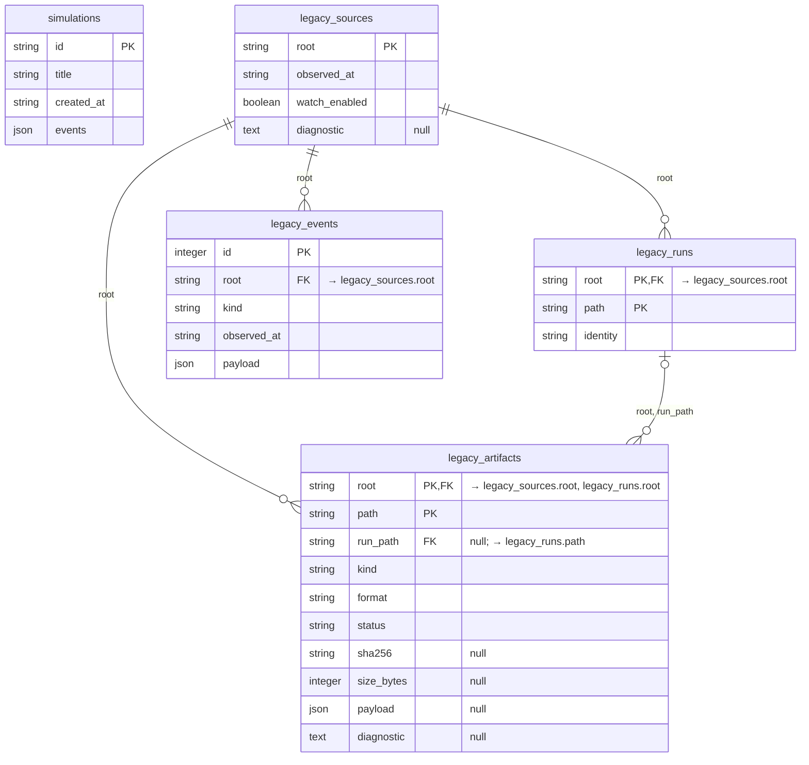

## Ejecución gestionada (P003)

Autoridad operativa de runs, intentos, cola, exclusión por checkout, procesos y commits (D015–D027). `managed_runs.root` es la raíz canónica del checkout; no hay tabla de proyecto.

P011-T012 (D174) no cambia tablas ni revisiones: amplía los JSON propios. `versions_json` congela la versión CLI
observada, `reviewer/executor_cli_launch_sha256`, hash de política y, en v7, procedencia automática/aserción y
PATH/ruta explícita. `managed_processes.spec.preflight_observed` conserva diagnóstico, mínimo, huella de lanzamiento
y perfil/procedencia condicional por intento. Un rechazo previo al target tiene `launch_permitted=false`, identidad
de proceso nula y captura `refused`; si ya hay un grupo esperando GO se registra su parada observada. Campos ausentes
en historiales anteriores siguen ausentes; no se rellenan ni se recalculan. [Flujo](flows/cli-compatibility.md).

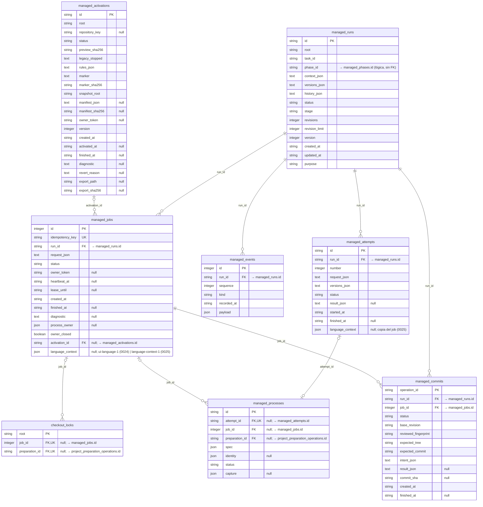

Unicidad: `managed_attempts` (run_id, number); `managed_events` (run_id, sequence); `uq_managed_commits_live` sobre `managed_commits` (run_id) donde status IN ('INTENT', 'COMMITTED'); `uq_managed_activations_live_root` sobre `managed_activations` (root) donde status IN ('PREPARING', 'ACTIVE', 'REVERTING'); `uq_managed_activations_live_repository` sobre `managed_activations` (repository_key) donde status IN ('PREPARING', 'ACTIVE', 'REVERTING').

## Prompts y permisos (P004)

Catálogo versionado por ámbito y peticiones de permiso exactas con su consumo (D030–D031).

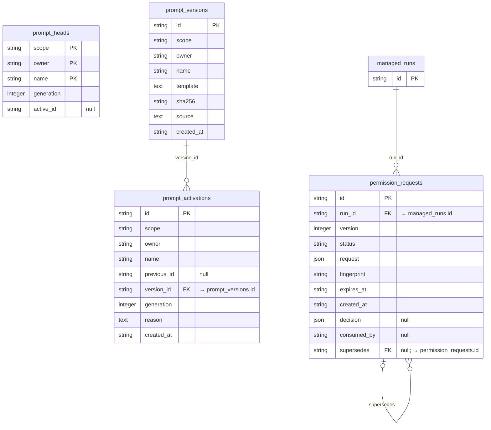

## Fases y creación (P004–P005)

Fases con definición versionada, preguntas, operaciones (check, cierre, transición, edición documental), autorizaciones y eventos (D032–D037). `managed_runs.phase_id` es una referencia lógica sin FK.

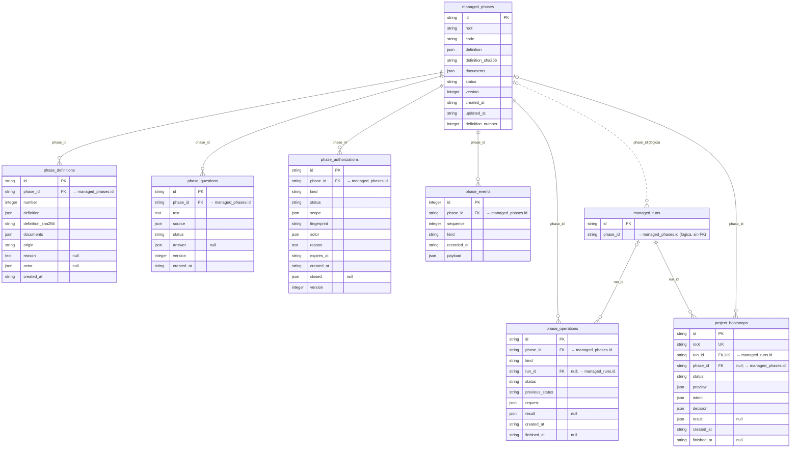

Unicidad: `managed_phases` (root, code); `uq_managed_phases_open_root` sobre `managed_phases` (root) donde status NOT IN ('CLOSED', 'ABANDONED'); `phase_definitions` (phase_id, number); `phase_events` (phase_id, sequence).

## Chat y planificación conversacional (P005, P007, P008)

Chat contextual (D035, D083), conversaciones de definición y planificación de fase (D075, D086) e importación del
Flujo A histórico (`kind = 'project_import'`, D098), conservado solo como datos tras D161: `source`, turnos,
propuestas y `import-drafts/<id>/` anteriores no se borran ni vuelven a ejecutarse. El Flujo B (`kind = 'onboarding'`, D102) usa la misma
columna `source` para congelar inventario, HEAD y árbol, y `onboarding-drafts/<id>/` para sus borradores. No añade
tablas, columnas ni índices. `managed_runs.purpose = 'onboarding'` enlaza sus turnos con la autoridad de planificación;
la intención de exportación queda en eventos antes del efecto. La guardia de downgrade de 0019 protege ambos orígenes.

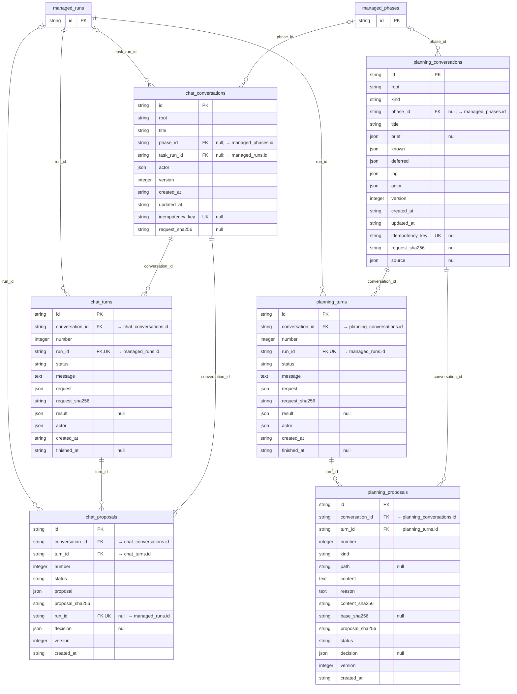

Unicidad: `uq_chat_conversations_key` sobre `chat_conversations` (idempotency_key); `chat_turns` (conversation_id, number); `uq_chat_turns_pending` sobre `chat_turns` (conversation_id) donde status = 'QUEUED'; `chat_proposals` (conversation_id, number); `uq_planning_conversations_key` sobre `planning_conversations` (idempotency_key); `uq_planning_definition` sobre `planning_conversations` (root) donde kind = 'definition'; `planning_turns` (conversation_id, number); `uq_planning_turns_pending` sobre `planning_turns` (conversation_id) donde status = 'QUEUED'; `planning_proposals` (conversation_id, number).

## Incorporación documental confirmada (P008-T012/T015)

`project_imports` conserva una operación por checkout y conversación: vista previa íntegra, intención de commit
sellada antes del efecto, decisión y resultado (D100). El Flujo B reutiliza esta tabla (D103), sin columnas ni
índices nuevos: `preview.flow = "onboarding"` identifica el origen; `preview.profile` y `profile_sha256` sellan el
perfil de la composición, y `decision.profile_sha256` registra su confirmación. Conserva el propósito compartido
`managed_runs.purpose = 'import_commit'`; la conversación mantiene `kind = 'onboarding'`. El job, lock, lease y recuperación son los de `managed_jobs`.
La fase y su base documental se insertan en la misma transacción que el resultado y el fin del job. Un estado
`INTERRUPTED` conserva la intención y bloquea trabajo nuevo y la reversión D027 hasta conciliarla.

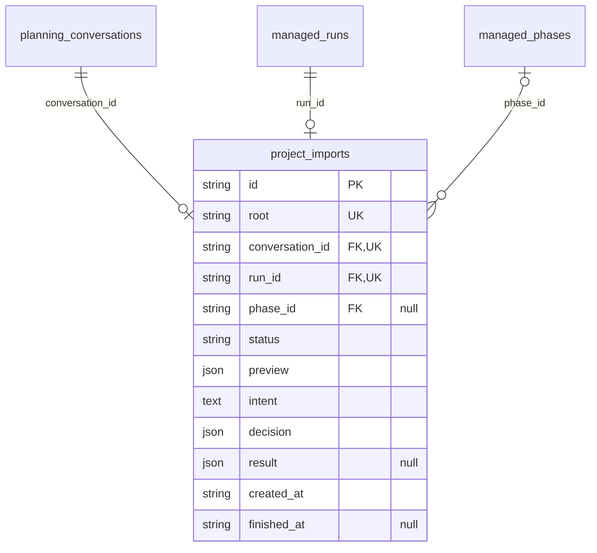

## Métricas y registro de proyectos (P007)

Métricas por intento con procedencia (D074) y registro de proyectos desde la UI (D078).
P009-T003 (D118) amplía el JSON `row` de fila/eventos con `agent_selection` opcional en v5:
`reviewer = {preset_id, model, effort}` y `executor = {preset_id}`; catálogo/modo siguen en `row.policy`.
Sin tablas/columnas ni migración nuevas. Cambio de versión/evento e invalidación de propuestas de planificación
son atómicos; solo cambian status/version/decision de la propuesta, nunca request/result del turno ni snapshots
del run. La fila sin selección conserva la pareja heredada y los eventos anteriores intactos.

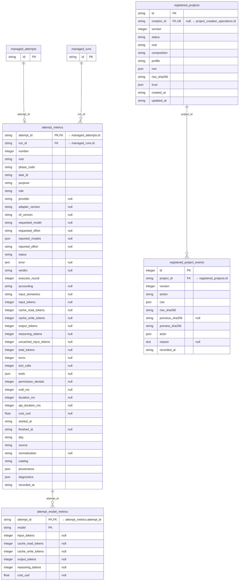

Unicidad: `ix_attempt_metrics_run` sobre `attempt_metrics` (run_id, number); `uq_registered_projects_active_root` sobre `registered_projects` (root) donde status = 'ACTIVE'; `registered_project_events` (project_id, version).

## Autoridad de carpeta y creación de hijos (P009-T002)

D116/D117. La selección UI autoriza hijos directos nuevos; no amplía las raíces TOML de D078. El singleton
no existe hasta la primera selección. Eventos de raíz conservan snapshots de cada revisión, sin FK a una fila
mutable como prueba de autoridad. Intención sellada antes de mkdir; identidad del hijo solo tras fsync del padre.
Alta, evento D078, `creation_id` y resultado REGISTERED se confirman juntos. No hay jobs, agentes o procesos
asociados a estas operaciones de creación; preparación de Django se registra por separado en T004 (D119).

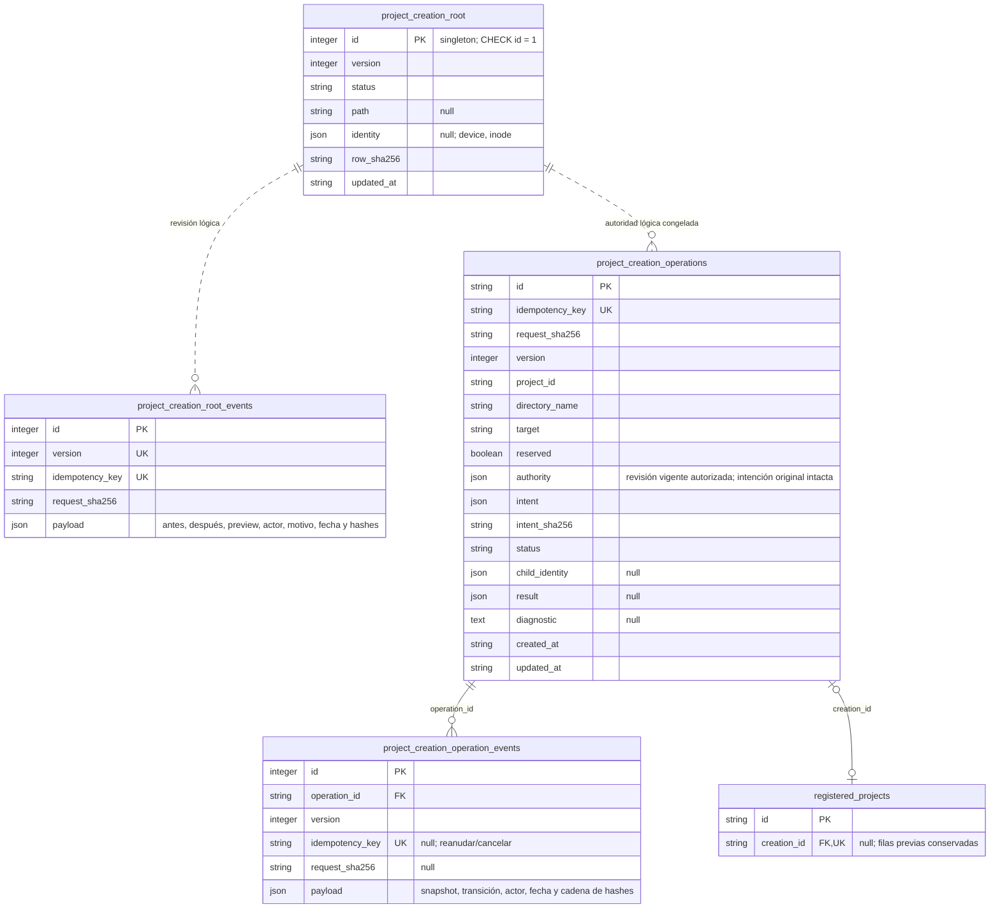

Unicidad: `uq_creation_reserved_id` sobre (project_id) y `uq_creation_reserved_target` sobre (target) donde
reserved = 1; `project_creation_operation_events` (operation_id, version); `uq_registered_creation` sobre
registered_projects (creation_id). Las reservas se contrastan transaccionalmente con filas D078 y destinos
anidados, incluidos alias físicos de mayúsculas. Los índices textuales no sustituyen esa comprobación.
REGISTERED libera la reserva de operación y manda D078; CANCELLED solo la libera con ausencia
acreditada. No caducan por timeout. Autoridad/retirada/efectos cortos comparten la exclusión de escritura SQLite.

## Preparación Django (P009-T004)

D119. Intención previa y reserva única por checkout; confirmación y admisión/registro comparten la transacción
SQLite. No hay run/attempt ficticio. Las capturas y bytes de preparación permanecen dentro de SQLite, sin
artefactos externos nuevos para backup o retención. El recibo solo se adopta junto a COMPLETED y la liberación
del lock; su SHA-256 se congela en jobs posteriores como `project_environment_sha256`.

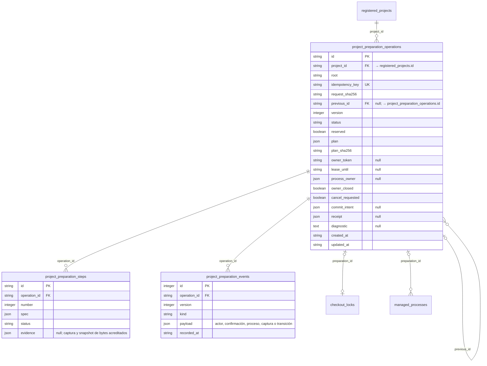

Unicidad: `uq_preparation_reserved` sobre (root) donde reserved = 1; pasos (operation_id, number), eventos
(operation_id, version). Reintentar crea otra operación enlazada y copia únicamente el prefijo DONE acreditado;
los registros/payloads de intentos anteriores conservan sus bytes. La sucesión se audita y traspasa la reserva.
Cancelación sin efectos libera la reserva; efectos inciertos se conservan reservados, incluso sin lock vivo.
Controles CAS guardan clave/hash en el payload del evento bajo la misma exclusión SQLite para replay.

`checkout_locks` conserva root como PK y exige exactamente un propietario (job_id o preparation_id). En
`managed_processes`, id sustituye a la PK attempt_id: las filas antiguas conservan id=attempt_id, su FK y su
job; para preparación, attempt_id/job_id son null y preparation_id es obligatorio. El CHECK impide propietarios
vacíos o mixtos. Ambas tablas hoja se reconstruyen con FKs activas, copiando todas las filas previas. Downgrade
solo sin historia de preparación; de lo contrario se usa backup en consulta, sin borrar evidencia.

## Proyección de runs (P010-T003)

D142/D144. `run-projection-1`: tablas derivadas de `managed_runs.history_json`, que sigue siendo la autoridad. Se
escriben en la misma transacción que el historial (`_queue_new_run` y `_history`) y `0023_run_projection` las rellena
decodificando una vez cada historial existente (formatos 1–8), sin modificarlo. Las vistas de runs solo leen estas
tablas, y las métricas y la vista previa de exportación (P010-T011, D145) las leen junto a `managed_attempts`; el motor,
la recuperación, los checks, el chat y los permisos siguen leyendo el historial. Las columnas
`*_json` guardan el texto exacto del historial o JSON congelado. El diff revisado se guarda en tramos fijos de 64 KiB
(`chunk` desde 0). El backup recalcula cada run y compara filas y recuentos; nunca reconstruye.

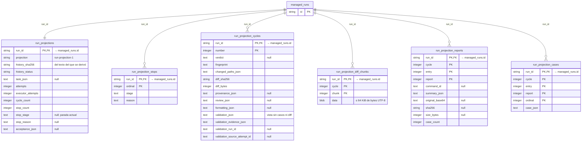

Las claves primarias compuestas fijan el orden estable de lectura: paradas por ordinal, ciclos por número, tramos,
reportes y casos por sus índices. `cycle` de tramos, reportes y casos es el `number` del ciclo, sin FK declarada.
Downgrade: elimina solo estas tablas.

## Preferencias de idioma (P011-T007)

Una fila por instalación/base (D166). `0024_product_preferences` la crea con `en`/`en` y versión 1; leerla nunca la
crea ni la repara. Sin FK: el resto del esquema solo la consulta al admitir un job.

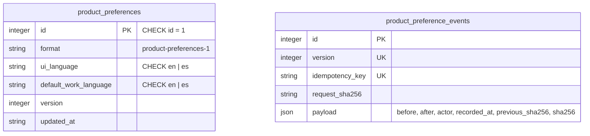

Cada `PUT /api/managed/preferences` con la versión esperada incrementa `version` y añade un evento encadenado por
hash; la misma clave con la misma petición devuelve el resultado registrado. `managed_jobs.language_context` sella
`{format: ui-language-1, ui_language, preferences_version}` en la transacción que admite el job; reanudar un run
(reintento, revalidación, bootstrap, importación, exportación o edición documental) copia el del primer job del
run, también null. Jobs anteriores a `0024` quedan null («no registrado»). Downgrade: rechazado si hay eventos;
sin ellos, todas las capturas son `en` de fábrica y se eliminan con la columna.

## Idioma de trabajo por proyecto (P011-T008)

Una fila por raíz canónica (D167), escrita una vez y nunca actualizada ni borrada. `0025_project_work_languages`
crea la tabla vacía: los proyectos anteriores quedan sin idioma de trabajo confirmado, sin inferirlo. Sin FK: la
raíz identifica el checkout aunque el registro se dé de baja, cambie de id o el proyecto venga del TOML.

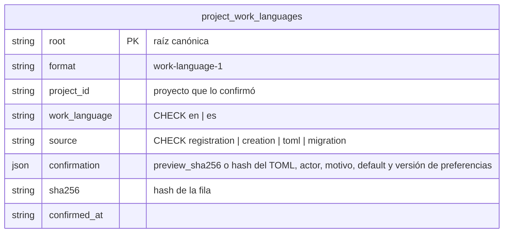

Se escribe en la transacción que confirma el alta (registro, registro del hijo creado), al arrancar con un TOML
`local-config-6` que lo declara, o en la confirmación explícita ausente → valor. Otro valor para la misma raíz se
rechaza. Desde `0025`, `managed_jobs.language_context` sella `language-context-1` (`ui_language`,
`preferences_version`, `work_language`, `work_language_source`, `work_language_sha256`) al admitir cada job nuevo;
sin fila no se admite trabajo nuevo. `managed_attempts.language_context` copia el del job al iniciar cada intento
(null antes de `0025`). Downgrade: rechazado si hay alguna fila (una confirmación explícita no se representa antes);
sin filas elimina la tabla y la columna.
