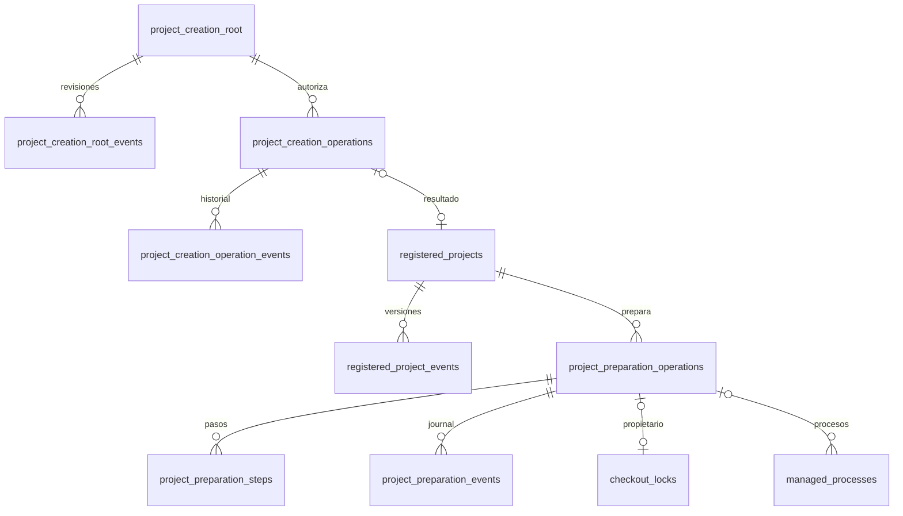

# P009-T001 — Contrato de creación, raíces y agentes por proyecto

Fecha: 2026-10-19. Base investigada: `3101c80`. Decisión:
[D116](../DECISIONS.md#d116--p009-t001-autoridad-de-creación-presets-por-proyecto-y-preparación-separada).
**Estado: diseño terminado; producto pendiente de T002–T004.** No implementa tablas, API, configuración ni recetas.
Aplica [D115](../DECISIONS.md#d115--p009-django-desde-cero-carpeta-de-proyectos-y-agentes-por-proyecto).

## 1. Contraste con los consumidores actuales

| Precedente y consumidor inspeccionado | Se conserva | Ampliación necesaria |
|---|---|---|
| D049; `services/local_config.py`, `LocalComposer.compose/ports/_composed` | TOML privado para ejecutables, entornos, Git, perfiles y límites; composición congelada y cuarentena. | Nuevos hijos aún inexistentes y selección de agentes por proyecto; `ports` no puede seguir reconstruyendo siempre `self.agents` global. |
| D051; ARCHITECTURE §9 | Operación real con wheel construido/verificado e instalado fuera de este checkout. | T006 concretará la instalación y su consentimiento. |
| D052; `_agents`, `_policy`, `services/managed_runtime.py`, contratos de planificación/revisión | Revisor elegido por el usuario, solo lectura; selección y motivo del ejecutor por tarea/revisión. | Catálogos de presets del servicio y selección efectiva por proyecto, sin fijar el modelo del ejecutor desde Ajustes. |
| D078; `services/project_registry.py`, `storage/registry.py`, `api/schemas.py`, `Registry.tsx`, `Settings.tsx` | Alta previa existente, confianza exacta, versión/eventos, baja lógica y rechazo de trabajos pendientes. | Autoridad distinta para crear hijos; alta idempotente de un destino que aún no existe; campos de roles. |
| D095; `_profile`, `_commands`, ejemplo `python-django` | Perfiles declarativos, argv exactos, JUnit, protección de configuración y paridad de modelos. | Los ejecutables absolutos hoy deben existir al componer: hace falta una vinculación diferida al entorno del hijo. |
| D037/D075/D089/D092; `adapters/bootstrap.py`, `core/engine/definition.py`, `storage/bootstrap.py` | Solo documentos admitidos, CAS, commit raíz conciliable y P001 adoptada. | Ningún scaffold ni marcador de creación nuevo entra en los borradores documentales. Preparación posterior independiente. |
| D105/D108/D110/D112; `adapters/local_git.py`, importaciones A/B | Sin filtros ejecutables, submódulos ni transporte implícito en esas fronteras. | La creación/receta usa Git local controlado; no modifica ni elude las guardias A/B. |
| D016/D047; `storage/models.py`, `storage/command_processes.py`, gate de procesos | Exclusión por checkout, identidad/grupo persistidos antes de GO y confirmación de escritor detenido. | Locks/procesos hoy referencian jobs y los eventos de comandos requieren run; la receta necesita propietario/eventos de preparación explícitos, no reutilizar esas FK con ids ficticios. |

El diseño amplía las autoridades expresamente previstas por D115. No modifica el comportamiento histórico de
`local-config-1/2/3/4`, `cli-12`, `commands-1`, codec 7 o `document_layout = "d088-12"`.

## 2. Autoridad de carpeta y convivencia con el TOML

Hay una única selección UI vigente por instalación, inicialmente ausente. No se rellena con HOME, cwd, raíces
del TOML o ejemplos. La UI admite una ruta absoluta introducida explícitamente; no requiere un selector nativo
ni ofrece exploración automática del disco. La vista previa normaliza separadores/punto y muestra la forma
canónica, pero rechaza `..`, NUL y enlaces en cualquier componente en vez de resolverlos silenciosamente.
El directorio padre debe existir y conservar identidad `(device, inode)`; el servicio no crea sus ancestros.

Guardar confirma el texto «El servicio podrá crear carpetas hijas nuevas en esta ubicación» y la ruta canónica
exacta. Se persisten revisión, ruta, identidad, hash, fecha, `actor()` y motivo opcional. `actor()` sigue siendo
la identidad del servicio, no una identidad personal autenticada. Guardar otra carpeta o retirar la vigente
incrementa la revisión y añade un evento; no borra eventos, carpetas ni proyectos. No hay `chmod` recursivo ni
modificación de TOML, configuración global o confianza de las CLI.

| Autoridad | Alcance | Retirada/cambio |
|---|---|---|
| `[registration].roots` (v3/v4 y futura v5) | Sigue autorizando registrar checkouts existentes con su confirmación de confianza exacta. | Conserva las reglas de D078; no concede creación de hijos por sí sola. |
| Selección UI vigente | Solo creación de hijos directos nuevos y alta asociada a esa operación; no alta genérica de repositorios existentes. No requiere estar bajo una raíz TOML. | Invalida previews y efectos de creación aún pendientes que lleven otra revisión. |
| Proyecto ya registrado | Autoridad propia del checkout y composición confirmados; procedencia de creación auditada. | Retirar el padre no retira ni pone en cuarentena sus hijos registrados. Su baja sigue siendo explícita. |

T002 habilita la carpeta UI en configuraciones registrables v3/v4 y después v5, aun con `roots = []`.
v1/v2 y configuraciones sin registrar siguen sin esta capacidad, con diagnóstico. Se conserva el techo
`bootstrap_enabled`: elegir carpeta no lo eleva. La creación desde cero exige que esté habilitado.
El servicio puede guardar un padre que contenga proyectos hermanos ya registrados; cada destino nuevo se
contrasta contra ellos. Rechaza un padre dentro de un checkout gestionado o de un repositorio Git, y rechaza
destinos iguales/anidados con cualquier proyecto o con SQLite, artefactos, migraciones, backups o TOML del servicio.
Un padre común que contenga estado del servicio en otro hijo no autoriza tocar ese hijo ni sus descendientes.
La detección de repositorio ancestro en esta selección es estática sobre marcadores `.git`, sin ejecutar Git
ni scripts o configuración del directorio elegido.

La revisión del padre se comprueba al confirmar, antes de `mkdir` y antes del alta. Un lock de creación del
servicio y transacciones de escritura serializan esas comprobaciones/efectos con guardar/retirar la raíz.
El permiso no puede revocarse a mitad de un efecto corto ya iniciado; tras el retorno de la retirada no empieza
otro efecto con la revisión antigua. Los fd anclados al padre, sin seguir enlaces, y las comprobaciones de
identidad antes/después evitan redirigir escrituras; se mantiene el límite cooperativo frente a mutaciones
externas, sin prometer aislamiento del sistema operativo.

## 3. Creación del hijo e idempotencia

El usuario aporta `project_id` y `directory_name` (la UI puede vincularlos inicialmente). Ambos usan
`[a-z0-9][a-z0-9._-]{0,63}`; el nombre es un componente, distinto de `.`/`..`, sin barras ni rutas absolutas.
El id conserva los reservados y las bajas de D078. El nombre puede diferir del id. No se busca un nombre libre
ni se añade un sufijo por cuenta del servidor. Se muestra el destino absoluto antes de confirmar «Crear».

La preview liga revisión/identidad del padre, id/nombre/destino, composición/perfil completos, política,
bootstrap, roles efectivos, versiones y las dos declaraciones: permiso de padre ya vigente y confianza en
el nuevo checkout exacto. Confirmar crear acepta esta segunda declaración en el mismo formulario; no vuelve
a pedir permiso del padre ni exige escribir su ruta de nuevo. El alta de un checkout existente conserva
`trust_root` de D078. Crear no invoca agentes, Git, instalaciones o red: deja el hijo registrado y enlaza a
la definición existente, cuyas invocaciones y confirmaciones conservan sus propios límites.

Antes de cualquier efecto se sella una intención en SQLite con id de operación, clave idempotente y hash del
payload. Una clave repetida con iguales bytes devuelve la operación original incluso después de cambiar la
raíz; una clave con otros bytes da 409. Hay reservas únicas de destino canónico e id contra operaciones
pendientes y filas del registro/TOML; dos claves no pueden crear el mismo hijo. Cada efecto revalida autoridad,
identidad, conflictos y composición. Un destino existente, incluso vacío o enlace colgante, bloquea sin adoptarlo.

Estados previstos: `INTENDED → DIRECTORY_CREATED → REGISTERED`; `BLOCKED` para un conflicto acreditado,
`RECOVERY_REQUIRED` para propiedad/efecto inciertos y `CANCELLED` para detener lo aún pendiente.
`DIRECTORY_CREATED` requiere identidad del hijo persistida y `fsync` del padre; no se coloca un marcador dentro
del hijo que rompería la definición documental. El alta y su evento D078, la referencia a la operación y el
estado `REGISTERED` se confirman en una transacción. Instalar en memoria ocurre después; reiniciar recompone
la fila sin repetir el alta ni crear otro id. La intención no es una tarea/run ni un permiso para un agente.

| Punto de caída o cambio | Conciliación permitida |
|---|---|
| Intención sellada, destino ausente | Reanudar la misma operación solo con revisión e identidad vigentes. |
| `mkdir` realizado, identidad no persistida | `RECOVERY_REQUIRED`: una carpeta vacía no prueba propiedad. No adoptarla, borrarla o repetir `mkdir`. |
| Identidad persistida, alta no confirmada | Verificar mismo hijo vacío y autoridad vigente; continuar alta una vez. Cualquier contenido ajeno bloquea. |
| Padre retirado/cambiado antes del alta | `BLOCKED`, sin más escrituras. Conservar hijo e intención; no convertirlo en alta genérica. |
| Padre elegido de nuevo en la misma ruta | La nueva revisión no revive intenciones. Una preview de reanudación explícita puede vincular la misma operación a esa revisión solo si hay identidad persistida, mismo hijo vacío y composición vigente. Preservar el intento anterior. |
| Alta confirmada, respuesta perdida | GET/repetición devuelve el mismo proyecto; no depende de que el padre siga vigente. |
| Cancelación o carpeta con deriva | Registrar diagnóstico y dejar bytes en su sitio. No hay borrado automático ni liberación silenciosa de una reserva incierta. |

El caso sin prueba de propiedad requiere resolución externa explícita y una nueva comprobación; no se presenta
como recuperado automáticamente. La UI muestra ruta/operación y bloqueo, sin recomendar limpieza destructiva.
Cancelar puede liberar la reserva si se acredita destino ausente y ningún efecto/escritor pendiente; conserva
la operación/eventos. Con carpeta creada o efecto incierto mantiene la reserva y el diagnóstico.

## 4. Presets y composición por proyecto (T003)

Se reserva **`local-config-5`**, optativa, para las nuevas formas de presets y preparación. Conserva las claves
v4 y añade `[agent_presets.<id>]`. Cada preset declara `provider`, `roles` admitidos, los campos CLI actuales
(`executable`, `cli_version`, `timeout_seconds`, `environment` y herramientas cuando correspondan), catálogo
`models`, subconjunto `efforts` del vocabulario del proveedor y `allow_open_executor` explícito.
No lleva la elección del revisor. El servicio valida nombres, proveedor/rol, CLI soportada, USER y reglas CLI
actuales; no invoca `version/help` ni consulta proveedores por cargar el catálogo. No se inventa disponibilidad
remota de modelos: el catálogo es la declaración local del operador.

`[agents.reviewer/executor]` conserva la pareja por defecto v4. Una fila sin selección nueva hereda esa pareja
y su política; la UI lo indica. No se crea un override por leerla, migrarla o reiniciar. Las filas v1–v4 y sus
hashes se componen por su rama actual. v1–v4 rechazan las claves nuevas con diagnóstico; habilitar presets
requiere migrar explícitamente el TOML privado a v5 por el operador, nunca desde el navegador.

La fila del registro v5 admite `agent_selection = {reviewer: {preset_id, model, effort}, executor: {preset_id}}`.
Los campos de catálogo/modo del ejecutor y planificación siguen en `policy`; no se duplican en dos autoridades.
`[[projects]]` v5 puede declarar la misma selección, pero sigue siendo de solo lectura en UI. Un proyecto
registrado antiguo puede incorporar una selección mediante un cambio confirmado de su fila, manteniendo id,
root e historial. La procedencia del padre no condiciona este cambio.

Ajustes ofrece presets filtrados por rol/proveedor; el usuario elige modelo/esfuerzo del revisor sin preselección
al cambiar de preset, y proveedor/modo/catálogos del ejecutor. Modelo/esfuerzo del revisor pertenecen al preset;
en `catalog`, listas no vacías del ejecutor son subconjuntos del preset. `open` solo si el preset lo admite:
el modelo concreto será un texto válido no vacío, el esfuerzo seguirá dentro del vocabulario permitido y el
catálogo seguirá como referencia D052. El piloto usa `agent` y catálogo. Ninguna selección concreta del ejecutor
en Ajustes sustituye la decisión y motivo del planificador/revisor. Sin preset compatible se muestra diagnóstico;
no se hereda otro proveedor, modelo o esfuerzo por fallback.

El cambio usa preview/hash y `expected_version` del registro: incrementa una vez fila/evento; el hash incluye
selección y contenido de ambos presets elegidos. Se exige ausencia de jobs `QUEUED/ACTIVE/RECOVERY_REQUIRED`,
locks, operaciones de preparación y conversaciones/aceptaciones todavía utilizables con la composición antigua.
La transacción comparte la exclusión de admisión del checkout; una carrera se rechaza, nunca ejecuta el job con
roles nuevos. Borradores de planificación anteriores quedan identificados como obsoletos, sin editar su snapshot;
requieren nueva planificación antes de enviar otra tarea. No se cambia un run pendiente de aceptación/commit.
El piloto cambia después de COMMITTED y sin trabajo pendiente. Deriva del TOML conserva cuarentena D049.

`LocalComposer` guarda por checkout agentes efectivos además de comandos/artefactos; `ports`, writer, vistas
`agents_view` y preflight usan esa composición. Se construyen adaptadores nuevos para cada job con esos agentes,
sin mutar `self.agents` global. Contrato, historial y métricas ya conservan selección/motivo y proveedor: se
reutilizan. Una selección fuera del catálogo o incompatible falla antes del ejecutor; no se retoca el plan.

## 5. Receta posterior al bootstrap (T004)

Orden obligatorio: **hijo registrado → definición D088 → commit documental raíz → receta confirmada y commit
técnico → cuatro tareas del Django**. La definición puede adoptar P001 con sus cuatro tareas; su envío queda
bloqueado por preparación pendiente. No se crea Task ni su migración de negocio en el scaffold.

Para resolver la dependencia circular de `_commands`, v5 permite, además de ejecutables absolutos, enlaces
tipados de composición `executables.python = {project_venv = "python"}` (análogos para pytest/ruff/mypy).
Solo nombres simples; la raíz de entorno `.venv` la fija la receta del servicio, no el cliente. La composición
documental congela el enlace declarativo/perfil sin exigir todavía `.venv/bin/*`; las rutas de agentes y Git
siguen siendo ejecutables existentes del TOML. Crear/definir/confirmar el commit documental no instancia ni
ejecuta las validaciones aún irresolubles. Antes de preparación, intentar tareas, checks de fase o comandos
del perfil devuelve `preparation_required`. Un proyecto v4 con ejecutables absolutos conserva su flujo actual.

La v5 añade `[recipes.django]` con `python_executable`, `installer_executable` absolutos y límites del operador;
el identificador de receta apunta a implementación empaquetada, nunca a un script del navegador/repositorio.
T004 fijará backend de instalación, versiones exactas, lock y lista cerrada de argv compatibles con esos
ejecutables, sin shell. El plan materializado, no un comando genérico, es la unidad de consentimiento.
El entorno de procesos, cwd y cache se declaran desde el servicio y el hijo; no se edita el HOME/global del usuario.
Los ejecutables del entorno solo se resuelven para comandos tras comprobar el recibo de preparación, identidad
del hijo/entorno, versiones, lock y ejecutables previstos. No se acepta una `.venv` ajena porque coincida su nombre.
El enlace al intérprete base creado por un venv se admite solo si coincide con el intérprete autorizado y el
recibo; no habilita enlaces arbitrarios de destinos ni herramientas.

La preview exige HEAD documental aceptado, checkout/índice limpio, archivos nuevos ausentes, padre de cada
archivo seguro, ninguna operación/job/lock incompatible y perfil/versiones vigentes. Muestra manifiesto completo
de archivos con bytes/hashes y diff, versiones/lock, entorno, argv/cwd/entorno público, timeouts, límites de salida,
cache/red, checks y commit previsto. No muestra secretos. Los artefactos generados por herramientas se comparan
con el manifiesto determinista de la receta; cambios por versión no previstos bloquean. La preview se calcula
sin instalar, resolver por red ni ejecutar código del checkout. No se invoca ningún agente para preparar.

Confirmar autoriza solo esa intención: crear `.venv`, instalar paquetes fijados dentro del modo offline/red
indicado, `startproject`/`startapp`, scaffold/configuración y `migrate` enumerados, checks y commit técnico.
Los comandos son argv exactos por paso, con ejecutables/entorno/límites del servicio; ni prefijos amplios ni
terminal web. El permiso del padre ya concedido no se solicita de nuevo. Red, instalaciones, llamadas al revisor
de definición y piloto solo se ejecutan si están cubiertas por su consentimiento concreto; T001 no los concede.

La receta tiene escritor propio y manifiesto cerrado de archivos protegidos (`manage.py`, dependencias/lock,
configuración de pytest/ruff/mypy, `.gitignore` y scaffold). No se añade una excepción al ejecutor normal ni a
`definition.allowed_draft`; no se abre escritura arbitraria con un flag de bootstrap. Los documentos de producto
y comandos en instrucciones se actualizan por bytes/diff confirmados cuando la preparación cambie su contenido;
los bloques del harness siguen regenerándose por sus mecanismos existentes. Paridad de datos/flujos también
aplica al scaffold. No se reescribe el commit raíz. SQLite local, `.venv`, caches, reportes y cualquier secreto
quedan ignorados; una clave de desarrollo, si se necesita, se genera fuera del commit en el hijo.

Se persiste la intención antes de efectos y un recibo por paso, incluidos proceso/grupo, salida, fingerprints y
resultado. Estados: `QUEUED → ACTIVE → COMMITTED`; `FAILED`, `CANCELLED` y `RECOVERY_REQUIRED` detienen efectos.
El supervisor ejecuta estos trabajos con lease y lock de checkout compartido con tareas; no se inventa un run
normal para habilitar escrituras de configuración. Se reutilizan primitivas de ejecución/gate y evidencia de
procesos, ampliando propietarios y lectores como indica §6; las FK actuales no admiten una preparación todavía.
El binding actual de `ManagedCommandRunner` consulta un run: se conserva para tareas y se añade un adaptador
`preparation-commands-1` que liga comandos al plan/journal de preparación, nunca a un run ficticio. Verifica
hashes del scaffold propio antes de ejecutar herramientas sobre él; código ajeno o modificado detiene el paso.
Recuperar no reinstala ni repite red o comandos por inferencia: concilia primero identidad, archivos exactos,
recibos y ausencia confirmada de escritor. Pasos puros acreditados y commit determinista se concilian; procesos
sin resultado acreditado requieren diagnóstico y autorización explícita del paso a reintentar dentro de una
nueva intención enlazada. La operación anterior queda intacta. Cancelar espera y confirma fin del grupo antes
de liberar el lock. No hay borrado/recreación automática de un entorno incierto ni retry/fallback oculto.

El commit técnico liga HEAD base, árbol exacto, identidad y mensaje/fecha sellados; concilia un commit ya creado
antes de actualizar SQLite. La adopción de resultado y recibo de entorno es atómica; una caída posterior al
commit no genera otro. Solo entonces el proyecto queda preparado. Deriva de archivos/configuración/entorno
invalida previews o bloquea ejecución, sin reparar automáticamente. La composición efectiva congela el recibo
del entorno para los jobs posteriores, sin modificar los snapshots documentales ya completados.

## 6. Persistencia propuesta y migraciones

**Solo diseño.** El esquema vigente sigue en `0020_project_imports`/35 tablas; no se añaden tablas ficticias a
[DDBB-DIAGRAM](../DDBB-DIAGRAM.md). T002 reservará la siguiente migración libre para selección/creación;
T003 usa JSON de fila/eventos D078 sin una segunda autoridad de roles; T004 añade preparación/pasos y los
campos de lease/exclusión necesarios. Los números se asignan al implementar, sin modificar migraciones selladas.

| Entidad futura | Campos y restricciones principales |
|---|---|
| `project_creation_root` | Singleton, revisión monotónica incluso retirada, estado `ACTIVE/REVOKED`, ruta/identidad o null inicial, hash, updated_at. Sin ruta predeterminada. |
| `project_creation_root_events` | PK id; revisión única, acción, antes/después, hash previo, preview, actor/motivo/fecha. Append-only. |
| `project_creation_operations` | PK id; clave idempotente única/hash; versión CAS; id/nombre/destino reservados, revisión/identidad padre, snapshot/hash de intención, estado, identidad hijo nullable, resultado/diagnóstico y fechas. Reautorizaciones se añaden como eventos, no se reescribe la intención original. |
| `project_creation_operation_events` | PK id; FK operación, versión única por operación, transición/recibo, actor/fecha/hash anterior. Conserva cancelación, deriva y reanudación confirmada. |
| `registered_projects` | Nullable `creation_id` único/FK operación, fuera de `row` para que v3/v4 sigan componiendo. Alta/evento y finalización de creación atómicos. Filas antiguas null. |
| Fila/eventos D078 v5 | `row.agent_selection` opcional, hash y versión existentes. Ni preset executable ni secretos en payload del cliente. |
| `project_preparation_operations` | PK id; FK proyecto, clave/hash, CAS, snapshot/hash plan y versiones, base HEAD, manifiesto/commit-intent, estado/lease, recibo de entorno nullable, resultado/diagnóstico/fechas. Solo una operación sin resolver por checkout. |
| `project_preparation_steps` | PK `(operation_id, number)`; FK operación, argv/cwd/entorno autorizado, estado, proceso/grupo, evidencias antes/después, captura/resultado. Historial append-only de intentos; reintento crea operación enlazada. |
| `project_preparation_events` | PK id; FK operación, secuencia única, tipo/payload/hash/fecha. Journal de pasos, intención/spawn/fin de procesos, cancelación y adopción; no depende de `managed_events.run_id`. |
| `checkout_locks`, `managed_processes` | Ampliar propietario: `job_id` nullable y `preparation_id` nullable/FK, exactamente uno no nulo. Preservar PK/unicidad por checkout del lock y todas las referencias anteriores a jobs. Una preparación no obtiene un lock paralelo. |

La exclusión de destino/id se mantiene sobre operaciones pendientes/inciertas más filas activas; después de
REGISTERED manda D078. Una reserva no desaparece por timeout. Creación y retirada se serializan también entre
dobles envíos; la validación en memoria no sustituye restricciones/transacciones SQLite. Backups incluyen
las tablas y artefactos referenciados nuevos; restaurar sigue en consulta y no recupera autoridad ejecutable.
T004 debe adaptar admisión/claim/release y `_unfinished`, lectores de procesos persistidos (incluido
`storage/command_processes.py`), recuperación, backup/restauración y retención al propietario de preparación.
Antes de enviar GO, su journal registra la identidad del grupo en esa operación. La exclusión por raíz y el
predicado de escritor detenido cubren ambos propietarios; ningún lector puede ignorar un proceso por carecer
de run. Migración SQLite y pruebas con filas previas deben verificar estas restricciones, no solo tablas nuevas.

Las relaciones del singleton con su historia/revisión son lógicas; los eventos guardan los bytes de cada
revisión, no una FK a una fila mutable como prueba de autoridad. El diagrama identifica entidades propuestas,
no un contrato ya migrado.

## 7. Contratos API/UI propuestos

Todas las rutas siguientes cuelgan de `/api/managed`; heredan sesión local, Host/Origin, CSRF y restricciones
cross-site actuales. Entradas estrictas (`extra=forbid`); confirmaciones con `Idempotency-Key`, motivo opcional,
`expected_version` y hash de preview. Repetir una confirmación devuelve su operación/resultado original, no
revalida una acción nueva. GET/preview no causan efectos. Polling por id/versión, sin necesitar pestaña abierta.

| Ruta futura | Contrato y resultado |
|---|---|
| `GET /project-creation-root` | Selección/revisión vigente o ausente, alcance, texto de permiso, disponibilidad/diagnóstico y eventos. No lista el disco. |
| `POST /project-creation-root/preview` y `/apply` | Acción `select/retire`, versión esperada y ruta explícita solo en select. Preview: ruta/identidad y hash; apply exige hash y confirmación exacta de la ruta en select. |
| `POST /project-creations/preview` y `/confirm` | Id/nombre, revisión de raíz, composición/política/roles, bootstrap y opciones de registro permitidas. Devuelve destino, versión/hash/diagnósticos; confirm devuelve id/estado/versión de operación y proyecto cuando existe. No admite una raíz alternativa en el body. |
| `GET /project-creations/{id}` | Intención, progreso, procedencia, resultado y bloqueos saneados. |
| `POST /project-creations/{id}/resume/preview` y `/resume/confirm` | Nueva revisión del mismo padre, versión CAS y comprobaciones de propiedad §3; nueva autorización auditada sobre la misma operación. No adopta destinos inciertos. |
| `POST /project-creations/{id}/cancel` | Versión/hash de intención, detiene futuros efectos; conserva carpetas y evidencia. |
| `GET /registry` ampliado | Mantiene `roots` TOML para alta existente; añade capacidades de creación y presets públicos: id/proveedor/roles/modelos/esfuerzos/modos. No devuelve ejecutables, entornos, herramientas privadas o credenciales. |
| `/registry/preview` y `/registry/apply` ampliados | `agent_selection` opcional solo v5; usa versión única D078 y la misma barrera de admisión para cambios. Alta existente sigue bajo raíces TOML; ningún payload finge `creation_id`. |
| `GET /projects/{p}/preparation` | Estado/receta disponible, perfil, recibo y operación pendiente; ausente para composiciones sin receta. |
| `POST /projects/{p}/preparation/preview` y `/confirm` | Receta nombrada y versión esperada del proyecto; preview devuelve manifiesto/argv/límites/HEAD/versiones/hash. Confirm liga todo y devuelve operación encolada. No admite archivos o comandos libres. |
| `GET /preparations/{id}`, `POST /preparations/{id}/cancel` | Progreso/recibos/diagnóstico y cancelación versionada. Reintentar pasa por nueva preview/confirm enlazada a la fallida. |

422 para forma/ruta/nombre/selección inválidos; 409 con `{code, diagnostic}` para `stale_version`,
`preview_changed`, `root_revoked`, `target_exists`, `target_identity_changed`, `pending_jobs`,
`preparation_required`, `preset_unavailable` o `recovery_required`. No exponer valores privados en errores.
Las capacidades ausentes conservan diagnóstico, sin romper el arranque de otros proyectos.

La UI incorpora «Carpeta de proyectos» en el registro, con guardar/retirar e historial. `/projects/new` distingue
«Crear carpeta nueva» de «Registrar carpeta existente»; no confunde las dos autoridades ni redirige a importación
un destino ocupado durante crear. Conserva idempotency key tras errores de transporte y enlaza a la operación.
El destino confirmado enlaza a `setup`; tras el commit documental muestra «Preparar Django», manifiesto/diff,
comandos/red, progreso y bloqueo de tareas hasta terminar. Ajustes permite editar roles en proyectos registrados
v5 y mantiene los del TOML en consulta. Cambiar preset limpia campos incompatibles y pide selección explícita.
OpenAPI, tipos generados y pruebas API/Node se actualizan en cada implementación, no en esta tarea documental.

## 8. Versiones, compatibilidad y recuperación

- La autoridad del padre se versiona en su propio registro y en intenciones de creación; no se mete como hash
  global en todos los proyectos. Retirarla no invalida trabajos legítimos de hijos ya registrados.
- v5 congela contenido efectivo de ambos presets seleccionados, política, perfil y comandos en
  `local_config_sha256`, además de `project_registry` cuando exista. Cambiar un preset no seleccionado no cambia
  el hash de proyectos con selección explícita. Heredados congelan los agentes globales como antes.
- Se reservan contratos operativos `project-creation-1` y `project-preparation-1` en sus intenciones, y
  `project_agents = "project-agents-1"` para proyectos con override. El recibo preparado entra en
  `project_environment_sha256` de jobs posteriores. Identidad, versiones y hash se verifican antes de efectos.
- El plan técnico congela `preparation_commands = "preparation-commands-1"` y hash de su configuración exacta;
  su binding usa operaciones/pasos. `commands-1` sigue ligándose a jobs/runs con su forma y hash actuales.
- `cli-12`, `commands-1`, codec 7, layout `d088-12` y snapshots de contexto/historial conservan sus formas:
  roles/modelos/esfuerzos ya caben en política y versiones. No se crean campos históricos obligatorios para
  datos que antes no existían. Si al implementar fuera necesario cambiar un contrato real de salida/runner,
  deberá versionarse y documentarse; no se da por cubierto con un hash de configuración.
- Cambio de paquete/TOML/preset/perfil/recibo no reinterpreta una intención pendiente: cuarentena antes de efectos.
  Conciliar un commit ya sellado usa sus bytes originales. No se sellan intenciones nuevas con versiones antiguas.
- Esquema aditivo, datos previos intactos. Una fila que no compone queda no disponible con causa y sus historiales
  consultables; no se asigna automáticamente otra pareja ni otro perfil. No se promete downgrade operativo del
  binario antiguo tras migrar; para volver se usa backup previo en consulta/procedimiento vigente.

## 9. Matriz de pruebas de frontera para T002–T005

| Área | Casos obligatorios y evidencia esperada |
|---|---|
| Raíz | Sin elección, dos instalaciones independientes/reinicio, fuera del TOML, roots TOML sin permiso de crear, guardar/retirar/repetir/CAS, cambio de identidad/enlace y padre sin permisos. Sin efectos ajenos ni valores por defecto. |
| Destino | `..`, absoluto, separadores/NUL, id reservado/retirado, archivo/enlace colgante/carpeta vacía existente, checkout anidado, conflicto TOML/registro/estado, nombres con colisión en filesystem. Sin sobrescritura. |
| Carreras y caídas | Dos claves/mismo destino, misma clave/otro payload, fallo antes/después de mkdir/checkpoint/alta/respuesta, retirada concurrente con cada paso, reelección misma ruta. Un único resultado o bloqueo con evidencia, nunca adopción por vacío. |
| Roles | Cuatro parejas en el mismo id; dos proyectos con presets distintos sin contaminación; revisión/plan/ejecución/métricas coinciden; catálogos/esfuerzos inválidos y preset ausente fallan sin fallback. |
| Admisión | Cambio de roles frente a submit, job/lock/preparación/run sin commit y borrador anterior; rechazar o marcar obsoleto antes de efectos. Deriva de presets/TOML pone pendientes en cuarentena y deja snapshots intactos. |
| Compatibilidad | v1–v4 sin selección conservan lectura/hashes; registro previo compone tras retirar la nueva raíz; v5 sin override hereda pareja explícita actual; fila inválida no impide arrancar otras. |
| Bootstrap/receta | Documentos sin `.venv` válidos, scaffold antes del commit raíz bloqueado, tareas antes de preparación bloqueadas; configuración protegida solo por receta confirmada, no por ejecutor normal. |
| Preparación | Enlaces/bytes ajenos, entorno ocupado, deriva HEAD/perfil/lock/argv, caída por paso y por commit/adopción, cancelación/proceso vivo, cache ausente sin red, red/reinstalación nunca implícitas. Un commit técnico o diagnóstico conservador. |
| Perfil real | T005: Django/pytest-django/ruff/mypy con versiones/lock de T004 y JUnit; preparación temporal previamente autorizada si faltan paquetes. Sin debilitar checks para hacerlos pasar. |
| API/UI | Sesión/CSRF/origen/extra-fields, payloads sin ejecutables/secretos, preview stale, pérdida de respuesta/polling/reinicio, destino visible, sin permiso redundante del padre; Node/tipos/build y QA de formularios. |
| Datos | Migración sobre SQLite temporal v0020 con filas sintéticas y locks/procesos de jobs previos; propietario job/preparación exclusivo, journal/atomicidad, admisión cruzada, lectores de procesos y backup/restauración de consulta; paridad al migrar. |

## 10. Decisiones pendientes de operación, no bloqueos de diseño

No se han encontrado contradicciones documentales que exijan elegir al usuario en T001. T004 decidirá versiones
de Django/herramientas, backend de instalación, lock y plantillas concretas, probándolos sin presumir permisos
de red. T006 recogerá raíz/nombre definitivos, presets, modelos/esfuerzos de los revisores Codex/Claude, catálogos
del ejecutor, CLI/puertos/paquete, llamadas/tiempo/correcciones, comandos/red y criterios de parada. Ninguna
selección histórica ni el nombre propuesto del piloto se convierte aquí en preferencia o consentimiento efectivo.
El modelo/esfuerzo concreto del ejecutor seguirá siendo decisión del revisor en cada tarea/revisión.

## 11. Validación de esta entrega

- `python3 -m unittest discover -s tests -p 'test_*.py'`: 12 checks correctos.
- Parsers del producto: 116 decisiones consecutivas, nueve fases con objetivo/criterios y doce tareas P009 en
  orden. STATE/NEXT_STEPS sin bloques gestionados y dentro de sus presupuestos; base acumulada intacta.
- 21 Markdown activos (sin recorrer el archivo histórico): 341 enlaces relativos/anclas válidos, usando
  `markdown-it` y comprobación de destinos/anclas. También se validan destinos archivados cuando se enlazan.
- 23 diagramas activos con sintaxis aceptada: ocho ER/tres secuencias mediante `mermaid.parse`; ocho flowcharts
  con el parser y sin sanitización DOM, y cuatro estados con su gramática sin extracción DOM. Node carece del
  DOM que exige la sanitización; se comprueba sintaxis, no renderizado ni QA visual del producto futuro.
- Diff revisado y `git diff --check` correcto. Sin cambios fuera de `docs/**`, ni archivos congelados de P008.
- No se repiten pytest completo, Alembic, tipos/build o pruebas de producto: no cambian código, modelos,
  migraciones, API, configuración ni versiones implementadas. Ningún proveedor, agente del producto, smoke,
  instalación, red, servicio o piloto ejecutado. La implementación comienza con P009-T002.
