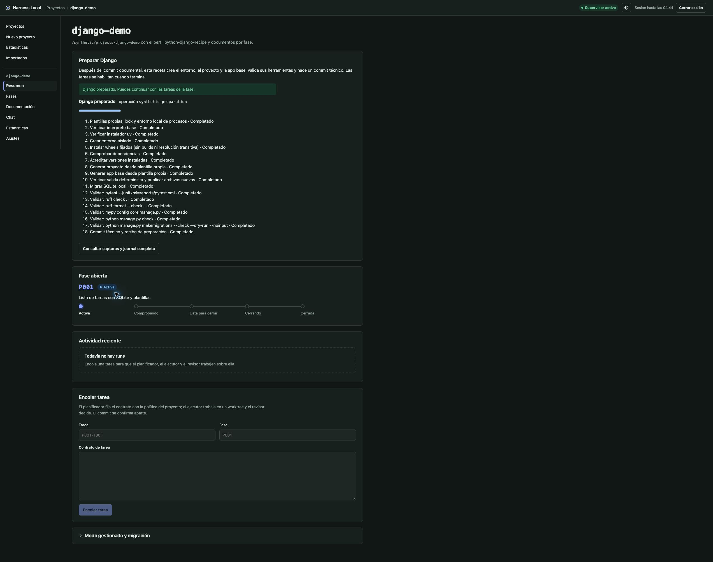

# P009-T004 — Receta Django desde cero y perfil ejecutable

Fecha: 2026-10-19. Decisión [D119](../DECISIONS.md#d119--p009-t004-receta-django-confirmada-y-entorno-acreditado).
Implementa [D116 §5–9](P009-T001_CONTRATO_CREACION.md#5-receta-posterior-al-bootstrap-t004).
Producto implementado y verificado con herramientas sintéticas; ejecución real de Django/pytest/ruff/mypy en T005.
Este repositorio sigue sin registrarse ni ejecutarse en el harness.

## Resultado y motivo

Un hijo nuevo puede definirse mediante D088 sin tener herramientas instaladas y, después del commit documental,
confirmar su preparación Django desde la UI. La preparación tiene autoridad propia para los archivos protegidos,
plan íntegro y commit técnico separado: no amplía los permisos del ejecutor ordinario ni el bootstrap documental.
No incluye Task, CRUD ni tareas de negocio del piloto.

- Receta empaquetada `django-recipe-1`, perfil `python-django-recipe`, templates literales propios para
  startproject/startapp y manifiesto de proyecto/app, plantilla/static y configuración de pytest/JUnit, ruff,
  mypy estricto con django-stubs/plugin y checks Django. Salida de generadores contrastada por bytes antes de publicar.
- V5 permite enlaces tipados python/pytest/ruff/mypy al entorno `.venv`, sin exigirlo para crear/definir.
  Ejemplo [de configuración](../../examples/django-recipe.example.toml). V1–v4 y los perfiles Django declarados
  con ejecutables absolutos conservan sus contratos. No hay dependencias nuevas en el runtime del harness.
- Los roles/presets efectivos declaran `PYTHONDONTWRITEBYTECODE=1`; se diagnostica su ausencia sin modificar
  sus entornos ni el TOML. Así los comandos Python de agentes no cambian incidentalmente el entorno acreditado.
- Plan sin efectos de herramientas: HEAD documental/índice limpio, ausencia de destinos incluso ignorados,
  identidad, versiones, contenido/hashes/diff de archivos, templates, lock, argv exactos, entorno público,
  límites por comando/stream, modo offline/network y commit. Sesión/CSRF, CAS/hash y clave idempotente al confirmar.
- CPython de patch explícito 3.11–3.13 y uv del operador con versión exacta; sus bytes se acreditan antes de efectos.
  Venv sin pip, wheels con hashes y closure cerrada, sin builds, dependencias implícitas, configuración descubierta,
  descargas de Python o retry HTTP. Cache/HOME/tmp dentro del hijo; wheelhouse local opcional del operador.
- Instalación network solo con techo del operador y plan confirmado. Offline usa wheels/caché disponibles y falla
  sin red ni cambio de modo si faltan. T004 no prepara ese wheelhouse ni instala las herramientas reales.
- Secreto aleatorio local ignorado, hash en el recibo sin bytes en planes/logs/commit; SQLite local, caches,
  entorno, staging y JUnit ignorados. No se sobrescriben destinos existentes. Escrituras nuevas por fd sin enlaces,
  identidad del hijo comprobada en el fd y creación exclusiva; límite cooperativo frente a mutaciones externas.

## Journal, recuperación y paridad

`project-preparation-1` registra operación, pasos y eventos antes de efectos. Migración `0022_project_preparation`,
42 tablas: las tres tablas nuevas y propietarios job/preparación exclusivos en locks y procesos compartidos.
Las filas antiguas conservan ids/FK/datos. Binding `preparation-commands-1`, sin un run/attempt ficticio;
`commands-1`, CLI, codec y snapshots históricos mantienen su forma. [Diagrama](../DDBB-DIAGRAM.md#preparación-django-p009-t004).

El carril escritor reclama lease/propietario y persiste el grupo antes de GO. Cada paso comprueba composición,
ejecutables, identidad, HEAD y snapshot acreditado. Captura acotada y JUnit con parser seguro/contadores coherentes,
original retenido inline. Los enlaces internos de la caché uv se acreditan sin seguirlos fuera de su raíz; los destinos de archivos
siguen sin admitir enlaces. La UI consulta progreso resumido y carga el journal completo solo al solicitarlo.

Errores y leases no repiten herramientas. Cancelación espera que el grupo propio muera; la recuperación no señala
PIDs persistidos. La reserva incierta bloquea admisión, cambios de roles y baja, incluso después de soltar el lock.
Una nueva preview/confirmación enlaza previous_id/retry_step y reutiliza solo el prefijo DONE acreditado;
archivos iniciales parciales, entorno incierto o bytes ajenos bloquean sin limpieza/reinstalación automática.
Una cancelación antes de efectos puede crear otra intención desde el primer paso.

El commit técnico fija árbol, blobs exactos, HEAD base, identidad/mensaje/fecha y hash antes de mover la referencia.
Una caída entre commit/checkpoint/adopción se concilia con el mismo commit y sin repetir comandos. La adopción de
COMPLETED/recibo/liberación es atómica. Jobs posteriores congelan `project_environment_sha256`; entorno y archivos
protegidos se verifican antes de tareas/checks y de cada comando nativo. Cambiar agentes conserva recibo compatible.

Backup/restauración de consulta y retención reconocen ambos propietarios. Las capturas, JUnit y snapshots de
preparación viven en SQLite; no se añaden referencias a streams externos ni se purga esta evidencia.
[Flujo completo](../flows/project-preparation.md), [creación](../flows/project-creation.md).

## Versiones y fuentes consultadas

El lock de wheels fija Django 5.2.17, pytest 9.0.3, pytest-django 4.11.1, ruff 0.14.1, mypy 1.18.2,
django-stubs/ext 5.2.7 y sus dependencias POSIX para Python 3.11–3.13. Paquetes/hashes de todos los wheels
publicados de esas versiones se guardan en `recipes/django-requirements.lock`; `django-packages.json` fija el cierre
que se contrasta con importlib.metadata. No se utiliza un resolver durante la preparación.

Se consultaron únicamente metadatos públicos, sin descargar/instalar paquetes: PyPI JSON por versión
([Django](https://pypi.org/pypi/Django/5.2.17/json),
[django-stubs](https://pypi.org/pypi/django-stubs/5.2.7/json)) y
[referencia oficial de uv](https://docs.astral.sh/uv/reference/cli/#uv-pip-install).
Los metadatos de django-stubs 5.2.7 declaran Django 5.2/mypy 1.13–1.18 y Python 3.10–3.13; se limita la receta
a 3.11–3.13 para cerrar dependencias sin marcadores adicionales de Python antiguo/Windows.
La comprobación con herramientas reales y ruedas disponibles corresponde expresamente a T005.

## Verificación

- `UV_CACHE_DIR=.local/uv-cache uv run --frozen --offline pytest -q`: **1.539 tests y 121 subtests
  correctos**, sin fallos (22 min 58 s). La colección se inició con 32 casos de preparación; los siete últimos
  casos se añadieron después y pasan dirigidos. La colección actual abarca **1.546 casos**.
- **39 casos nuevos** de receta/compatibilidad correctos (suite de 37 y dos variantes adicionales del nombre
  de perfil previo): definición sin entorno, manifiesto/argv/red, replay/CAS, destinos/enlaces/bytes ajenos,
  versiones/entorno, cancelación viva, leases UTC, intérprete/uv modificados, salida de generadores,
  JUnit incoherente, deriva de pasos frente al plan, caídas de commit/checkpoint/adopción, reintentos
  explícitos sin repetir prefijo, compatibilidad v4/v5, backup/restauración de consulta y API.
- Regresiones dirigidas: **233 tests** de receta, jobs, comandos, registro, creación, retención y backup;
  **105 tests** de receta/configuración/roles; matriz final de receta/registro/creación con **80 tests**.
  Los casos añadidos durante la revisión final vuelven a verificar cache uv interna/escapes, política
  explícita de bytecode, lease no UTC, argv sellado y perfiles previos sin opt-in de receta.
- `python3 -m unittest discover -s tests -p 'test_*.py'`: **12 checks** correctos.
- `node --test frontend/tests/*.test.mjs`: **79 tests** correctos. Tipos y build Vite correctos.
- Alembic upgrade/check en SQLite temporal: sin diferencias de metadata. Migración con locks/procesos
  anteriores y restricciones de propietario verificados; la SQLite local del usuario no se modifica.
- OpenAPI exportado coincide con `create_app().openapi()` y tipos regenerados. Comparación semántica:
  **114 paths y 207 schemas anteriores intactos**, seis paths/seis schemas añadidos.
- Wheel/sdist construidos offline con fuentes y UI compiladas: todos los bytes empaquetados coinciden,
  incluidos receta, lock, metadata y migración. El script de construcción reutiliza el lock/cache de npm
  en modo offline; no se instala ni se opera el wheel, ni se ejecuta el smoke de distribución.
- Documentación: **22 Markdown activos, 369 enlaces/anclas relativos**, 119 decisiones, nueve fases y doce
  tareas P009 por los parsers; STATE/base/NEXT_STEPS dentro de presupuesto. Nueve ER y dos flowcharts con
  gramática Mermaid correcta, sin render DOM. Diff revisado y whitespace correcto.
- Avisos existentes: deprecación Starlette/httpx en pytest y chunk Mermaid superior a 500 kB en Vite.
  Las dos incidencias de la primera pasada (fixture de API y exportación OpenAPI regenerada durante esa
  ejecución) quedan corregidas y verificadas en la pasada completa final.

Las pruebas usan raíces, Git y SQLite temporales, CLIs falsas y datos sintéticos; los probes de Python/uv/Django
pasan por el transporte POSIX real, sin paquetes Django instalados ni proveedores. El ensayo completo de cuatro
tareas y las herramientas reales **no** se presentan como completados.
QA visual de assets compilados en Chrome y HTTP sintético loopback: manifiesto, consentimiento explícito,
confirmación deshabilitada hasta aceptar, progreso y estado preparado; tareas bloqueadas antes del recibo.
La captura muestra **respuestas sintéticas**, no una instalación real. Pestaña y servidor cerrados.

Sin smokes, instalación real de Django/uv, agentes/proveedores reales, piloto, push o publicación.
Siguiente tarea: P009-T005; preparar paquetes si faltan requiere su autorización concreta, sin descarga implícita.
