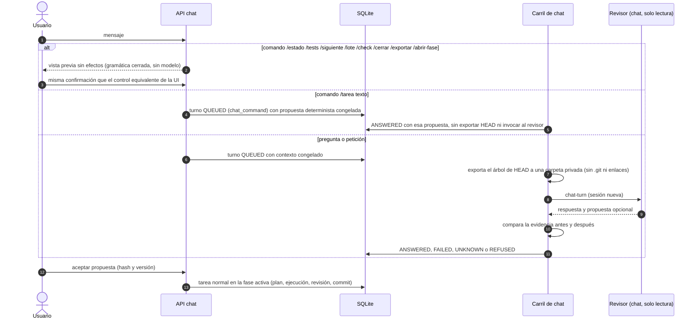

# Flujo — chat del proyecto

Preguntas sobre una instantánea de HEAD sin esperar al ejecutor, comandos deterministas y propuestas que solo se
convierten en tareas con confirmación (D035, D083).

Las preguntas no toman el lock del checkout; las tareas aceptadas siguen el [flujo de tarea](task-run.md).
Los nombres de comando son tokens de protocolo y no se traducen; la respuesta de `/tarea` sigue el idioma visual
y el texto de la tarea propuesta, el idioma de trabajo (D169). Un turno cuyo escritor se confirma detenido queda
`UNKNOWN`, y uno rechazado antes de efectos, `REFUSED`; ninguno se reintenta solo.
Cada turno sella el idioma visual vigente al admitirlo ([preferencias de idioma](language-preferences.md)).

## Fuente en el código

- `core/engine/chat.py`, `core/engine/chat_commands.py`, `storage/chat.py`, `adapters/chat_snapshot.py`.
- Plantilla `chat-turn.md`.
