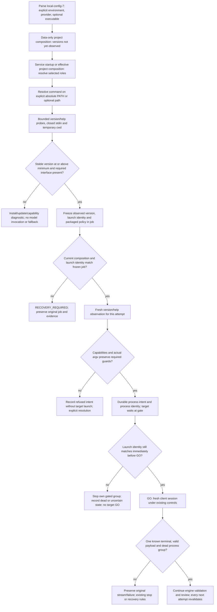

# Flow — automatic CLI discovery and compatibility

Implemented in P011-T012 (D174), following the [contract](../phase/P011-T011_CONTRATO_COMPATIBILIDAD_CLI.md)
and its HITL clarification. No version pin, candidate acceptance or operator evidence file is required in v7.

Minimums are Codex 0.163.0 and Claude Code 2.1.304 for both roles. Historical configurations/evidence remain
readable; a below-minimum client cannot start new work. Only effective provider roles are detected during normal
operation; `check-config --preflight` explicitly diagnoses defaults and all preset roles. No auth/status/login,
test prompt, network lookup, installation or global configuration change is part of discovery.

Each mutation observes the client again and reuses that project resolution only inside the same request. Each
attempt also observes version/help again. Content-hash caching restats inode, size, mtime and ctime; it is not a
cached compatibility verdict. A fresh job can detect an updated client automatically; a queued job never adopts it. Source/profile hashes
bind the packaged policy, and symlink/script/interpreter hashes bind explicit local launch files. Hashing does not
certify transitive runtime dependencies or prevent adversarial concurrent replacement. Public reports expose hashes
and structured diagnostics, not raw help, environment values or executable paths.

HITL D174: later releases matching the known interface are admitted with **conditional compatibility**. The
packaged policy retains explicit sandbox, trust, memory and configuration controls; it does not claim observation
of undocumented startup persistence or effective permissions in every new release. Local missing/changed controls
block. No per-release approval/audit is transferred to the user. Provider-internal retries remain unknown; the
harness adds no fallback or retry. Read-only project/history views do not trigger discovery.
