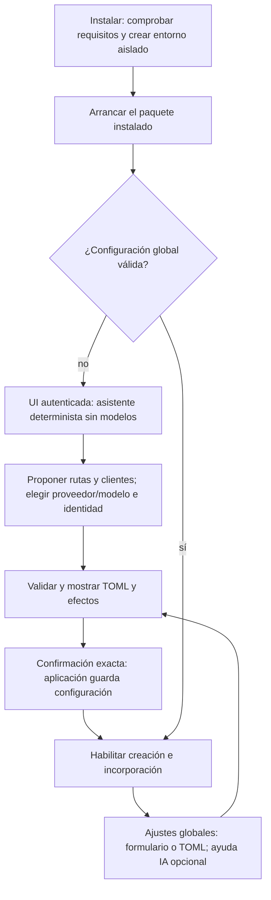
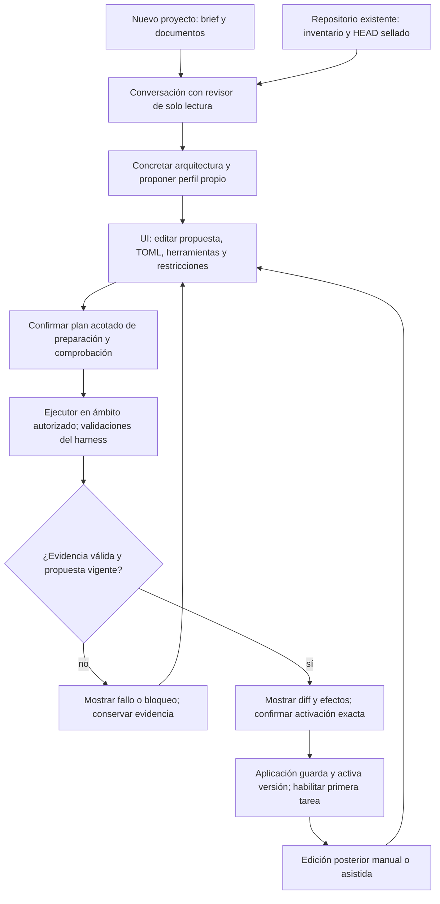

# Flujo planificado — instalación y configuración guiadas (P013)

**Estado: diseñado a nivel de fase, no implementado.**
[D215](../DECISIONS.md#d215--p013-instalación-guiada-y-configuración-desde-la-ui),
[plan](../phase/P013_PLAN.md) y [tareas](../NEXT_STEPS.md).
T001 concretará estados persistidos, contratos y recuperación antes de implementar.
El flujo vigente aún usa el TOML del operador descrito en ARCHITECTURE §6/§9 y la composición del
[flujo de incorporación](project-onboarding.md).

## Primer uso y ajustes globales

La clave de sesión, Host/Origin y CSRF se mantienen antes de permitir escribir configuración. Detectar clientes
no invoca modelos ni inicia sesión. Configuración inválida muestra diagnósticos y conserva el archivo previo.
Si el cambio requiere reinicio, el asistente lo explica y no lo presenta como activo antes de aplicarlo.
La restauración de consulta no habilita este carril de escritura.

## Perfil específico del proyecto

La definición no requiere una composición de stack elegida antes de disponer del contexto. La colocación
exacta del commit documental y la preparación en las dos entradas se resolverá en T001, conservando sus
guardias Git y la recuperación. Los ejemplos/recetas existentes son opcionales; un perfil propuesto no
acredita que sus herramientas estén instaladas o que sus comandos pasen.

El revisor propone; el ejecutor prepara/comprueba dentro del proyecto o área acotada; la aplicación escribe
los archivos de configuración validados. No se entrega a los agentes escritura general del TOML global.
La asistencia global usa el mismo principio, una vez configurados los agentes, con comprobaciones limitadas
al ámbito autorizado. CAS, hashes e intenciones recuperables evitan sobrescribir otra edición o duplicar
efectos. Las versiones de jobs, historiales y recibos anteriores no se reescriben al activar cambios.
