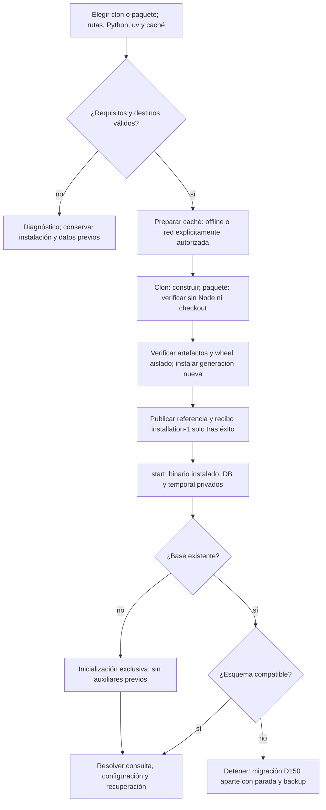
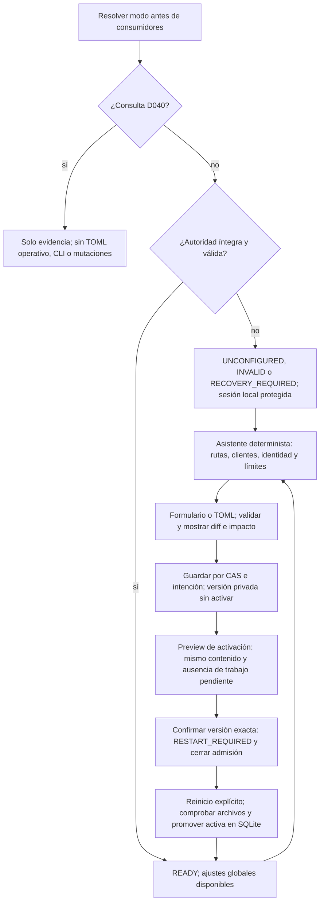
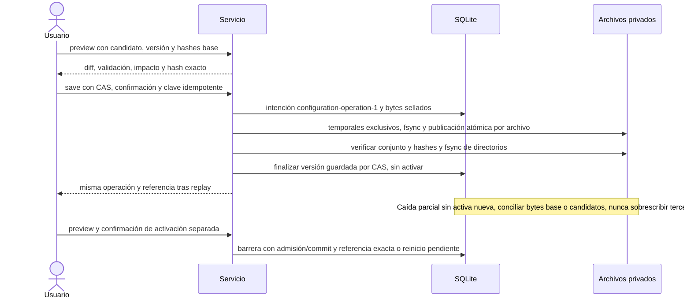
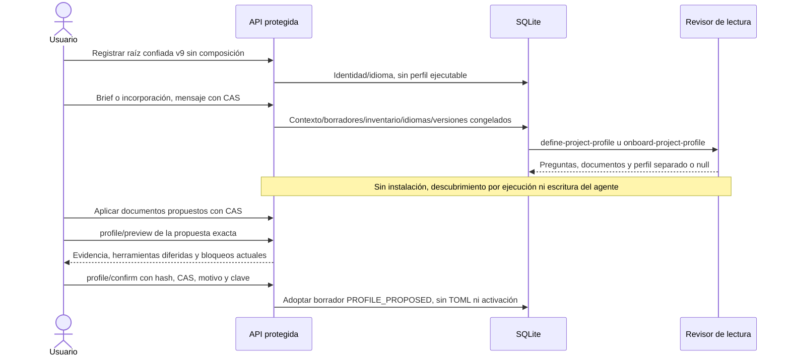
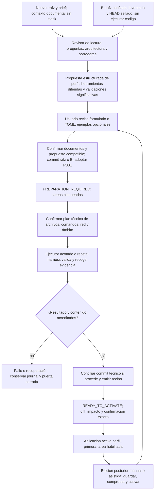

# Flujo — instalación y configuración guiadas (P013)

**Instalación T002, arranque T003, persistencia T004, API/arranque global T005, UI T006, propuesta de perfil T007 y preparación genérica T008 y alta/activación T009 y edición/asistencia T010 implementados; compatibilidad/backup pendientes T011.**
[Entrega T002](../phase/P013-T002_INSTALACION.md), D219; validación con herramientas falsas, sin recorrido instalado nuevo.
[Entrega T003](../phase/P013-T003_ARRANQUE.md), D220; procesos/señales sintéticos, sin servicio instalado real.
[Contrato](../phase/P013-T001_CONTRATO.md), D216–D218 en [DECISIONS](../DECISIONS.md),
[plan](../phase/P013_PLAN.md) y [tareas](../NEXT_STEPS.md).
TOML 1–8 conserva su entrada. T005 consume global v9 por referencia activa; T007 añade altas documentales/propuestas; preparación genérica entregada en T008; alta/activación integradas entregadas en T009.

## Instalación y primer arranque

Fallos de caché/requisitos no abren red ni publican instalación parcial. Actualizar usa generación nueva y
parada explícita, sin borrar datos ni hacer downgrade de esquema. Reiniciar no reinstala, migra, limpia locks
inciertos o acredita muerte de escritores. T002 conserva la comparación contra fuentes al construir y
entrega manifiesto `distribution-1`,
wrappers/verificador/fixture con checksums para paquete autocontenido. Comprueba miembros/metadatos/hashes
y el recorrido sintético instalado D051; las pruebas de T002 no ejecutan ese servicio.
`installation-1` vive en cada generación; `current.json` referencia generación/hash tras fsync. Un lock
excluye instaladores, replay comprueba paquete/venv y `--upgrade --writers-stopped` conserva anteriores.
Fallos/interrupciones retienen intención FAILED o PREPARING sin anunciar una generación lista.
Datos/configuración se crean privados y vacíos en instalación nueva, sin DB/TOML ni migraciones.

T003 resuelve `current.json`/`installation-1` y verifica paquete/venv antes de ejecutar su Python aislado,
con cwd en los datos del recibo. DB/configuración elegibles dentro de sus respectivas raíces; temporal
privado y puerto loopback elegibles. Rechaza puerto ocupado/rutas inseguras; preflight de esquema SQLite
en solo lectura y `init-db` exclusivo solo si no hay DB ni auxiliares. No reinstala ni migra al reiniciar.
Locks de instancia/instalación heredados por el hijo impiden segundo servicio/actualización incluso si
muere el wrapper; señales se reenvían y se espera al hijo. No libera guardias de jobs ni declara escritores
muertos. Consulta D040 omite TOML operativo. T005 entrega al servicio la configuración ausente/inválida:
conserva sesión y bloquea trabajo; T006 conduce al asistente protegido siguiente. Persistencia T004 conectada
a autoridad global/arranque por T005; perfiles propios entregados en T007–T009.

## Asistente y activación global

Sesión/Host/Origin/cross-site/CSRF también sin TOML. Detectar no invoca modelos; comprobar clientes es acción
explícita version/help D174. Ayuda IA solo con pareja activa congelada. Archivo inválido no se reemplaza por
un ejemplo ni habilita colas; fallo al promover conserva activa anterior y bloqueo, sin fallback silencioso.
Cancelar una activación pendiente también exige versión/confirmación; guardar no tiene ese efecto.

T006: tras resolver consulta, el modo bloqueado conduce a `/setup` antes de montar un workspace operativo;
preferencias, estadísticas y evidencias por id siguen consultables sin acciones de proyecto. Con READY, navegación a `/settings/configuration`. Formulario ↔ TOML usa
`POST /configuration/form`, sin efectos; detección/preflight requieren sus botones propios. Validación local
por campo y parser del servidor; preview muestra TOML/diff y hash antes de guardar. Candidato, base CAS y
solicitud pendiente se conservan en la pestaña; sondeo/conflicto no los reemplazan y recarga no reenvía POST.
Cambiar candidato/base exige preview y confirmación nuevas. Tras respuesta perdida, usuario revisa/reenvía
el mismo sobre/clave; recuperación inspecciona hashes y exige declaración de escritores detenidos.
Activación usa solo la guardada validada con su preview y confirmación separados; muestra activa/guardada/
pendiente y orden de reinicio explícita, sin arrancarlo desde UI. Cancelar fija id/versión revisados. Legacy
muestra importación pendiente T011; consulta restaurada nunca monta el editor. [Entrega](../phase/P013-T006_ASISTENTE_UI.md), D223.

## Persistencia y recuperación

Primitivas T004 implementadas ([D221](../DECISIONS.md#d221--p013-t004-journal-y-referencias-de-configuración),
[entrega](../phase/P013-T004_CONFIGURACION.md)): `preview/save`, `activation_preview/activate`,
`promote_pending/cancel_pending`, `recovery_preview/recover` y descarte/importación explícitos de cambios externos.
Endpoints globales y consumo global v9 en T005, UI global en T006; consumo/UI de perfiles propios entregados en T009.
Guardado con barrera SQLite y flock de instalación; intención ligada
a directorios de configuración/estado. Revisiones DRAFT o VALIDATED, copias privadas y fsync por publicación.
Recuperación exige declaración de escritores detenidos y exclusión efectiva; se audita como otra operación,
sin inferir parada por lease. Global sella el conjunto pendiente por id de activación y promueve en transacción;
permite guardar borradores mientras espera reinicio. Proyecto requiere verificador de preparación del servicio
(sin fallback permisivo); T008/T009 conectan recibos/HEAD/runtime. Trabajo pendiente bloquea activación,
no guardado. Bundle actual rechaza operaciones de configuración: soporte autocontenido pendiente T011.

TOML inmutable manda en contenido; SQLite manda en qué referencia está activa. Las copias editables
`global.toml`/`projects/<id>/project.toml` no son hot reload. Edición externa bloquea nuevas operaciones del
ámbito hasta importar/descartar por CAS. Deriva de versión inmutable detiene/cuarentena antes de efectos.
Una caída o lease vencido no permite asumir escritor detenido. Repetir clave/payload devuelve resultado;
otro payload con la misma clave da conflicto. Backup futuro incluye archivos/versiones/intenciones por
bytes/hashes, no solo rutas; restore conserva consulta sin repararlos ni activar procesos.

## Perfil por proyecto y dos entradas

### Propuesta entregada en T007

[D224](../DECISIONS.md#d224--p013-t007-contexto-documental-sin-stack-y-propuesta-de-perfil),
[entrega](../phase/P013-T007_PROPUESTA_PERFIL.md). API de registro v9 admite una raíz existente confiada
sin composición ni perfil. `IntakeContext` solo lleva raíz, política/pareja/idioma y layout; no hay runner
ni comandos de stack. El registro sigue ACTIVE a efectos de identidad, pero la disponibilidad operativa
es `PROFILE_REQUIRED`. Definición nueva admite carpeta vacía ya elegida; B usa inventario estático/HEAD y
borradores privados. T009 entrega creación automática de carpeta sin perfil, handoff documental y UI integrada.

Nuevo/B conversan antes de tener comandos; especificación/arquitectura concretas preceden al candidato.
Cada comando de preparación/validación/formateador/prefijo cita fuentes con hash y motivo. Herramientas
requieren nombre y requisito de entorno, diferidos; ayuda/versión/no-op no acreditan validación funcional.
Preview/confirmación comprueban documentos aplicados, HEAD/inventario, último turno, preguntas/pendientes,
contexto e identidades de composición; bloquean ante deriva. B comprueba HEAD también antes de encolar y GO,
sin cambiar el comportamiento de conversaciones históricas. Solo se ejecutan lecturas Git estáticas.

Reenvío exacto devuelve la adopción previa incluso tras ser sustituida por otro turno; misma clave con
otro payload da conflicto. Confirmar no escribe configuración, prepara, comitea documentos ni habilita tareas.
GET publica `PROFILE_REQUIRED`/`PROFILE_PROPOSED` sin sondear herramientas; la segunda solo indica borrador
adoptado, cuya vigencia se revisa en preview. Formatos 1–8 mantienen su ruta; v9 no admite activar una
composición con nombre a través del registro para eludir T008/T009. Restore D040 conserva sus guardias.

### Recorrido general: preparación T008 y alta/activación T009 entregadas

P001 ACTIVE no equivale a perfil operativo. El TOML vive fuera del checkout y el commit documental precede
al técnico. En B se conservan guardias Git, originales/phase-000 y bytes del código; en nuevo, solo D088 antes
del commit raíz. Cambiar el perfil contradiciendo documentos exige edición documental confirmada y evidencia
nueva. Activación no repite alta/commits/preparación. Perfil propio se activa sin reiniciar, con barrera de
admisión; trabajo pendiente ajeno a su evidencia de alta ya terminada lo bloquea según D118.

`project-profile-preparation-1` es preparación genérica nueva, no conversión de recetas/recibos v1/v2.
Ejecutor sin escritura general de configuración global ni ajustes del equipo. Guardar/activar son escrituras
del servicio confirmadas por el usuario. Recibo liga perfil/comandos/herramientas/entorno/contenido; propuesta
sin comprobar no acredita entorno listo. Caída exige recuperación enlazada, nunca replay implícito de red.

V1–v8 conservan operación/hashes; edición guiada requiere importación explícita al conjunto v9/proyecto v1,
originales intactos. Jobs/snapshots/recibos históricos no se actualizan a posteriori. El detalle de estados,
API/UI, reinicios y matriz de fallos está en el contrato; diagrama de datos se ampliará con la migración real.

## API global inicial entregada en T005

[D222](../DECISIONS.md#d222--p013-t005-asistente-api-y-arranque-con-autoridad-global-versionada),
[API efectiva y checks](../phase/P013-T005_ASISTENTE_API.md). `start` fija directorios del recibo; preflight valida
esquema/consulta y deja TOML ausente/inválido al servicio protegido. `serve` pasa directorios/entrada explícita a
`ConfigurationSetup`, sin leer TOML antes de resolver D040. Sin autoridad no reconcilia altas/preparaciones ni
inicia consumidor; preferencias y editor siguen accesibles con sesión/Host/Origin/CSRF.

1. GET devuelve modo, referencias guardada/activa/pendiente, CAS y operaciones que requieren conciliación.
2. Detectar por PATH aportado devuelve candidatos/usuario/rutas; no ejecuta procesos ni hereda entorno.
3. Formulario JSON o TOML → preview/diff → save exacto/idempotente T004; activa intacta.
4. `/check-clients` separado ejecuta solo version/help D174 con clientes/entorno explícitos; sin inferencia.
5. Preview/confirmación de activación → `RESTART_REQUIRED`; HTTP y barrera SQLite cierran mutaciones gestionadas.
6. Próximo arranque promueve el conjunto por T004 antes de componer global; fallo conserva bloqueo/referencias.
   Cancelar pendiente exige CAS y no habilita un proceso que no cargó la activa.
7. Caída de guardado → operación visible → preview de recuperación por bytes → declaración explícita de parada
   y confirmación exacta; sin replay de clientes. Consulta restaurada nunca detecta/guarda/activa/repara.

Guardado/lectura no comprueban clientes implícitamente. Cambio externo no hace hot reload; deriva inmutable
bloquea antes de escritura. Global READY solo acredita autoridad global: el registro/admisión con perfiles
propios se entrega en T007–T009. Editor inicial rechaza autoridad legacy/registro previo hasta la importación
explícita T011, conservando originales. Asistente UI T006 entregado; sin QA visual/servicio instalado nuevo.

### Preparación genérica entregada en T008

[D225](../DECISIONS.md#d225--p013-t008-preparación-genérica-confirmada-y-recibo-propio),
[entrega y checks](../phase/P013-T008_PREPARACION.md). T008 entregó el carril de servicio/API; T009 añade el handoff documental/configuración y la UI/activación. Las pruebas siembran esas precondiciones,
sin atribuirles un alta completa ya implementada. Recetas y recibos anteriores mantienen su carril propio.

1. Revisor puede añadir `preparation_plan` a la propuesta: archivos/prefijos concretos, local ignorado, entorno
   estable, dependencias/lock/hashes, red HTTPS/scripts e instrucciones/selección del ejecutor. Confirmar perfil
   sigue adoptando solo borrador; sin plan técnico no se prepara.
2. Preview con `contract = project-profile-preparation-1`, referencia/hash del TOML guardado VALIDATED y
   propuesta/hash exactos. Exige global compatible, registro actual, commit documental COMPLETED ligado al
   perfil y P001 adoptada; primera preparación sobre HEAD documental limpio. No invoca CLI ni comandos de stack.
3. Confirmar literal/hash/motivo/clave, revalidar bajo barrera y reservar checkout con intención/pasos. Reenvío
   exacto devuelve operación; cambios de petición/base dan conflicto, sin sobrescritura/rebase.
4. Worker reclama lease, comprueba guardias y crea directorios privados confirmados. Ejecutor prepara solo
   archivos permitidos; aplicación ejecuta preparación y validaciones exactas, con argv sin shell, cwd/entorno/
   límites explícitos. CLI y nativos registran grupo antes de GO. Alcance/Git/documentos se revisan tras cada paso;
   JUnit debe ser fresco y contener éxito sin fallos. Modelo/entorno/configuración no cambian por la propuesta.
5. Commit técnico CAS si cambia contenido versionado; intención permite conciliar el mismo hash. Emitir recibo
   compatible y liberar lock solo con detención acreditada. Recibo verifica configuración, herramientas/enlaces,
   archivos protegidos y entorno estable; código ordinario y reportes transitorios pueden evolucionar.
6. Error/cancelación/timeout/lease conserva journal/bytes y puerta cerrada. No hay replay al reiniciar. Sucesor
   confirmado exige escritor/grupos detenidos y bytes exactos del último prefijo DONE; efectos parciales ajenos
   bloquean recuperación. Cancelación solo señala el handle propio vivo.

El recibo no activa ni instala un contexto de tareas; T009 entrega esa confirmación separada. No se concede escritura
de TOML global, documentos o ajustes del equipo. Rutas/destinos/scripts y argv son autoridad cooperativa revisable,
no un sandbox nuevo; offline nunca cambia automáticamente a red.

### Alta y activación entregadas en T009

[D226](../DECISIONS.md#d226--p013-t009-alta-documental-y-activación-del-perfil-propio),
[entrega](../phase/P013-T009_ALTA_UI.md). Probado con HTTP/UI sintéticos y Git/SQLite temporales; sin proveedores.

1. Creación conserva padre/reserva/identidad/idioma y permite hijo sin composición; B registra raíz confiada.
   Conversación, preguntas y borradores siguen el contexto documental T007, sin runner de stack.
2. UI revisa candidato, comandos/evidencia/ámbito por formulario o TOML. Copiar un catálogo es optativo y crea
   contenido propio; editar versiona otra propuesta, conserva el turno del revisor y exige evidencia y nueva
   adopción CAS. Contradicciones documentales requieren otro turno/edición confirmados, nunca parchear snapshots.
3. Commit raíz/B exige propuesta ACCEPTED vigente y sella `profile_proposal_sha256`. Usa el perfil real solo
   para renderizar documentos; el run y la autoridad conservan `IntakeContext`. B mantiene código/originales,
   phase-000, objetos locales y guardias Git. Commit terminado y P001 adoptada cierran su conversación.
4. Editor de proyecto deriva `project-config-1` con referencia global, pareja/política admitidas y procedencia
   de la propuesta. Usuario completa rutas/herramientas y entorno acotado. Aplicación valida, muestra diff y
   guarda por T004 fuera del checkout; guardar no instala ni activa. Perfil distinto exige otro ciclo documental.
5. UI confirma plan T008 exacto con motivo y conserva pasos, journal, cancelación/confirm-stopped/reintento
   enlazado y recibo. B toma hashes de su `result_tree` sellado; no se reescribe el resultado histórico de importación.
6. Preview/activación independientes exigen configuración VALIDATED guardada, global compatible, recibo exacto,
   documentos/entorno/herramientas íntegros, HEAD técnico limpio y barrera D118. Precompone antes de publicar;
   referencia activa SQLite y nueva composición habilitan tareas sin reinicio. Fallo al instalar conserva puerta
   cerrada; resolución/reinicio solo reinstalan autoridad verificada, sin repetir alta, comandos o commits.
7. Jobs congelan revisión/hash/configuración/recibo. Nuevas admisiones revisan copia e inmutable; jobs propios
   revisan la inmutable antes de efectos. Una copia editable no cambia el contrato admitido. Guardar otra versión
   conserva activa anterior; recibo activo se busca por referencia exacta, sin adoptar el candidato más reciente.
8. Formularios/TOML y base CAS permanecen en la pestaña; conflicto no rebasa. Confirmaciones de perfil/guardado/
   preparación/activación conservan sobre y clave ante respuesta perdida; reenvío solo explícito, nunca al sondear.
   Estado/documentos/preparación/recibo visibles en/es. P001 ACTIVE por sí sola no habilita la primera tarea.

Importación/backup/recuperación integrada T011 y QA visual instalada T012 siguen
pendientes. Consulta D040 no edita/prepara/activa. Formatos 1–8 y sus hashes/recetas conservados.

## Edición y asistencia entregadas en T010

[D227](../DECISIONS.md#d227--p013-t010-edición-posterior-asistencia-congelada-e-impacto-conjunto),
[entrega](../phase/P013-T010_EDICION_ASISTIDA.md). Perfil ACTIVE mantiene editor. Preparar edición toma HEAD
limpio/documentos confirmados y plan anterior; cambios de perfil requieren actualización documental previa.
Guardar conserva activa y jobs; candidato técnico distinto → nueva preparación T008 → recibo exacto → preview
con diff/evidencia → activación sin reinicio y recomposición. Clientes candidatos no sustituyen la pareja que
comprueba/prepara. Agentes/política/global sin cambio técnico pueden conservar el recibo original verificado;
la activación registra su referencia, sin reconstruirlo ni elegir un recibo posterior por semejanza.

Global: editar → preview con global y copias propias derivadas → guardar el conjunto T004 → confirmar todas
las referencias → RESTART_REQUIRED → reiniciar/promover conjunto verificado. Cancelar por versiones de todos
los ámbitos de la operación pendiente conserva activas incluso con otro borrador global posterior. Revisar otra vez el borrador global puede regenerar sus propias derivadas, nunca
sobrescribir un borrador independiente. Impacto muestra comandos/herramientas/recibos/reinicio/jobs congelados.

Asistencia opcional: texto y contexto documental explícito → preview con clientes activos/selección/ámbito →
confirmación exacta → ASSIST con intención persistida → directorio privado nuevo → revisor de lectura o ejecutor
acotado → resultado/propuesta. Aplicar solo cambia el borrador local; guardar/preparar/activar son acciones
posteriores independientes. El revisor devuelve TOML/motivo/preguntas; el ejecutor devuelve observaciones y no
instala ni ejecuta comandos/red. Preparar el proyecto usa después T008 y su ámbito/plan propios. Global solo
con clientes ya configurados; documentos del proyecto se eligen de AGENTS/especificación/arquitectura/decisiones.

ASSIST conserva snapshot, pareja/identidad, propietario e intención/spawn/captura del grupo antes de GO. Respuesta
perdida → repetir mismo sobre consulta resultado original; ningún GET/montaje/arranque relanza el turno.
Caída/incertidumbre → consulta de operación → confirmar escritores detenidos con comprobación de liveness →
cerrar sin replay. Una asistencia viva no cambia la autoridad ni los checkpoints de jobs congelados. Consulta
restaurada rechaza este carril antes de leer rutas o descubrir clientes. Sin migración ni permiso general nuevo.
