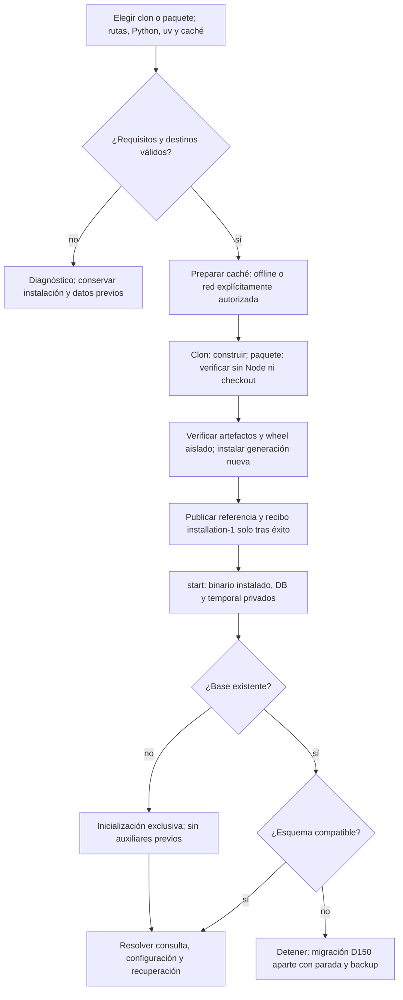
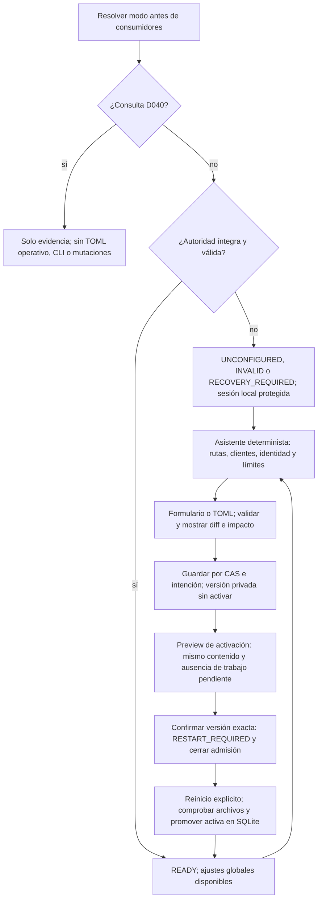
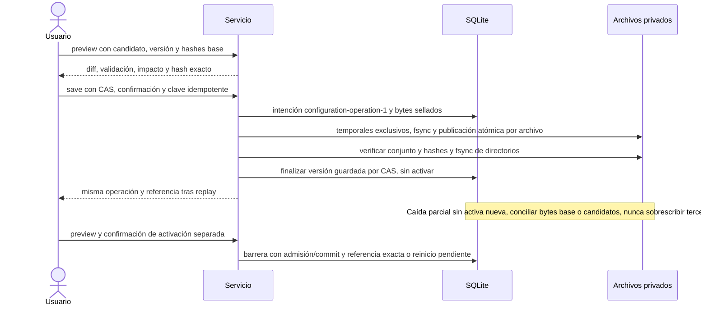
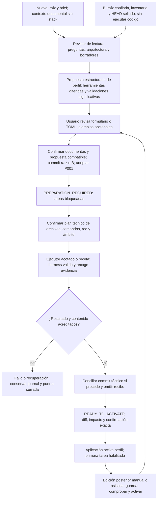

# Flujo — instalación y configuración guiadas (P013)

**Instalación T002, arranque T003 y persistencia T004 implementados; integración pendiente T005–T011.**
[Entrega T002](../phase/P013-T002_INSTALACION.md), D219; validación con herramientas falsas, sin recorrido instalado nuevo.
[Entrega T003](../phase/P013-T003_ARRANQUE.md), D220; procesos/señales sintéticos, sin servicio instalado real.
[Contrato](../phase/P013-T001_CONTRATO.md), D216–D218 en [DECISIONS](../DECISIONS.md),
[plan](../phase/P013_PLAN.md) y [tareas](../NEXT_STEPS.md).
El flujo vigente aún usa TOML 1–8 y composición según ARCHITECTURE §6/§9.

## Instalación y primer arranque

Fallos de caché/requisitos no abren red ni publican instalación parcial. Actualizar usa generación nueva y
parada explícita, sin borrar datos ni hacer downgrade de esquema. Reiniciar no reinstala, migra, limpia locks
inciertos o acredita muerte de escritores. T002 conserva la comparación contra fuentes al construir y
entrega manifiesto `distribution-1`,
wrappers/verificador/fixture con checksums para paquete autocontenido. Comprueba miembros/metadatos/hashes
y el recorrido sintético instalado D051; las pruebas de T002 no ejecutan ese servicio.
`installation-1` vive en cada generación; `current.json` referencia generación/hash tras fsync. Un lock
excluye instaladores, replay comprueba paquete/venv y `--upgrade --writers-stopped` conserva anteriores.
Fallos/interrupciones retienen intención FAILED o PREPARING sin anunciar una generación lista.
Datos/configuración se crean privados y vacíos en instalación nueva, sin DB/TOML ni migraciones.

T003 resuelve `current.json`/`installation-1` y verifica paquete/venv antes de ejecutar su Python aislado,
con cwd en los datos del recibo. DB/configuración elegibles dentro de sus respectivas raíces; temporal
privado y puerto loopback elegibles. Rechaza puerto ocupado/rutas inseguras; preflight de esquema SQLite
en solo lectura y `init-db` exclusivo solo si no hay DB ni auxiliares. No reinstala ni migra al reiniciar.
Locks de instancia/instalación heredados por el hijo impiden segundo servicio/actualización incluso si
muere el wrapper; señales se reenvían y se espera al hijo. No libera guardias de jobs ni declara escritores
muertos. Consulta D040 omite TOML operativo; TOML inválido bloquea antes de servir. Sin TOML arranca hoy
la UI protegida de consulta vigente, sin consumidores gestionados; la transición al asistente del diagrama
siguiente sigue pendiente T005/T006. T004 entrega la persistencia separada; aún no se conecta con este wrapper ni con consumidores del servicio.

## Asistente y activación global

Sesión/Host/Origin/cross-site/CSRF también sin TOML. Detectar no invoca modelos; comprobar clientes es acción
explícita version/help D174. Ayuda IA solo con pareja activa congelada. Archivo inválido no se reemplaza por
un ejemplo ni habilita colas; fallo al promover conserva activa anterior y bloqueo, sin fallback silencioso.
Cancelar una activación pendiente también exige versión/confirmación; guardar no tiene ese efecto.

## Persistencia y recuperación

Primitivas T004 implementadas ([D221](../DECISIONS.md#d221--p013-t004-journal-y-referencias-de-configuración),
[entrega](../phase/P013-T004_CONFIGURACION.md)): `preview/save`, `activation_preview/activate`,
`promote_pending/cancel_pending`, `recovery_preview/recover` y descarte/importación explícitos de cambios externos.
Sin endpoints/UI ni ejecución v9 todavía. Guardado con barrera SQLite y flock de instalación; intención ligada
a directorios de configuración/estado. Revisiones DRAFT o VALIDATED, copias privadas y fsync por publicación.
Recuperación exige declaración de escritores detenidos y exclusión efectiva; se audita como otra operación,
sin inferir parada por lease. Global sella el conjunto pendiente por id de activación y promueve en transacción;
permite guardar borradores mientras espera reinicio. Proyecto requiere verificador de preparación del servicio
(sin fallback permisivo); T008/T009 conectarán recibos/HEAD/runtime. Trabajo pendiente bloquea activación,
no guardado. Bundle actual rechaza operaciones de configuración: soporte autocontenido pendiente T011.

TOML inmutable manda en contenido; SQLite manda en qué referencia está activa. Las copias editables
`global.toml`/`projects/<id>/project.toml` no son hot reload. Edición externa bloquea nuevas operaciones del
ámbito hasta importar/descartar por CAS. Deriva de versión inmutable detiene/cuarentena antes de efectos.
Una caída o lease vencido no permite asumir escritor detenido. Repetir clave/payload devuelve resultado;
otro payload con la misma clave da conflicto. Backup futuro incluye archivos/versiones/intenciones por
bytes/hashes, no solo rutas; restore conserva consulta sin repararlos ni activar procesos.

## Perfil por proyecto y dos entradas

P001 ACTIVE no equivale a perfil operativo. El TOML vive fuera del checkout y el commit documental precede
al técnico. En B se conservan guardias Git, originales/phase-000 y bytes del código; en nuevo, solo D088 antes
del commit raíz. Cambiar el perfil contradiciendo documentos exige edición documental confirmada y evidencia
nueva. Activación no repite alta/commits/preparación. Perfil propio se activa sin reiniciar, con barrera de
admisión; trabajo pendiente ajeno a su evidencia de alta ya terminada lo bloquea según D118.

`project-profile-preparation-1` es preparación genérica nueva, no conversión de recetas/recibos v1/v2.
Ejecutor sin escritura general de configuración global ni ajustes del equipo. Guardar/activar son escrituras
del servicio confirmadas por el usuario. Recibo liga perfil/comandos/herramientas/entorno/contenido; propuesta
sin comprobar no acredita entorno listo. Caída exige recuperación enlazada, nunca replay implícito de red.

V1–v8 conservan operación/hashes; edición guiada requiere importación explícita al conjunto v9/proyecto v1,
originales intactos. Jobs/snapshots/recibos históricos no se actualizan a posteriori. El detalle de estados,
API/UI, reinicios y matriz de fallos está en el contrato; diagrama de datos se ampliará con la migración real.
