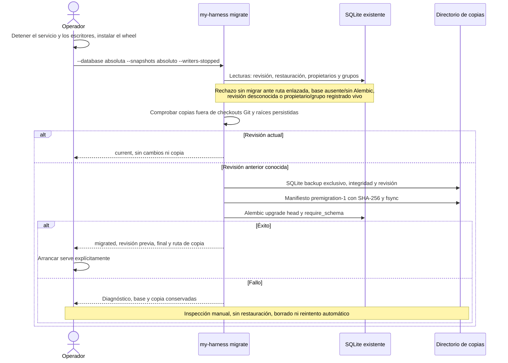

# Flujo — migración explícita de SQLite

P010-T012, D150. CLI instalada sobre `storage/migrate.py` y la instantánea `premigration-1` de D053. Sin cambios
de esquema ni datos de autoridad nuevos. `init-db` crea; `serve` comprueba la revisión y nunca migra (D043).

`--writers-stopped` declara también que no queda un servicio inactivo sin propietario persistido. La comprobación
de vida usa las mismas identidades cooperativas que backup: no mata procesos ni prueba su muerte por un lease.
No se exploran configuraciones globales ni se opera sobre checkouts. El directorio se crea solo cuando hace falta
copiar; los nombres de copia son exclusivos, con modo 0600. La instantánea contiene SQLite, no streams ni otros
artefactos; no sustituye `backup-create` y no es una restauración de consulta.

Si falla la copia o su sellado, no se llama a Alembic; los parciales se conservan. Si falla la migración, se conserva
el estado resultante y la copia anterior, sin ocultar cambios mediante restauración automática. El operador mantiene
detenidos los escritores durante toda la operación. Los historiales y snapshots previos se preservan; `0023` rellena
la proyección derivada leyendo los formatos 1–8. Sin migraciones nuevas ni cambio de DDBB-DIAGRAM.

`scripts/dev` sigue usando `prepare_database`: permite crear su base y conserva su ubicación de copias. Comparte
las comprobaciones ampliadas de propietarios/grupos y la instantánea verificada; no necesita los argumentos de la
CLI instalada. Evidencia y límites en [la entrega](../archive/phase-010/P010-T012_MIGRACION_INSTALADA.md).
