# Flujo — documentos gestionados

Tres vías escriben documentación en un proyecto v2 y todas terminan en un commit del harness (D036, D072, D080, D081).

```mermaid
flowchart TD
    subgraph T["Commit de tarea"]
        T1["Tarea aceptada"] --> T2["Regenerar bloques de STATE, NEXT_STEPS, ROADMAP y DECISIONS"]
        T2 --> T3["MechanicalUpdate en el mismo commit"]
        T3 --> T4["Adopción del hash si la base coincidía"]
    end
    subgraph E["Edición confirmada (document_edit)"]
        E1["Contenido desde la API o cambios del editor"] --> E2{"¿Bloques gestionados intactos?"}
        E2 -- "no" --> E3["Rechazo o «regenerar»: prosa local con los bloques de la base"]
        E2 -- "sí" --> E4["Vista previa con diff y CAS sobre el hash base"]
        E3 --> E4
        E4 --> E5["Confirmación del hash"]
        E5 --> E6["Job bajo el lock: intención sellada y commit"]
    end
    subgraph X["Exportación manual (D036)"]
        X1["Vista previa de bloques desde SQLite"] --> X2["Confirmación del diff exacto"]
        X2 --> X3["Commit conciliable y adopción de hashes"]
    end
```

Reglas comunes: solo el harness escribe los bloques `harness-local:managed-*`; `docs/archive/**` es de solo lectura;
con documentos sin confirmar no arranca ninguna tarea, check, exportación ni transición; un cambio externo después de
la vista previa invalida el job sin sobrescribir.

## Cambios previstos en P008 (D088, sin implementar)

- El índice de decisiones se genera desde los encabezados del propio `DECISIONS.md` (sin `decisions/`) (T002).
- Los ejecutores pueden editar `docs/flows/**`, `docs/DDBB-DIAGRAM.md`, `docs/ARCHITECTURE.md`,
  `docs/SPECIFICATION.md` y `docs/phase/**` cuando su contrato lo incluya (T003).
- `AGENTS.md`, `CLAUDE.md` y `GEMINI.md` pasan a ser documentos que el harness puede escribir (T002, T003).

## Fuente en el código

- `core/engine/documents.py` (layout, bloques, render), `core/engine/document_ops.py` (edición y transición),
  `core/engine/document_export.py`, `storage/documents.py`, `storage/document_export.py`.
