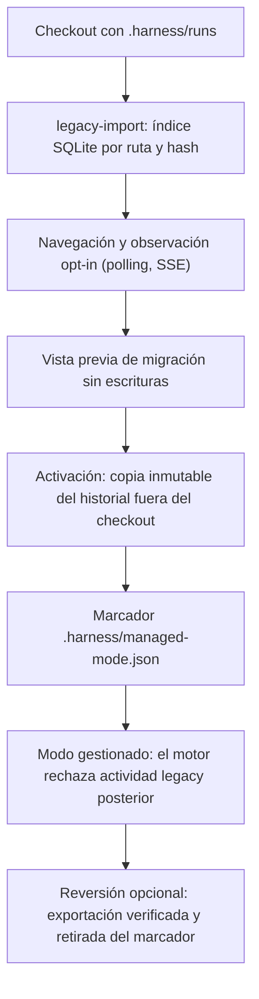
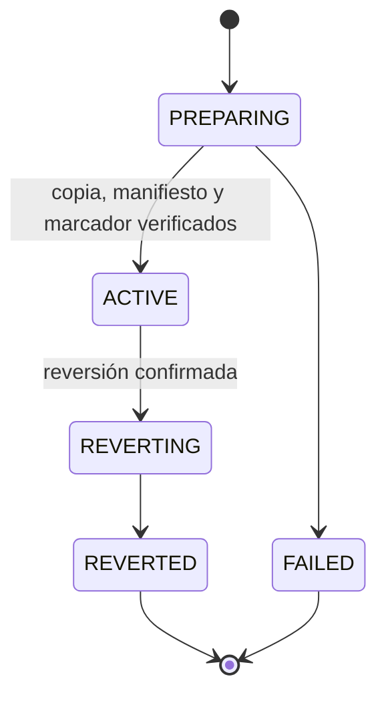
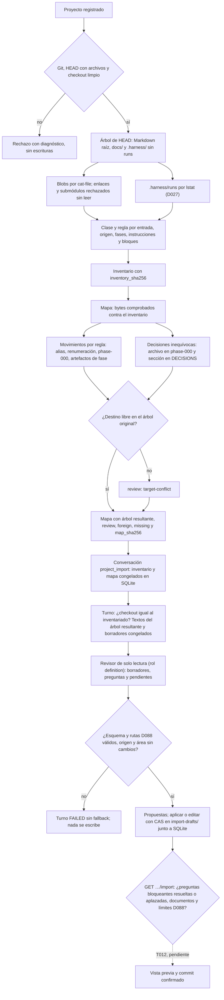

# Flujo — harness anterior: observación y paso a gestionado

Un checkout con `.harness/runs` de un harness anterior (ReferenceProject) se observa en lectura y puede pasar a modo
gestionado (D012–D014, D027). Ninguna de las dos vías reescribe hoy los documentos del proyecto.

## Estados de la activación

## Flujo A en P008 (D088)

El Flujo A (T009–T012) añade, sobre esta vía y sobre proyectos v1/v2 de este harness, la normalización documental al
layout unificado. Implementados: el inventario de solo lectura (P008-T009, D096), el mapa determinista de
renombrados, movimientos y composición de decisiones (P008-T010, D097) y la conversación `project_import` en la que
el revisor propone fusiones y adelgazamiento como borradores privados (P008-T011, D098). Pendiente: la vista previa y
el commit confirmado con CAS (T012).

Límite (D098): con `.harness/runs` sin activar, la guardia de modo D027 rechaza los turnos de la conversación; la
conversación y su estado sí se pueden crear y consultar. D099 fija el orden para T012: primero la activación D027 y
después la importación, con el marcador de la activación viva tolerado por el inventario y fuera del commit.

## Fuente en el código

- `core/legacy.py`, `adapters/legacy.py`, `storage/legacy.py`, `storage/observation.py`, `services/observation.py`.
- `core/migration.py`, `adapters/migration.py`, `storage/migration.py`, `services/migration.py`.
- `core/project_import.py`, `adapters/project_import.py` (inventario del Flujo A).
- `core/project_normalization.py` (mapa de normalización del Flujo A).
- `core/engine/import_conversation.py`, `storage/import_drafts.py`, `storage/planning.py` (conversación del Flujo A).
