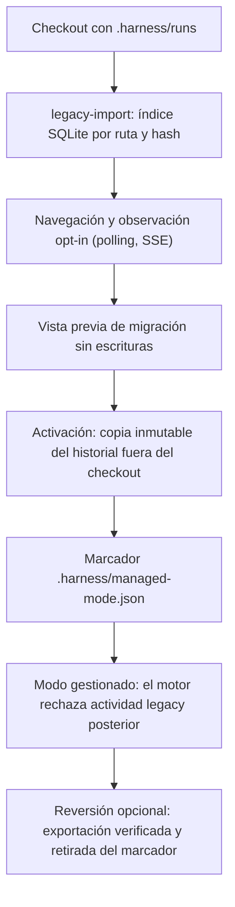
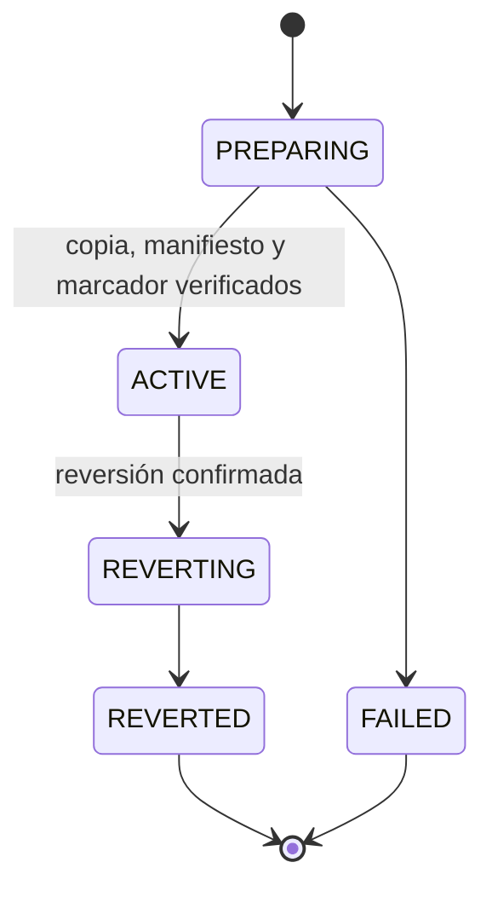
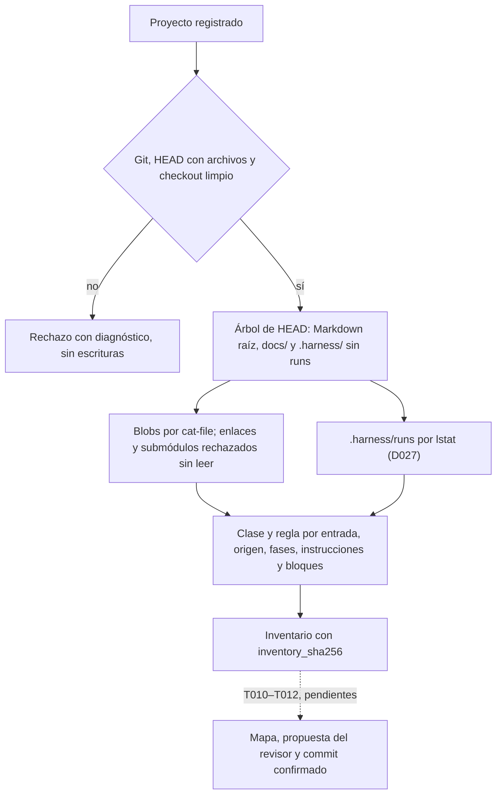

# Flujo — harness anterior: observación y paso a gestionado

Un checkout con `.harness/runs` de un harness anterior (ReferenceProject) se observa en lectura y puede pasar a modo
gestionado (D012–D014, D027). Ninguna de las dos vías reescribe hoy los documentos del proyecto.

## Estados de la activación

## Flujo A en P008 (D088)

El Flujo A (T009–T012) añade, sobre esta vía y sobre proyectos v1/v2 de este harness, la normalización documental al
layout unificado. Implementado: el inventario de solo lectura (P008-T009, D096). Pendientes: el mapa determinista de
renombrados y movimientos (T010), la propuesta del revisor para fusionar y adelgazar (T011) y un commit confirmado
con CAS (T012).

## Fuente en el código

- `core/legacy.py`, `adapters/legacy.py`, `storage/legacy.py`, `storage/observation.py`, `services/observation.py`.
- `core/migration.py`, `adapters/migration.py`, `storage/migration.py`, `services/migration.py`.
- `core/project_import.py`, `adapters/project_import.py` (inventario del Flujo A).
