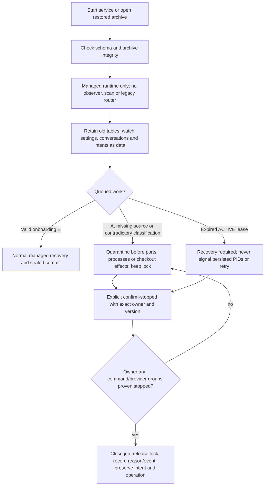
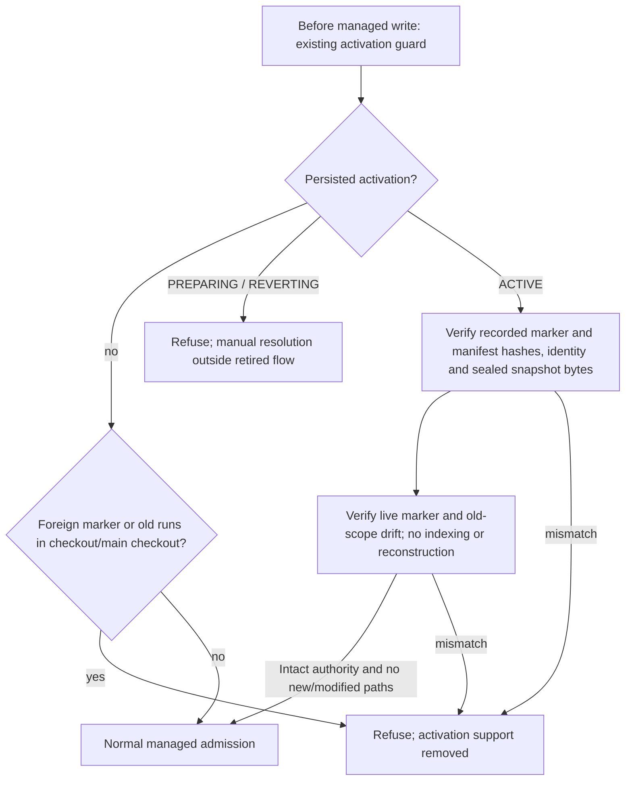

# Compatibility after legacy/A retirement

P011-T019, D161 implements D155 and the T001 §6 contract. Legacy observation, indexing, activation/reversion
and Flow A normalization/import are removed. This canonical document now describes compatibility only;
the original behavior and its evidence remain in the phase archive and historical decisions.

The API paths `/api/legacy/**`, activation/reversion and managed `/import` paths are absent from the router and
OpenAPI. Unknown API paths return 404 after session and local request guards; restored archives still reject
mutations uniformly. `/legacy` and `/projects/:p/import` resolve to the UI's not-found page, without a redirect.
`legacy-import` and `legacy-summary` fail argument parsing before opening a database. No flag reactivates them.
The current prompt catalog excludes `import-project`. Frozen catalogs remain readable with that record;
rendering it fails and persisted active heads cannot add it to a current catalog.

An already ACTIVE job keeps its lease/lock until the existing recovery rules apply. Queued A/ambiguous work is
claimed solely to establish a quarantined owner and lock, then stops before factories or filesystem checks.
`confirm-stopped` requires exact owner/version, a reason, and dead/closed owner and groups. It never invokes
an old intent. It records `retired_work_resolved` and preserves the old conversation, request, drafts and operation
verbatim. A retained unresolved import intent continues to block a new writer; resolving or moving old data is
manual, outside the retired product flow. Completed managed history remains available through managed run views.

`core/managed_mode.py`, `adapters/managed_mode.py`, `adapters/safe_files.py` and `storage/managed_mode.py`
contain only compatibility reads and admission checks. They cannot create, finish, abandon or revert activations.
A foreign marker, missing/corrupt snapshot or legacy writer continues to block managed work. The marker is
excluded from Git only when validated against this installation's intact ACTIVE authority.

`legacy_sources/runs/artifacts/events`, `managed_activations`, `activation_id`, `project_imports`, conversations,
histories and migrations 0001–0023 remain unchanged. `watch_enabled=true` is inert; startup does not change it
or traverse its external source. Backup reads sealed manifests and already referenced snapshot/export paths,
verifies hashes and copies evidence without importing the external checkout. Restore remains query-only and
starts no observer or retired job. An older schema requires the explicit SQLite migration command; this does
not activate a project or normalize its documentation. See [database migration](database-migration.md).

The two product entries are [new project definition](project-definition.md) and
[onboarding a repository without harness](project-onboarding.md). Existing managed projects can be registered
or reopened normally. Synthetic H0 simulations remain independent from project onboarding and legacy support.
