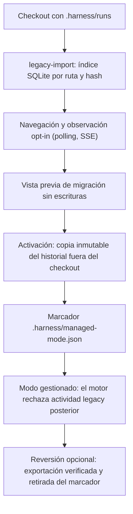
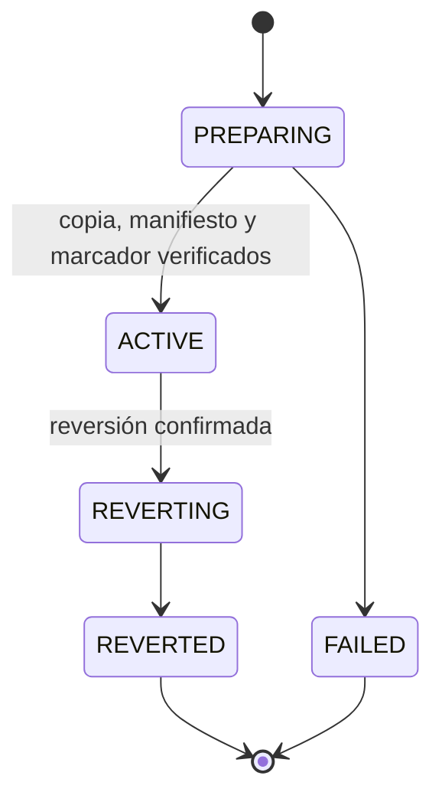

# Flujo — harness anterior: observación y paso a gestionado

Un checkout con `.harness/runs` de un harness anterior (ReferenceProject) se observa en lectura y puede pasar a modo
gestionado (D012–D014, D027). Ninguna de las dos vías reescribe hoy los documentos del proyecto.

## Estados de la activación

## Flujo A en P008 (D088)

El Flujo A (T009–T012) añade, sobre esta vía y sobre proyectos v1/v2 de este harness, la normalización documental al
layout unificado. Implementados: el inventario de solo lectura (P008-T009, D096), el mapa determinista de
renombrados, movimientos y composición de decisiones (P008-T010, D097) y la conversación `project_import` en la que
el revisor propone fusiones y adelgazamiento como borradores privados (P008-T011, D098), y la vista previa y
el commit confirmado con CAS y adopción de fase (P008-T012, D100). T016 (D105) corrige la frontera Git de H1–H3.

```mermaid
flowchart TD
    A["Proyecto registrado"] --> A1{"¿Runs legacy sin activar?"}
    A1 -- sí --> A2["Vista previa y activación D027 confirmada aparte; copia verificada"]
    A2 --> B0
    A1 -- no --> B0{"¿Sin filtros clean/process configurados, incluidos includes?"}
    B0 -- no --> R
    B0 -- sí --> B{"Git, HEAD con archivos y checkout limpio"}
    B -- no --> R["Rechazo con diagnóstico, sin escrituras"]
    B -- sí --> C["Árbol de HEAD: Markdown raíz, docs/ y .harness/ sin runs"]
    C --> D["Blobs por cat-file; enlaces y submódulos rechazados sin leer"]
    C --> E[".harness/runs por lstat (D027)"]
    D --> F["Clase y regla por entrada, origen, fases, instrucciones y bloques"]
    E --> F
    F --> G["Inventario con inventory_sha256"]
    G --> M["Mapa: bytes comprobados contra el inventario"]
    M --> N["Movimientos por regla: alias, renumeración, phase-000, artefactos de fase"]
    M --> O["Decisiones inequívocas: archivo en phase-000 y sección en DECISIONS"]
    N --> P{"¿Destino libre en el árbol original?"}
    O --> P
    P -- no --> Q["review: target-conflict"]
    P -- sí --> S["Mapa con árbol resultante, review, foreign, missing y map_sha256"]
    Q --> S
    S --> T["Conversación project_import: inventario y mapa congelados en SQLite"]
    T --> U["Turno: ¿checkout igual al inventariado? Textos del árbol resultante y borradores congelados"]
    U --> V["Revisor de solo lectura (rol definition): borradores, preguntas y pendientes"]
    V --> W{"¿Esquema y rutas D088 válidos, origen y área sin cambios?"}
    W -- no --> X["Turno FAILED sin fallback; nada se escribe"]
    W -- sí --> Y["Propuestas; aplicar o editar con CAS en import-drafts/ junto a SQLite"]
    Y --> Z{"GET …/import: ¿preguntas bloqueantes resueltas o aplazadas, documentos y límites D088?"}
    Z -- sí --> H["Árbol completo: mapa, borradores y bloques; originales sustituidos o retirados al archivo"]
    H --> H1{"¿STATE y NEXT_STEPS coinciden en fase descrita por ROADMAP? ¿Destinos libres?"}
    H1 -- no --> R
    H1 -- sí --> H1B{"¿Destinos nuevos no ignorados y blobs iguales a los bytes confirmados?"}
    H1B -- no --> R
    H1B -- sí --> H2["Confirmación de hash, motivo e Idempotency-Key"]
    H2 --> H3["Job y project_imports con intención sellada, antes de escribir"]
    H3 --> H3B["Recomprobar filtros, destinos y blobs sellados antes de ejecutar"]
    H3B --> H4["CAS por archivo, borrados y escritura; commit documental determinista"]
    H4 --> H5["Transacción: fase ACTIVE y base documental adoptadas; importación COMPLETED y job DONE"]
    H3 --> H6["Caída: RECOVERY_REQUIRED; confirmar escritor detenido"]
    H6 --> H7["INTERRUPTED: reconfirmar la misma intención y el mismo commit"]
    H7 --> H3B
```

D099 implementada en T012: la activación va antes de crear la conversación. Solo el marcador no versionado de
una activación propia, `ACTIVE`, coincidente por hash y sin deriva se tolera en el inventario y se excluye de las
capturas Git (también al continuar con tareas). Otro marcador o cualquier otro cambio sigue bloqueando. El commit
no versiona el marcador ni modifica `.gitignore`.

La vista previa conserva en `archive/phase-000/import-originals/<ruta original>` cada original cuyo destino cambia
por borradores o bloques y cada documento retirado de `review` (salvo el archivo existente). Los movimientos del mapa
conservan sus originales por bytes; lo ajeno queda donde está y se lista para la confirmación. Una colisión de archivo,
directorio o mayúsculas bloquea. STATE y NEXT_STEPS deben declarar la misma fase, con objetivo y criterios en ROADMAP;
no se infiere ningún intento ni aceptación desde el historial. Después del commit, la fase puede continuar por las
acciones existentes; repetir la vista previa devuelve la importación ya completada sin cambios.

Desde T016 (D105), el inventario rechaza configuraciones `filter.*.clean` y `filter.*.process`, incluidos los
includes de Git, antes de `status`. Las mismas guardias compartidas con B preceden a captura/sellado y ejecución,
también al reanudar. No se invocan filtros ni se cambia configuración. Los destinos nuevos ignorados impiden
confirmar; las conversiones internas de atributos también bloquean si cualquier blob del árbol documental
resultante difiere de su SHA-256 confirmado, incluidos originales archivados y binarios. El sellado final debe
reproducir el árbol de la vista previa. Cambiar atributos después de confirmar se detecta al recalcular la intención
antes de escribir; cambiar exclusiones se vuelve a comprobar en el job. Se mantiene la CAS y la recuperación del
mismo commit. `document_layout = "d088-9"` pone en cuarentena jobs con composiciones anteriores; ninguna intención
sellada se reescribe y la configuración global permanece intacta.

## Fuente en el código

- `core/legacy.py`, `adapters/legacy.py`, `storage/legacy.py`, `storage/observation.py`, `services/observation.py`.
- `core/migration.py`, `adapters/migration.py`, `storage/migration.py`, `services/migration.py`.
- `core/project_import.py`, `adapters/project_import.py` (inventario del Flujo A).
- `core/project_normalization.py` (mapa de normalización del Flujo A).
- `core/engine/import_conversation.py`, `storage/import_drafts.py`, `storage/planning.py` (conversación del Flujo A).
- `core/engine/import_commit.py`, `storage/project_import.py` (vista previa, confirmación y conciliación).
