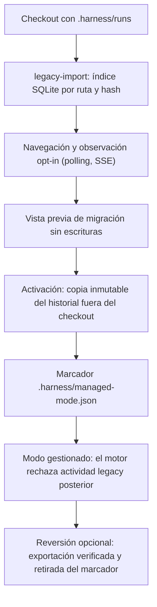
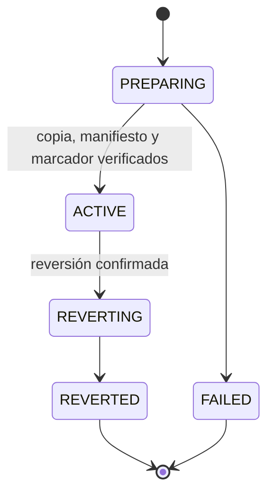

# Flujo — harness anterior: observación y paso a gestionado

Un checkout con `.harness/runs` de un harness anterior (ReferenceProject) se observa en lectura y puede pasar a modo
gestionado (D012–D014, D027). Ninguna de las dos vías reescribe hoy los documentos del proyecto.

## Estados de la activación

## Cambios previstos en P008 (D088, sin implementar)

El Flujo A (T009–T012) añade, sobre esta vía y sobre proyectos v1/v2 de este harness, la normalización documental al
layout unificado: inventario de solo lectura, mapa determinista de renombrados y movimientos, propuesta del revisor
para fusionar y adelgazar y un commit confirmado con CAS.

## Fuente en el código

- `core/legacy.py`, `adapters/legacy.py`, `storage/legacy.py`, `storage/observation.py`, `services/observation.py`.
- `core/migration.py`, `adapters/migration.py`, `storage/migration.py`, `services/migration.py`.
