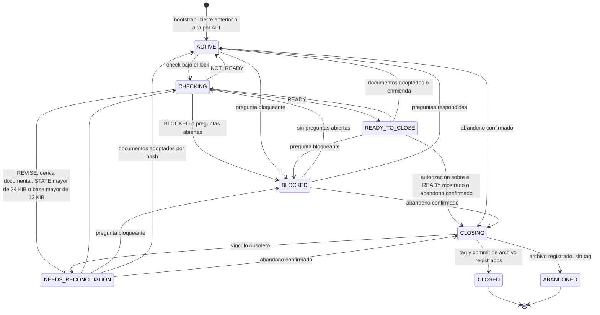
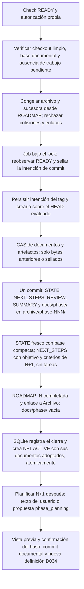
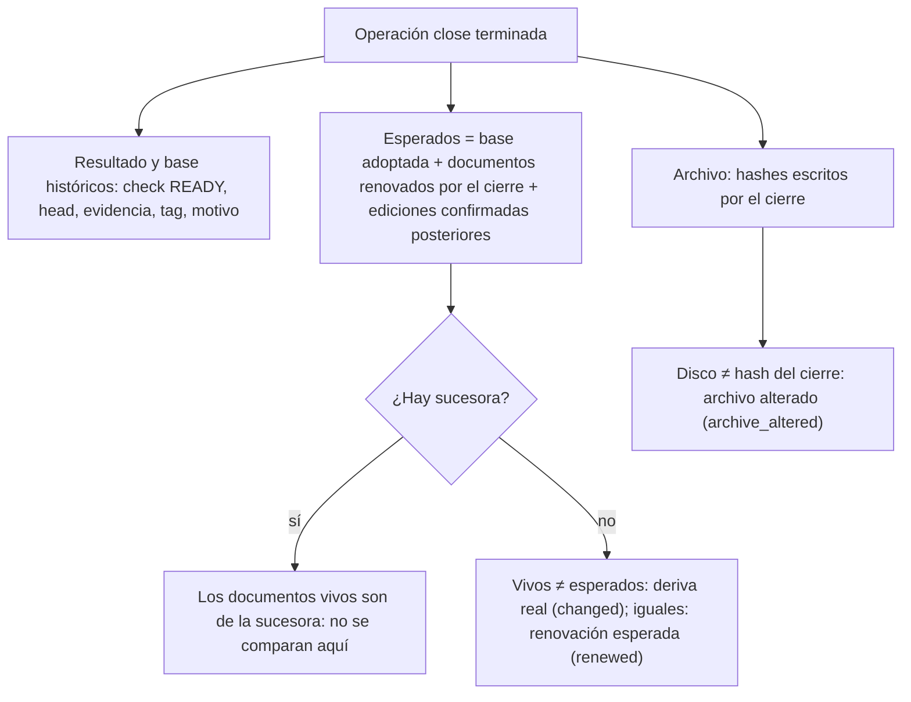

# Flujo — ciclo de vida de una fase

Implementado: D032, D034 y cierre unificado de D088/P008-T004 (D091).

## Estados de la fase

Un check o cierre que falla, se rechaza antes de efectos o cuyo escritor se confirma detenido devuelve la fase a su
estado previo (`BLOCKED` si hay preguntas abiertas); en un cierre invalida además su autorización y deja la intención
de tag sellada como efecto incierto para la conciliación. Reanudar un cierre exige la misma terminal y, para
`CLOSED`, el mismo vínculo READY. Las preguntas se rechazan en `CLOSING`, `CLOSED` y `ABANDONED`; las enmiendas,
también durante `CHECKING`.

Una enmienda conserva la definición anterior e invalida READY y lotes. El lote desatendido encadena
`tarea → commit → siguiente tarea`, pero nunca comprueba ni cierra. Un cierre interrumpido mantiene la intención
sellada: tras confirmar el escritor detenido, una nueva petición explícita reanuda el mismo run y commit.

## Cierre y archivo unificados

El abandono usa el mismo archivo y commit, sin exigir READY ni crear tag. Si ROADMAP no tiene sucesora, se archiva y
se deja indicado que no hay fase activa. STATE y NEXT_STEPS se archivan por bytes; también los artefactos binarios y
las subcarpetas de `docs/phase/`. REVIEW y SUMMARY se generan desde la instantánea SQLite.

Las nuevas transiciones separadas H6.3 se rechazan. Sus intenciones ya selladas conservan la vía de recuperación;
sus endpoints se retiraron de API/UI en T006 (D093), conservando la conciliación interna del motor. Nunca se recalcula
una intención pendiente ni se reescriben sus snapshots. El prompt de planificación usa el destino exacto del contexto: la fase ACTIVE vacía, o la
siguiente en conversaciones anteriores (T005, D092). Propone NEXT_STEPS y exige confirmación propia del plan; no
autoriza otra transición. Desde T006, la página de la fase ACTIVE sin tareas ofrece texto o propuesta conversacional,
vista previa con diff y hash, motivo y confirmación idempotente del plan. Cambiar la versión de la fase o el origen
del plan descarta la vista previa. La fase cerrada enlaza a su sucesora; no ofrece otra transición.

## Consulta de una fase cerrada (P010-T005)

La lectura de una fase CLOSED o ABANDONED añade `closure` ([D147](../DECISIONS.md#d147--p010-t005-evidencia-histórica-de-una-fase-cerrada)),
sin cambiar `phase.documents`, el READY ni lo que comprueba un check:

La página de documentos usa los mismos hashes esperados cuando la última fase está terminada, así que la renovación
del cierre no aparece como deriva. Una fase abierta conserva sus guardias: deriva frente a la base adoptada y READY
obsoleto si los documentos cambian.

## Fuente en el código

- `core/engine/phases.py`, `storage/phases.py`: check, cierre, preguntas, enmiendas, abandono y lote.
- `storage/closure.py`, `core/engine/document_ops.py`: preparación, intención y adopción del archivo.
- `storage/phase_plan.py`, `storage/planning.py`: plan posterior confirmado y conversación sobre la fase activa vacía.
- `storage/transition.py`: conciliación de transiciones antiguas.
- `storage/phases.py` (`closure_view`, `expected_documents`), `storage/documents.py` (`status`) y `frontend/src/Phases.tsx`:
  consulta de una fase terminada (P010-T005).
- `core/engine/documents.py`: REVIEW, SUMMARY y proyecciones de STATE, NEXT_STEPS y ROADMAP.
