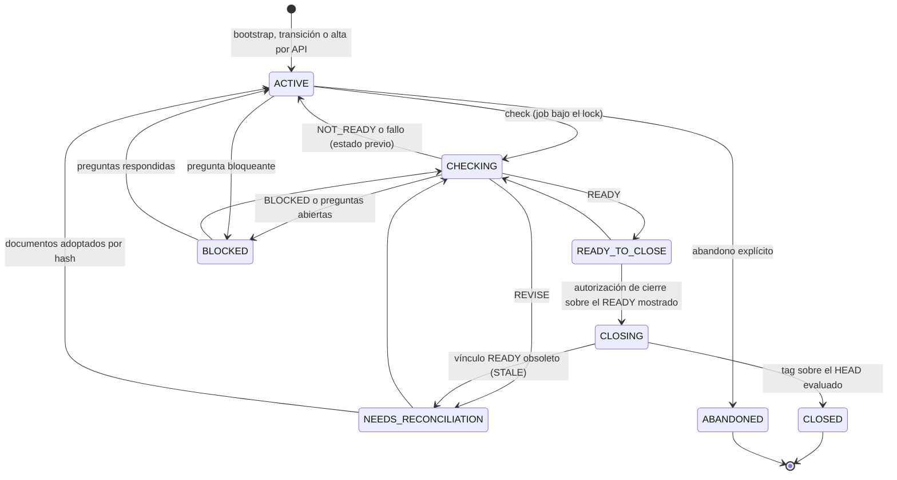
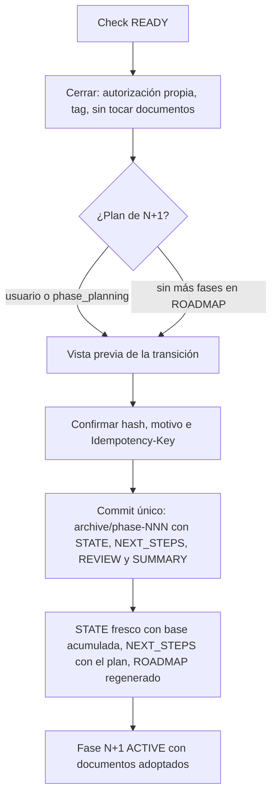
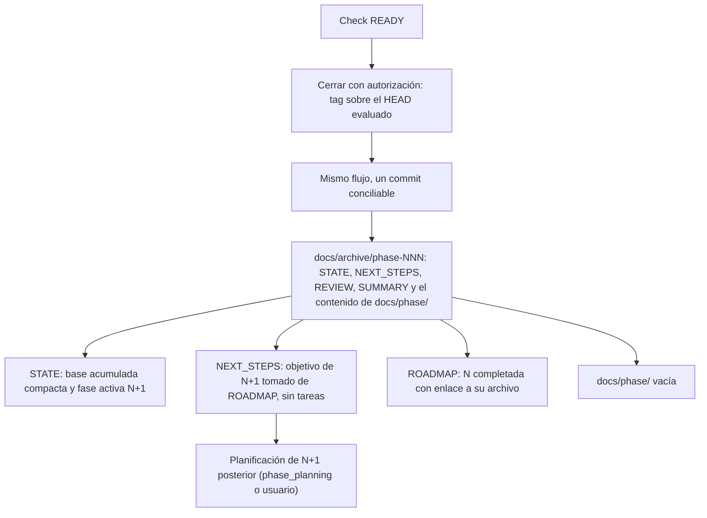

# Flujo — ciclo de vida de una fase

Estado vigente (D032, D034, H6.3) y cambio aprobado para P008 (D088).

## Estados de la fase (implementado)

Una enmienda crea una versión nueva de la definición e invalida READY y lotes. El lote desatendido encadena
tarea → commit → siguiente tarea, pero nunca comprueba ni cierra.

## Cierre y transición hoy (H6.3)

## Cierre previsto en P008 (D088, tarea P008-T004, sin implementar)

## Fuente en el código

- `core/engine/phases.py`, `storage/phases.py` (check, cierre, preguntas, enmiendas, abandono, lote).
- `core/engine/document_ops.py` (`preview_transition`), `storage/transition.py`, `core/engine/documents.py`
  (`render_review`, `render_summary`, `render_roadmap`).
- Plantillas `close-phase.md` y `reconcile-phase.md`.
