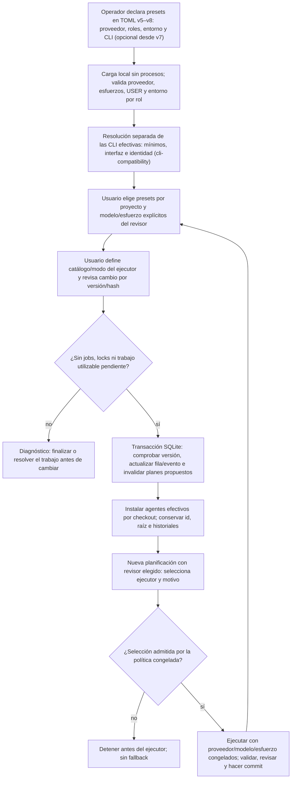

# Flujo — selección de agentes por proyecto

Implementado en P009-T003 ([D118](../DECISIONS.md#d118--p009-t003-presets-v5-y-selección-de-agentes-por-proyecto)),
según [D116](../archive/phase-009/P009-T001_CONTRATO_CREACION.md#4-presets-y-composición-por-proyecto-t003).
P011-T012 (D174) añade `local-config-7`, conservado en `local-config-8` (P012-T010): proveedor/modelo/esfuerzo y
entorno siguen explícitos, pero ejecutable y versión son opcionales. El servicio detecta las CLI efectivas antes de admitir trabajo; mínimos comunes
Codex 0.163.0 / Claude 2.1.304. [Detección, congelación, guardias y cuarentena](cli-compatibility.md).

Una fila sin `agent_selection` hereda `[agents.reviewer/executor]`, sin crear un override al leer o reiniciar.
V1–v6 conservan lectura y hashes de configuración; v1–v4 rechazan selección/presets nuevos. Los pins antiguos son
aserciones explícitas, no bypass de los mínimos actuales. Proyectos TOML siguen en consulta
en la UI. La creación de un hijo y el alta de un checkout existente admiten la misma selección opcional v5.

El navegador solo envía ids de presets y selección del revisor. Ejecutables, herramientas y entornos quedan
en el TOML privado. Elegir otro preset no preselecciona modelo/esfuerzo del revisor; se vacían ambos campos.
En `catalog`, modelos/esfuerzos del ejecutor son subconjuntos del preset. `open` exige permiso del preset:
el modelo es texto con forma admitida y el esfuerzo pertenece al subconjunto permitido por ese preset;
los modelos del catálogo son referencias. El revisor decide la selección concreta y el motivo por tarea/revisión.

Preview/confirmación reutilizan `/registry/preview` y `/registry/apply`: CAS y repetición de la misma preview
sin incrementar otra versión. El hash liga fila, selección, ambos presets completos y versiones. Ausencia o
incompatibilidad no hereda otro proveedor; al reiniciar, una fila inválida queda no disponible con diagnóstico.
Cambiar capacidades del TOML mantiene la cuarentena de jobs por composición antes de cualquier efecto.

La transacción se serializa con la admisión. Rechaza jobs QUEUED/ACTIVE/RECOVERY_REQUIRED, locks, aceptación
pendiente, commit con intención, propuestas de chat sin resolver y definición/importación con turnos todavía
utilizables u operaciones documentales incompletas (definición, incorporación B o importaciones antiguas conservadas
como datos). Las ya adoptadas no bloquean.
T004 añade la reserva de preparación a esa exclusión ([flujo](project-preparation.md)); una preparación
pendiente o incierta bloquea cambios de roles incluso después de liberar su lock.

Los planes de fase PROPOSED pasan a SUPERSEDED con actor/fecha y referencia a la versión nueva, en la misma
transacción. Su contenido/hash y los request/result de los turnos no se reescriben; requieren nuevo turno de
planificación antes de aceptar otro plan. Conversaciones sin turno no congelaron agentes. Chat sin propuestas
pendientes puede continuar con un turno nuevo y los agentes efectivos. La UI muestra bloqueos en lectura/preview.

Admisión de runs nuevos, reanudación y commit comprueban la versión activa del registro bajo el mismo lock SQLite.
V5 también liga id/hash de la fila, evitando admitir un contexto anterior cuando otro id adopta la misma raíz.
Si una petición antigua llega antes del cambio, su job impide cambiar; si llega después, se rechaza. Lectura e
idempotencia de operaciones previas conservadas. Adaptadores por job usan los agentes del checkout, sin mutar
la pareja global ni modificar otros proyectos.

[T005](../archive/phase-009/P009-T005_ENSAYO_DJANGO.md) recorre las cuatro parejas en el mismo hijo preparado, con cambios
confirmados entre commits y reinicios del servicio. Los procesos de agentes son falsos, pasan por los adaptadores
CLI reales y dejan proveedor/modelo/esfuerzo y motivo verificables; los historiales anteriores permanecen intactos.

## Ampliación diseñada en P013-T001

El [contrato P013](../phase/P013-T001_CONTRATO.md) y el [flujo de configuración](configuration-setup.md)
concretan el recorrido futuro sin composición previa, guardado/activación versionados, preparación y backup.
**Diseñado, no implementado:** este documento conserva el flujo vigente hasta las entregas T004–T011.
Commit documental previo al técnico; perfil/recibo confirmado antes de tareas en el carril nuevo; formatos,
jobs, snapshots y recibos existentes intactos. La aplicación guarda TOML privado fuera de checkouts;
ningún agente obtiene escritura general de configuración global. Consulta D040 no adquiere mutaciones.
