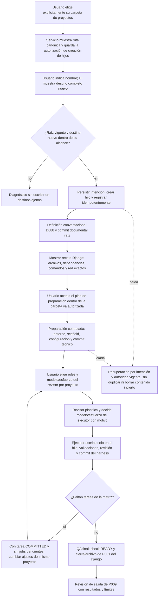

# Flujo previsto — carpeta de proyectos y Django desde cero (P009)

**Estado: diseñado, pendiente de implementación.** D115; [plan](../phase/P009_PLAN_DJANGO.md) y
[tareas](../NEXT_STEPS.md). El flujo vigente de definición documental continúa en
[project-definition](project-definition.md); este documento describe la ampliación de P009.

La raíz padre se elige desde una acción de UI; la IA no la descubre o deduce. Guardarla concede al servicio
crear nuevos hijos sin repetir el permiso de carpeta para cada proyecto; no concede escritura al ejecutor
en el padre/hermanos ni autorización general para red, instalación o proveedores. Las operaciones técnicas
se ejecutan dentro de su plan confirmado, con intención previa, idempotencia y recuperación.

La configuración de roles es por proyecto, desde presets del servicio: el usuario fija proveedor/modelo/esfuerzo
del revisor y proveedor/catálogo del ejecutor; el revisor fija modelo/esfuerzo concretos de este último.
Matriz en el mismo id/checkout: Codex→Codex, Codex→Claude, Claude→Claude y Claude→Codex, siempre revisor→ejecutor.
Las cuatro tareas terminan COMMITTED; no se modifican los snapshots previos al cambiar ajustes.

T001 definirá API, persistencia/migraciones y convivencia con el TOML. Al implementar T002–T004 se actualizarán
este flujo y los diagramas vigentes con lo realmente construido. Este diseño no añade tablas al diagrama actual.
