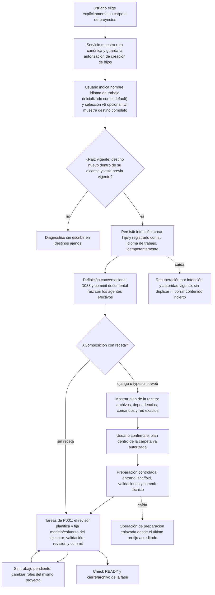
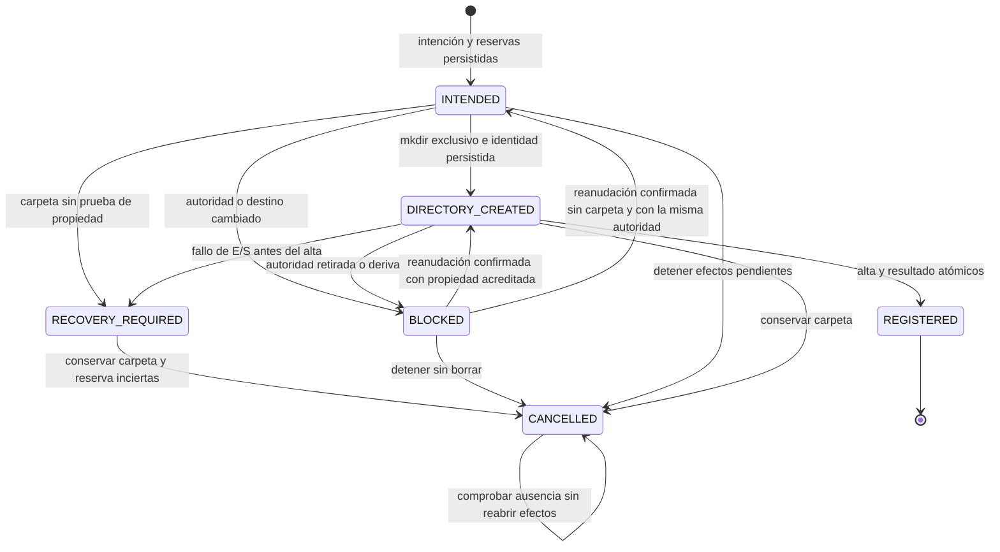

# Flujo — carpeta de proyectos y creación desde cero (P009, P010)

**Estado: selección/retirada de carpeta y creación/registro del hijo implementados en T002 (D117).**
Roles por proyecto implementados en T003 (D118); preparación Django implementada en T004 (D119) y TypeScript web
en P010-T002 (D143); idioma de trabajo al crear desde P011-T008 (D167).
T005 verifica el recorrido con CLI falsas y herramientas Django reales en un hijo temporal ([evidencia](../archive/phase-009/P009-T005_ENSAYO_DJANGO.md), D120). D115/D116;
[contrato/API/recuperación](../archive/phase-009/P009-T001_CONTRATO_CREACION.md), [plan](../archive/phase-009/P009_PLAN_DJANGO.md) y
[tareas archivadas](../archive/phase-009/NEXT_STEPS.md). El flujo vigente de definición documental continúa en
[project-definition](project-definition.md); el detalle técnico de preparación está en
[project-preparation](project-preparation.md). T007–T012 completan el piloto real con P001 del hijo cerrada
y archivada (D139); [matriz y límites](../archive/phase-009/P009-T012_CIERRE_PILOTO.md).

Detalle de cada etapa: [definición](project-definition.md), [preparación](project-preparation.md),
[agentes](project-agents.md), [idioma de trabajo](project-work-language.md), [tarea](task-run.md) y
[fase](phase-lifecycle.md). Una composición con receta bloquea tareas, checks y cierres hasta completar la
preparación con su recibo.

La raíz padre se elige desde una acción de UI; la IA no la descubre o deduce. Guardarla concede al servicio
crear nuevos hijos sin repetir el permiso de carpeta para cada proyecto; no concede escritura al ejecutor
en el padre/hermanos ni autorización general para red, instalación o proveedores. Las operaciones técnicas
se ejecutan dentro de su plan confirmado, con intención previa, idempotencia y recuperación.

La configuración de roles es por proyecto, desde presets del servicio: el usuario fija proveedor/modelo/esfuerzo
del revisor y proveedor/catálogo del ejecutor; el revisor fija modelo/esfuerzo concretos de este último. Cambiar
ajustes no modifica los snapshots previos.

Piloto histórico P009 (no es una etapa del producto): la matriz Codex→Codex, Codex→Claude, Claude→Claude y
Claude→Codex en el mismo id/checkout, con las cuatro tareas COMMITTED, QA final, cierre de P001 del hijo y revisión
de salida de P009, quedó acreditada en su [matriz y límites](../archive/phase-009/P009-T012_CIERRE_PILOTO.md).

La autoridad UI permite hijos directos nuevos, aunque el padre no figure en el TOML. Las raíces TOML mantienen
el alta de carpetas existentes con confianza exacta; elegir el padre no amplía ese alta ni confía en hermanos.
Al guardar/cambiar/retirar la selección aumenta su revisión. Antes de cada efecto corto, creación comprueba
esa revisión y la identidad del padre bajo exclusión compartida con la retirada. Los conflictos incluyen ancestros físicos y alias de mayúsculas, también en reservas aún sin carpeta.
Un hijo ya registrado sigue con su autoridad propia. Reelección de la misma ruta no reanuda operaciones automáticamente.

Una caída después de `mkdir` y antes de persistir la identidad exige recuperación explícita; el vacío no
demuestra propiedad. No se borran carpetas inciertas. Repetir clave/payload devuelve la operación original;
otra clave no puede reservar el mismo destino/id. Una respuesta perdida tras el alta devuelve el mismo proyecto,
incluso si después se retiró el padre. El estado `BLOCKED` no concede autoridad para continuar.

**Implementado en T003:** en v5, presets seleccionados y agentes efectivos se componen por checkout.
[Selección, bloqueos e invalidación de planes](project-agents.md). Cambiar ajustes exige no tener
trabajo pendiente utilizable bajo la selección anterior; se congelan versiones y los borradores anteriores
quedan obsoletos. Formatos previos y proyectos sin override conservan su pareja global, sin sustituciones.

**Implementado en T004:** la definición admite solo sus documentos actuales. Los enlaces tipados a herramientas de `.venv` permiten
confirmar ese commit sin instalar antes; tareas/checks de ese perfil siguen bloqueados hasta preparar.
La receta usa escritor y plan propios para archivos protegidos, con intención/pasos/lease/lock y procesos
registrados. Confirmar liga archivos/argv/HEAD/versiones/red/límites; fallos o cancelación detienen, sin repetir
instalación/red. El commit técnico se concilia antes de adoptar atómicamente el recibo y habilitar tareas.

T002 implementa `/project-creation-root` (GET, preview y apply) y `/project-creations`
(preview, confirm, lectura por id, resume/preview, resume/confirm y cancel). Confirmaciones con sesión, CSRF,
clave idempotente, versión y hash; el formulario conserva el sobre tras perder respuesta o recargar.
El arranque clasifica un destino presente sin identidad acreditada como RECOVERY_REQUIRED, sin tocarlo.
Los efectos son síncronos y cortos, serializados con la retirada mediante lock y transacciones SQLite.
Guardar otra selección o retirarla bloquea intenciones pendientes; la reanudación confirma la misma operación
y preserva su intención original. Cancelar solo libera reservas si se acredita ausencia; conserva bytes. Tras resolución externa, una nueva
comprobación versionada puede liberar una reserva de cancelación sin reabrir efectos.
Cuatro tablas nuevas y procedencia del registro en [DDBB-DIAGRAM](../DDBB-DIAGRAM.md);
detalles y verificación en [entrega T002](../archive/phase-009/P009-T002_CARPETA_PROYECTOS.md). D118 implementa roles con el JSON existente del registro. D116 sigue fijando
el contrato de receta implementado por D119; [flujo de preparación](project-preparation.md) y [entrega T004](../archive/phase-009/P009-T004_RECETA_DJANGO.md).

## Ampliación diseñada en P013-T001

El [contrato P013](../phase/P013-T001_CONTRATO.md) y el [flujo de configuración](configuration-setup.md)
concretan el recorrido futuro sin composición previa, guardado/activación versionados, preparación y backup.
**Diseñado, no implementado:** este documento conserva el flujo vigente hasta las entregas T004–T011.
Commit documental previo al técnico; perfil/recibo confirmado antes de tareas en el carril nuevo; formatos,
jobs, snapshots y recibos existentes intactos. La aplicación guarda TOML privado fuera de checkouts;
ningún agente obtiene escritura general de configuración global. Consulta D040 no adquiere mutaciones.
