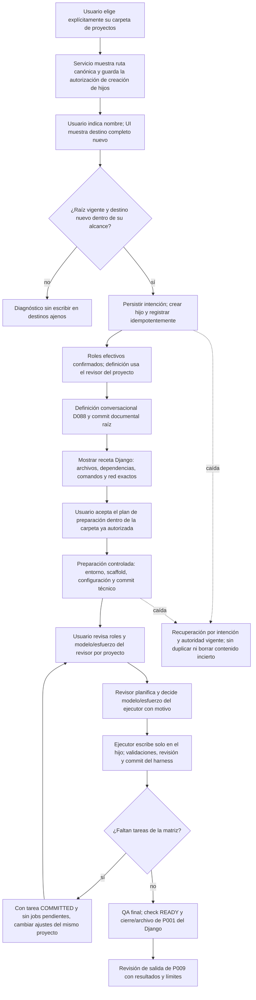
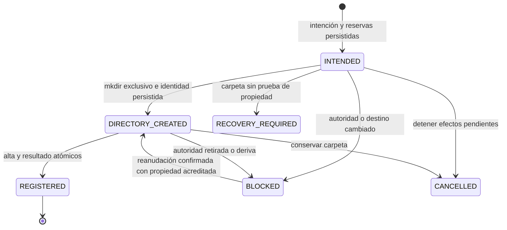

# Flujo previsto — carpeta de proyectos y Django desde cero (P009)

**Estado: diseño T001 completado, pendiente de implementación.** D115/D116;
[contrato/API/recuperación](../phase/P009-T001_CONTRATO_CREACION.md), [plan](../phase/P009_PLAN_DJANGO.md) y
[tareas](../NEXT_STEPS.md). El flujo vigente de definición documental continúa en
[project-definition](project-definition.md); este documento describe la ampliación de P009.

La raíz padre se elige desde una acción de UI; la IA no la descubre o deduce. Guardarla concede al servicio
crear nuevos hijos sin repetir el permiso de carpeta para cada proyecto; no concede escritura al ejecutor
en el padre/hermanos ni autorización general para red, instalación o proveedores. Las operaciones técnicas
se ejecutan dentro de su plan confirmado, con intención previa, idempotencia y recuperación.

La configuración de roles es por proyecto, desde presets del servicio: el usuario fija proveedor/modelo/esfuerzo
del revisor y proveedor/catálogo del ejecutor; el revisor fija modelo/esfuerzo concretos de este último.
Matriz en el mismo id/checkout: Codex→Codex, Codex→Claude, Claude→Claude y Claude→Codex, siempre revisor→ejecutor.
Las cuatro tareas terminan COMMITTED; no se modifican los snapshots previos al cambiar ajustes.

La autoridad UI permite hijos directos nuevos, aunque el padre no figure en el TOML. Las raíces TOML mantienen
el alta de carpetas existentes con confianza exacta; elegir el padre no amplía ese alta ni confía en hermanos.
Al guardar/cambiar/retirar la selección aumenta su revisión. Antes de cada efecto corto, creación comprueba
esa revisión y la identidad del padre bajo exclusión compartida con la retirada. Un hijo ya registrado sigue
con su autoridad propia. Reelección de la misma ruta no reanuda operaciones automáticamente.

Una caída después de `mkdir` y antes de persistir la identidad exige recuperación explícita; el vacío no
demuestra propiedad. No se borran carpetas inciertas. Repetir clave/payload devuelve la operación original;
otra clave no puede reservar el mismo destino/id. Una respuesta perdida tras el alta devuelve el mismo proyecto,
incluso si después se retiró el padre. El estado `BLOCKED` no concede autoridad para continuar.

En v5, presets seleccionados y agentes efectivos se componen por checkout. Cambiar ajustes exige no tener
trabajo pendiente utilizable bajo la selección anterior; se congelan versiones y los borradores anteriores
quedan obsoletos. Formatos previos y proyectos sin override conservan su pareja global, sin sustituciones.

La definición admite solo sus documentos actuales. Los enlaces tipados a herramientas de `.venv` permiten
confirmar ese commit sin instalar antes; tareas/checks de ese perfil siguen bloqueados hasta preparar.
La receta usa escritor y plan propios para archivos protegidos, con intención/pasos/lease/lock y procesos
registrados. Confirmar liga archivos/argv/HEAD/versiones/red/límites; fallos o cancelación detienen, sin repetir
instalación/red. El commit técnico se concilia antes de adoptar atómicamente el recibo y habilitar tareas.

D116 y el contrato fijan API, esquema propuesto, compatibilidad y matriz de pruebas. Al implementar T002–T004
se actualizarán este flujo y los diagramas vigentes con lo construido. No se añaden aquí tablas al diagrama actual.
