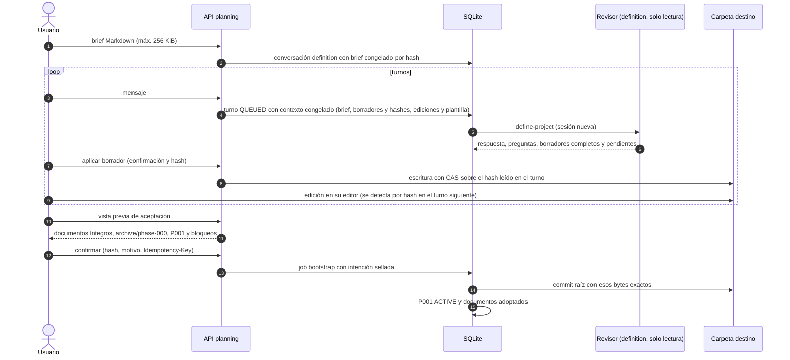

# Flujo — creación de un proyecto (definición conversacional)

Proyecto nuevo en una carpeta vacía con el contrato documental unificado (D072, D075, D082, D088). Es la única vía de
creación: la v1 (formulario H4.2, plantilla `project-foundation` y descubrimiento de un turno) se rechaza con
diagnóstico en el motor (D089); sus endpoints y Bootstrap.tsx se retiraron de API/UI en T006 (D093). El agente nunca
escribe: el harness aplica borradores confirmados con CAS y el commit raíz sigue el bootstrap D037.

P009 implementa la elección de carpeta padre y la preparación Django posterior al commit documental en el
[flujo de creación desde cero](project-creation.md) (D117/D119). T007–T012 acreditan el recorrido real con P001
del hijo cerrada y archivada (D139). El siguiente diagrama describe la etapa de definición documental.
El [contrato T001](../archive/phase-009/P009-T001_CONTRATO_CREACION.md#5-receta-posterior-al-bootstrap-t004) conserva estos
borradores y commit raíz: el scaffold/entorno se prepara después mediante una operación distinta, sin ampliar
`allowed_draft` ni aceptar marcadores ajenos en la carpeta de definición.

Bloquean la aceptación: documentos obligatorios ausentes, ROADMAP sin fases, P001 sin objetivo y criterios,
NEXT_STEPS sin una tarea P001-TNNN válida, DECISIONS con numeración repetida, preguntas bloqueantes abiertas sin
aplazar o archivos ajenos a la plantilla.

Marcadores gestionados (P010-T004, [D146](../DECISIONS.md#d146--p010-t004-marcadores-opcionales-en-la-definición)):
son opcionales en los borradores. La vista previa regenera los bloques de STATE, NEXT_STEPS, ROADMAP y DECISIONS donde
estén sus marcadores y añade al final del documento el bloque que falte; un marcador parcial o en otro documento
bloquea. En una carpeta nueva el contexto del turno no lista borradores y la plantilla `define-project` pide redactar
desde el brief, sin preguntar por contenido ni marcadores previos.

Borradores admitidos (T002/T005, D092): la plantilla de D088 (AGENTS, CLAUDE, GEMINI, README, SPECIFICATION, ARCHITECTURE,
ROADMAP, STATE, NEXT_STEPS, DECISIONS y DDBB-DIAGRAM) y `docs/flows/*.md`. AGENTS, CLAUDE, GEMINI y DDBB-DIAGRAM no
redactados salen de la plantilla, con el título de la conversación y los comandos del perfil congelado. Esos valores
por defecto se muestran al revisor en el contexto del turno; no sustituyen los borradores existentes. Los once
documentos son obligatorios en el resultado aceptado. La vista previa bloquea AGENTS de más de 60 líneas y
CLAUDE/GEMINI de más de 15. Los borradores de flujos admiten un solo nivel; ni los artefactos de `docs/phase/` ni
archivos individuales de decisiones son borradores de definición.

## Repositorios existentes (P008-T009–T015)

Un repositorio sin harness entra por [incorporación B](project-onboarding.md), con vista previa y confirmación
propias antes del commit. El harness anterior y la normalización A están retirados (D161); no se redirigen a B.
Registrar o reabrir un proyecto ya gestionado conserva su autoridad y no repite el alta.

## Fuente en el código

- `core/engine/definition.py`, `storage/planning.py`, `adapters/bootstrap.py`, `storage/bootstrap.py`.
- Plantillas `define-project.md` y `plan-phase.md`; `core/engine/documents.py` (`skeleton`).

## Ampliación diseñada en P013-T001

El [contrato P013](../phase/P013-T001_CONTRATO.md) y el [flujo de configuración](configuration-setup.md)
concretan el recorrido futuro sin composición previa, guardado/activación versionados, preparación y backup.
**T007 entrega el contexto de alta sin stack y la propuesta de perfil separada**, con validación por fuentes,
CAS y adopción de borrador sin TOML ni activación ([D224](../DECISIONS.md#d224--p013-t007-contexto-documental-sin-stack-y-propuesta-de-perfil)).
Los diagramas anteriores conservan la ruta 1–8. El carril v9 sobre raíz existente usa el
[flujo entregado](configuration-setup.md#alta-y-activación-entregadas-en-t009): T008 prepara y T009 une
creación sin perfil, commit documental raíz/B, TOML privado y activación confirmada.
[Entrega T009](../phase/P013-T009_ALTA_UI.md), D226; recorridos sintéticos en ambas entradas.
Commit documental previo al técnico; perfil/recibo confirmado antes de tareas en el carril nuevo; formatos,
jobs, snapshots y recibos existentes intactos. La aplicación guarda TOML privado fuera de checkouts;
ningún agente obtiene escritura general de configuración global. Consulta D040 no adquiere mutaciones.
