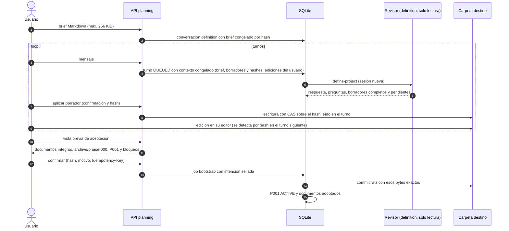

# Flujo — creación de un proyecto (definición conversacional)

Proyecto nuevo en una carpeta vacía con el contrato documental v2 (D072, D075, D082). El agente nunca escribe: el
harness aplica borradores confirmados con CAS y el commit raíz sigue el bootstrap D037.

Bloquean la aceptación: documentos obligatorios ausentes, ROADMAP sin fases, P001 sin objetivo y criterios,
NEXT_STEPS sin una tarea P001-TNNN válida, preguntas bloqueantes abiertas sin aplazar o archivos ajenos a la plantilla.

## Cambios previstos en P008 (D088, sin implementar)

- La plantilla incorpora `AGENTS.md`, `CLAUDE.md`, `GEMINI.md`, `docs/DDBB-DIAGRAM.md` (o «Sin persistencia»),
  `docs/flows/*.md` y `docs/phase/`; desaparecen `decisions/`, `architecture/` y `research/` (T002, T005).
- La creación v1 (formulario D037/H4.2) se retira; solo queda esta conversación (T002, T006).
- Un repositorio con contenido entra por los flujos de importación A o B (T009–T015).

## Fuente en el código

- `core/engine/definition.py`, `storage/planning.py`, `adapters/bootstrap.py`, `storage/bootstrap.py`.
- Plantillas `define-project.md` y `plan-phase.md`; `core/engine/documents.py` (`skeleton`).
