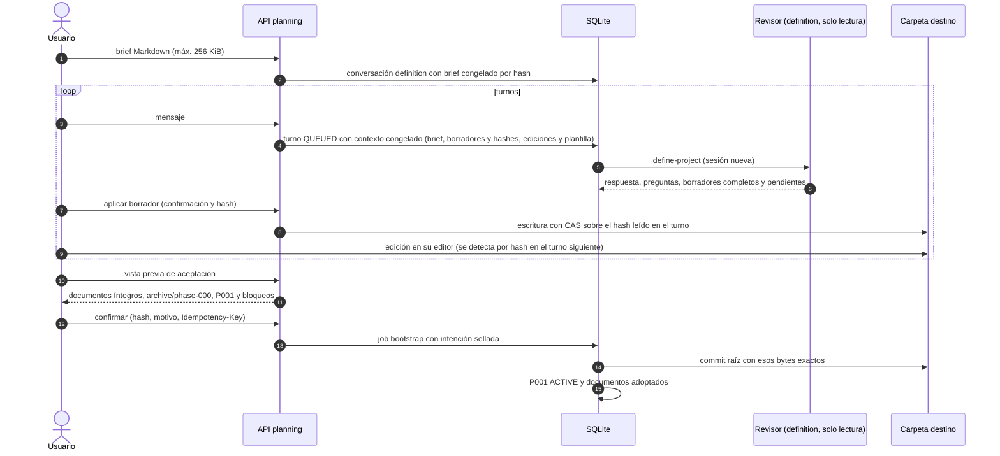

# Flujo — creación de un proyecto (definición conversacional)

Proyecto nuevo en una carpeta vacía con el contrato documental unificado (D072, D075, D082, D088). Es la única vía de
creación: la v1 (formulario H4.2, plantilla `project-foundation` y descubrimiento de un turno) se rechaza con
diagnóstico en el motor (D089); sus endpoints y Bootstrap.tsx se retiraron de API/UI en T006 (D093). El agente nunca
escribe: el harness aplica borradores confirmados con CAS y el commit raíz sigue el bootstrap D037.

Bloquean la aceptación: documentos obligatorios ausentes, ROADMAP sin fases, P001 sin objetivo y criterios,
NEXT_STEPS sin una tarea P001-TNNN válida, DECISIONS con numeración repetida, preguntas bloqueantes abiertas sin
aplazar o archivos ajenos a la plantilla.

Borradores admitidos (T002/T005, D092): la plantilla de D088 (AGENTS, CLAUDE, GEMINI, README, SPECIFICATION, ARCHITECTURE,
ROADMAP, STATE, NEXT_STEPS, DECISIONS y DDBB-DIAGRAM) y `docs/flows/*.md`. AGENTS, CLAUDE, GEMINI y DDBB-DIAGRAM no
redactados salen de la plantilla, con el título de la conversación y los comandos del perfil congelado. Esos valores
por defecto se muestran al revisor en el contexto del turno; no sustituyen los borradores existentes. Los once
documentos son obligatorios en el resultado aceptado. La vista previa bloquea AGENTS de más de 60 líneas y
CLAUDE/GEMINI de más de 15. Los borradores de flujos admiten un solo nivel; ni los artefactos de `docs/phase/` ni
archivos individuales de decisiones son borradores de definición.

## Cambios previstos en P008 (D088, sin implementar)

- Un repositorio con contenido entra por los flujos de importación A o B (T009–T015).

## Fuente en el código

- `core/engine/definition.py`, `storage/planning.py`, `adapters/bootstrap.py`, `storage/bootstrap.py`.
- Plantillas `define-project.md` y `plan-phase.md`; `core/engine/documents.py` (`skeleton`).
