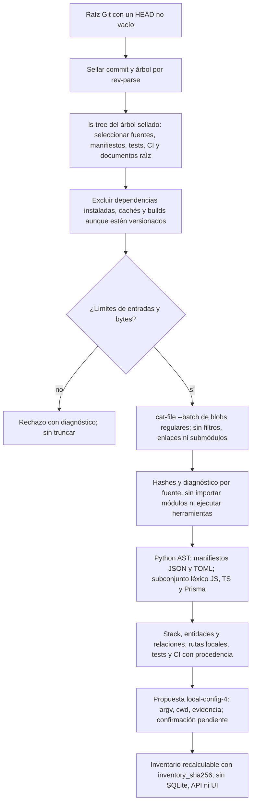
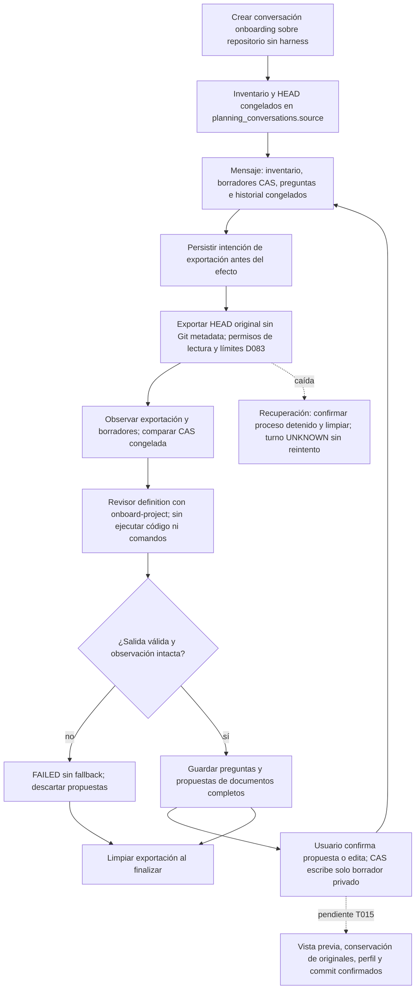

# Flujo — incorporación de un repositorio sin harness

El Flujo B de D088 describe el código existente antes de proponer su documentación y ponerlo bajo control del
harness. **Implementado en P008-T013 (D101): inventario estático y propuesta de perfil.** La conversación con el
revisor sobre HEAD está implementada en T014 (D102); la confirmación del perfil y el commit documental (T015)
siguen pendientes.

La lectura usa el árbol del commit sellado, incluso con cambios locales: no inspecciona el worktree, el índice ni
archivos sin seguimiento. No usa `status`, que podría invocar filtros `clean`. La futura confirmación de T015
deberá comprobar su base y el checkout antes de cualquier escritura. Releer el mismo árbol produce el mismo
inventario; la huella no contiene raíz ni fecha/id del commit.

Cada fuente seleccionada lleva modo Git, tamaño, SHA-256 y estado. Enlaces y submódulos no se siguen; un archivo
excesivo, binario, no UTF-8 o de sintaxis no analizable deja un diagnóstico explícito. El árbol completo sigue
identificando la base, incluidos archivos fuera del ámbito. Límites: 50.000 entradas del árbol, 1 MiB por fuente
y 32 MiB de fuentes leídas; exceder el total o las entradas rechaza la operación.

El análisis observa declaraciones de modelos Django/SQLAlchemy, entidades TypeORM, modelos Prisma, rutas Django,
decoradores FastAPI y llamadas de routers Express reconocidos. No ejecuta expresiones ni resuelve imports,
herencia entre módulos, includes, montajes o prefijos importados. Los hallazgos citan ruta y línea, las rutas
dinámicas llevan `dynamic`, y los destinos de relación desconocidos quedan a `null`. El revisor de T014 deberá
completar y contrastar esta evidencia con la instantánea de código; el inventario no acredita el esquema runtime.

La propuesta contiene solo comandos basados en herramientas/configuración observadas, scripts declarados en
`package.json`, `manage.py` junto a evidencia Django o `go.mod`. Cada comando conserva `cwd` y sus fuentes.
Preparación vacía; no instala ni ejecuta nada, no añade JUnit no observado ni escribe el TOML. Si no encuentra
validaciones, `ready=false`: el usuario deberá definirlas. Siempre exige confirmar o editar comandos, timeouts,
rutas y scripts, y aportar ejecutables, entorno y composición; ningún perfil queda activo en T013.

## Fuente en el código

- `adapters/project_onboarding.py`: `read_inventory(root)` con Git de solo lectura.
- `core/project_onboarding.py`: `build_inventory(entries, head, tree)` puro y propuesta de perfil.
- `tests/product/test_project_onboarding.py`: fuentes y checkouts sintéticos, sin frameworks instalados ni código
  del proyecto ejecutado.

## Conversación de ingeniería inversa (P008-T014, D102)

La API admite `kind = "onboarding"` en las rutas de planificación existentes, sin brief ni fase. Congela el
inventario completo de T013 en la conversación y usa su HEAD en todos los turnos, aunque cambie el checkout vivo.
T015 deberá rechazar una base obsoleta antes de escribir. STATE/NEXT_STEPS o `.harness/` versionados remiten al
Flujo A; fases, creación o importación confirmada en esta instalación también impiden conversar/incorporar de nuevo.

La exportación completa usa los límites de D083, más estrictos que los del inventario: 20.000 archivos, 16 MiB
por archivo y 128 MiB en total, sin enlaces ni submódulos. Git exige `--no-lazy-fetch`; no hay filtros, ejecución de
fuentes ni comandos del perfil. El contexto conjunto del inventario y los borradores se limita a 2 MiB sin truncar.
La exportación conserva el carril y lock de planificación, con permisos cooperativos de lectura, no aislamiento OS.

La plantilla pide los once documentos D088, flujos de módulos observados, entidades/relaciones contrastadas con el
código real y DECISIONS con estado «inferida del código». No usa el diagrama «Sin persistencia» ni comandos de
plantilla como fallback. Pregunta las incógnitas, incluido el trabajo futuro de P001; las preguntas bloqueantes y
sus aplazamientos explícitos quedan guardados para la futura confirmación. Una propuesta del revisor no prueba
que su contenido sea correcto: la generación semántica depende de su revisión y confirmación humanas.

Los borradores se guardan en `onboarding-drafts/<id>/` junto a SQLite. Los cambios antes de invocar impiden llamar;
los cambios de la exportación o del área durante el turno descartan la respuesta. El README original y el resto
del checkout permanecen intactos al aplicar una propuesta confirmada: solo cambia el borrador privado. La plantilla
pide consentimiento para proponer sustituir README; T015 deberá conservar el original y confirmar la sustitución.
Sin UI específica ni operación de commit en T014. El perfil propuesto sigue sin activar ni escribir el TOML.

Fuente: `storage/onboarding.py`, `storage/planning.py`, `core/engine/templates/onboard-project.md` y
`tests/product/test_onboarding_conversation.py`. La exportación y limpieza reutilizan `adapters/chat_snapshot.py`.
