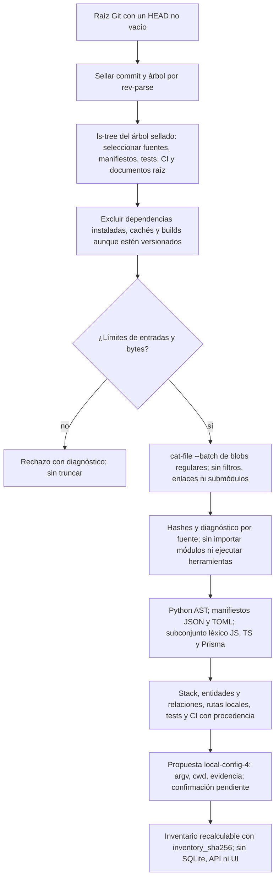
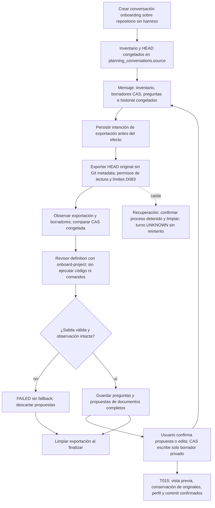
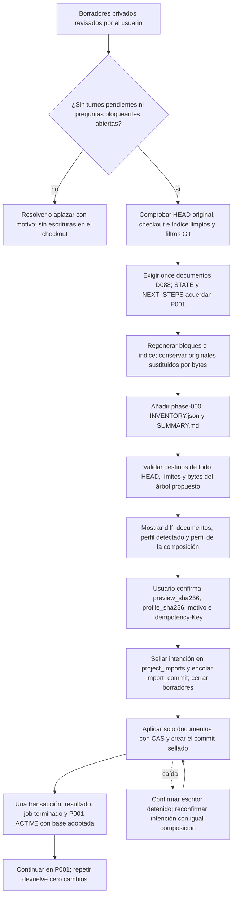

# Flujo — incorporación de un repositorio sin harness

El Flujo B de D088 describe el código existente antes de proponer su documentación y ponerlo bajo control del
harness. **Implementado en P008-T013 (D101): inventario estático y propuesta de perfil.** La conversación con el
revisor sobre HEAD está implementada en T014 (D102), y la vista previa, confirmación del perfil y commit
documental con P001 adoptada en T015 (D103).

La lectura usa el árbol del commit sellado, incluso con cambios locales: no inspecciona el worktree, el índice ni
archivos sin seguimiento. No usa `status`, que podría invocar filtros `clean`. La confirmación de T015
comprueba su base y el checkout antes de cualquier escritura. Releer el mismo árbol produce el mismo
inventario; la huella no contiene raíz ni fecha/id del commit.

Cada fuente seleccionada lleva modo Git, tamaño, SHA-256 y estado. Enlaces y submódulos no se siguen; un archivo
excesivo, binario, no UTF-8 o de sintaxis no analizable deja un diagnóstico explícito. El árbol completo sigue
identificando la base, incluidos archivos fuera del ámbito. Límites: 50.000 entradas del árbol, 1 MiB por fuente
y 32 MiB de fuentes leídas; exceder el total o las entradas rechaza la operación.

El análisis observa declaraciones de modelos Django/SQLAlchemy, entidades TypeORM, modelos Prisma, rutas Django,
decoradores FastAPI y llamadas de routers Express reconocidos. No ejecuta expresiones ni resuelve imports,
herencia entre módulos, includes, montajes o prefijos importados. Los hallazgos citan ruta y línea, las rutas
dinámicas llevan `dynamic`, y los destinos de relación desconocidos quedan a `null`. El revisor de T014 deberá
completar y contrastar esta evidencia con la instantánea de código; el inventario no acredita el esquema runtime.

La propuesta contiene solo comandos basados en herramientas/configuración observadas, scripts declarados en
`package.json`, `manage.py` junto a evidencia Django o `go.mod`. Cada comando conserva `cwd` y sus fuentes.
Preparación vacía; no instala ni ejecuta nada, no añade JUnit no observado ni escribe el TOML. Si no encuentra
validaciones, `ready=false`: el usuario deberá definirlas. Siempre exige confirmar o editar comandos, timeouts,
rutas y scripts, y aportar ejecutables, entorno y composición; ningún perfil queda activo en T013.

## Fuente en el código

- `adapters/project_onboarding.py`: `read_inventory(root)` con Git de solo lectura.
- `core/project_onboarding.py`: `build_inventory(entries, head, tree)` puro y propuesta de perfil.
- `tests/product/test_project_onboarding.py`: fuentes y checkouts sintéticos, sin frameworks instalados ni código
  del proyecto ejecutado.

## Conversación de ingeniería inversa (P008-T014, D102)

La API admite `kind = "onboarding"` en las rutas de planificación existentes, sin brief ni fase. Congela el
inventario completo de T013 en la conversación y usa su HEAD en todos los turnos, aunque cambie el checkout vivo.
T015 rechaza una base obsoleta antes de escribir. STATE/NEXT_STEPS o `.harness/` versionados remiten al
Flujo A; fases, creación o importación confirmada en esta instalación también impiden conversar/incorporar de nuevo.

La exportación completa usa los límites de D083, más estrictos que los del inventario: 20.000 archivos, 16 MiB
por archivo y 128 MiB en total, sin enlaces ni submódulos. Git exige `--no-lazy-fetch`; no hay filtros, ejecución de
fuentes ni comandos del perfil. El contexto conjunto del inventario y los borradores se limita a 2 MiB sin truncar.
La exportación conserva el carril y lock de planificación, con permisos cooperativos de lectura, no aislamiento OS.

La plantilla pide los once documentos D088, flujos de módulos observados, entidades/relaciones contrastadas con el
código real y DECISIONS con estado «inferida del código». No usa el diagrama «Sin persistencia» ni comandos de
plantilla como fallback. Pregunta las incógnitas, incluido el trabajo futuro de P001; las preguntas bloqueantes y
sus aplazamientos explícitos quedan guardados para la futura confirmación. Una propuesta del revisor no prueba
que su contenido sea correcto: la generación semántica depende de su revisión y confirmación humanas.

Los borradores se guardan en `onboarding-drafts/<id>/` junto a SQLite. Los cambios antes de invocar impiden llamar;
los cambios de la exportación o del área durante el turno descartan la respuesta. El README original y el resto
del checkout permanecen intactos al aplicar una propuesta confirmada: solo cambia el borrador privado. La plantilla
pide consentimiento para proponer sustituir README; T015 conserva el original y confirma la sustitución.
La UI específica y el commit los añade T015. El perfil detectado sigue siendo una propuesta; la composición
del operador se confirma por separado dentro de la vista previa. No se escribe el TOML.

Fuente: `storage/onboarding.py`, `storage/planning.py`, `core/engine/templates/onboard-project.md` y
`tests/product/test_onboarding_conversation.py`. La exportación y limpieza reutilizan `adapters/chat_snapshot.py`.

## Vista previa, confirmación y continuidad (P008-T015, D103)

`POST …/planning/{c}/onboarding/preview` exige borradores válidos, AGENTS ≤60 líneas, CLAUDE/GEMINI ≤15 y una
P001 con objetivo y criterios en ROADMAP. No rellena documentación ni comandos por plantilla. Un turno pendiente
o una pregunta bloqueante sin responder ni aplazar impiden confirmar. Una fase distinta, destinos ocupados,
colisiones de mayúsculas o archivo/directorio y límites excedidos bloquean antes del efecto.

La vista previa muestra los documentos y bytes exactos, diff, HEAD y árbol propuesto, originales conservados y
perfil completo de la composición (validaciones, preparación, JUnit y rutas). El perfil detectado del inventario
se muestra como propuesta: el operador debe declararlo o editarlo en su TOML y seleccionar la composición en
Ajustes. `POST …/onboarding/confirm` exige `preview_sha256`, `profile_sha256`, motivo, confirmación explícita e
Idempotency-Key. No admite comandos o ejecutables arbitrarios del cliente ni escribe el TOML; no ejecuta
preparación, validadores ni código del proyecto.

Se conserva el inventario congelado en `docs/archive/phase-000/INVENTORY.json` y el resumen, conversación,
preguntas, aplazamientos, pendientes y perfil en `SUMMARY.md`. Cada original sustituido se conserva en
`onboarding-originals/<ruta original>`. README sin reemplazo sigue en su sitio. No se sobrescribe ni renumera
ningún archivo previo. El código del HEAD original conserva rutas, bytes y modos en el commit resultante.

La operación usa `project_imports` y `purpose = import_commit` de D100, con `preview.flow = onboarding`; no añade
esquema. La intención contiene bytes, autor, fecha, árbol y commit antes de escribir. La CAS admite los bytes
originales o los sellados; una caída requiere confirmar detenido el escritor y reconfirmar la intención con el
mismo contexto/versiones/autor para conciliar el mismo run y commit. No crea fase hasta registrar el resultado;
la adopción de P001 ACTIVE, su base documental y el fin del job son atómicos. La confirmación cierra los
borradores de todas las conversaciones del checkout; una intención incierta bloquea nuevo trabajo.

El escritor Git compartido no ejecuta filtros clean/process durante el Flujo B: se rechazan configuraciones de
esos filtros (incluidos includes) antes de capturar y antes de ejecutar el commit. Se contrastan los blobs sellados
con los bytes de la vista previa; cualquier conversión interna que los cambie también bloquea. Desde T016 (D105),
estas guardias son comunes a A/B: comprueban todo el árbol documental resultante, los destinos nuevos ignorados
y la igualdad del árbol en el sellado final; se repiten al ejecutar/reanudar sin alterar la intención. Se mantienen los
límites de D083, 512 KiB por documento y 4 MiB de diff, sin truncar, y la exclusión cooperativa de D100.

`GET …/projects/{p}/onboarding` permite recuperar la operación y la UI `/projects/:p/onboarding[/:c/*borrador]`
reutiliza conversación, editor CAS y confirmación del Flujo A, con perfil y continuidad en P001. Una tarea de P001
se encola por una acción posterior con la composición confirmada. `document_layout = "d088-9"` (T016) pone en cuarentena
jobs anteriores antes de efectos; no se reescriben snapshots, intenciones ni historiales existentes.

Fuente: `core/engine/onboarding_commit.py`, `storage/onboarding_commit.py`, infraestructura compartida de
`import_commit.py` / `storage/project_import.py` y `tests/product/test_onboarding_commit.py`.
