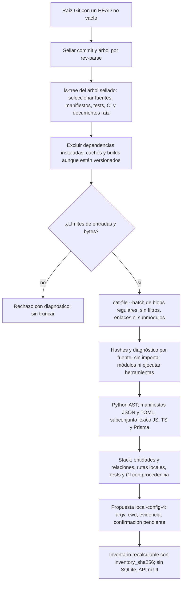

# Flujo — incorporación de un repositorio sin harness

El Flujo B de D088 describe el código existente antes de proponer su documentación y ponerlo bajo control del
harness. **Implementado en P008-T013 (D101): inventario estático y propuesta de perfil.** La conversación con el
revisor (T014), la confirmación del perfil y el commit documental (T015) siguen pendientes.

La lectura usa el árbol del commit sellado, incluso con cambios locales: no inspecciona el worktree, el índice ni
archivos sin seguimiento. No usa `status`, que podría invocar filtros `clean`. La futura confirmación de T015
deberá comprobar su base y el checkout antes de cualquier escritura. Releer el mismo árbol produce el mismo
inventario; la huella no contiene raíz ni fecha/id del commit.

Cada fuente seleccionada lleva modo Git, tamaño, SHA-256 y estado. Enlaces y submódulos no se siguen; un archivo
excesivo, binario, no UTF-8 o de sintaxis no analizable deja un diagnóstico explícito. El árbol completo sigue
identificando la base, incluidos archivos fuera del ámbito. Límites: 50.000 entradas del árbol, 1 MiB por fuente
y 32 MiB de fuentes leídas; exceder el total o las entradas rechaza la operación.

El análisis observa declaraciones de modelos Django/SQLAlchemy, entidades TypeORM, modelos Prisma, rutas Django,
decoradores FastAPI y llamadas de routers Express reconocidos. No ejecuta expresiones ni resuelve imports,
herencia entre módulos, includes, montajes o prefijos importados. Los hallazgos citan ruta y línea, las rutas
dinámicas llevan `dynamic`, y los destinos de relación desconocidos quedan a `null`. El revisor de T014 deberá
completar y contrastar esta evidencia con la instantánea de código; el inventario no acredita el esquema runtime.

La propuesta contiene solo comandos basados en herramientas/configuración observadas, scripts declarados en
`package.json`, `manage.py` junto a evidencia Django o `go.mod`. Cada comando conserva `cwd` y sus fuentes.
Preparación vacía; no instala ni ejecuta nada, no añade JUnit no observado ni escribe el TOML. Si no encuentra
validaciones, `ready=false`: el usuario deberá definirlas. Siempre exige confirmar o editar comandos, timeouts,
rutas y scripts, y aportar ejecutables, entorno y composición; ningún perfil queda activo en T013.

## Fuente en el código

- `adapters/project_onboarding.py`: `read_inventory(root)` con Git de solo lectura.
- `core/project_onboarding.py`: `build_inventory(entries, head, tree)` puro y propuesta de perfil.
- `tests/product/test_project_onboarding.py`: fuentes y checkouts sintéticos, sin frameworks instalados ni código
  del proyecto ejecutado.
