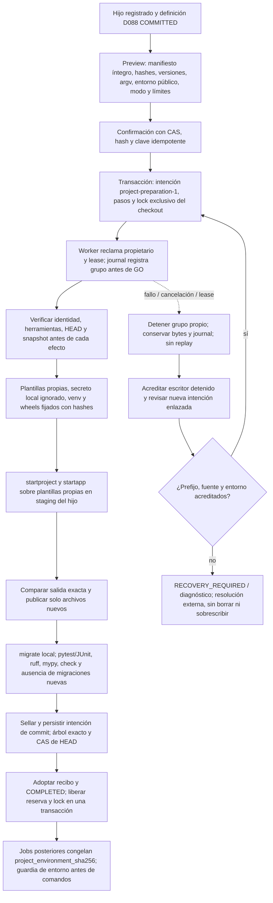

# Flujo — preparación Django confirmada (P009-T004)

Implementado en D119; [contrato previo](../phase/P009-T001_CONTRATO_CREACION.md#5-receta-posterior-al-bootstrap-t004),
[entrega y límites](../phase/P009-T004_RECETA_DJANGO.md). Solo hijos nuevos registrados por el servicio, composición
v5 con `recipe = "django"`, perfil empaquetado y commit documental raíz aceptado. No ejecuta agentes.

El padre ya autorizado no se vuelve a confirmar: esta confirmación cubre efectos técnicos nuevos dentro del
hijo. La preview no instala, resuelve paquetes ni invoca procesos Django/uv. Solo consulta Git local controlado
sin filtros/submódulos/lazy-fetch. Exige HEAD raíz documental y ausencia de destinos, incluso ignorados.
Las plantillas Python se materializan dentro de `.harness-preparation/`; generación no usa los templates de
Django que introducen secretos o contenido dependiente de su versión. Configuración protegida se escribe por
este servicio confirmado; el ejecutor ordinario conserva sus restricciones.

El instalador usa wheels con hashes, `--no-deps`, sin builds, configuración descubierta, descargas de Python
ni retry HTTP. Modo offline no cambia a red al fallar: usa wheelhouse explícito del operador, si existe, o
caché privada del hijo. Un hijo sin wheels/caché falla con captura. Modo network requiere techo del operador y
confirmación de ese plan. HOME, TMPDIR y caché son locales al hijo; no se modifica el entorno global.

Estados de operación: QUEUED → ACTIVE → COMPLETED; FAILED/CANCELLED para detenciones acreditadas;
RECOVERY_REQUIRED para lease/propietario inciertos. Pasos PENDING → STARTED → DONE con snapshot después del
resultado. Los procesos usan `preparation-commands-1` y FK preparation_id, nunca eventos o runs ficticios.
GET muestra journal/capturas; cancel y confirm-stopped son CAS/idempotentes. Cancelar usa el handle propio del
proceso, espera la muerte del grupo y solo entonces libera el lock. Nunca se señala un PID persistido.

Una caída no autoriza repetir instalación o red. Nueva preview/confirm con previous_id/retry_step crea otra
operación; el prefijo DONE se copia con evidencia, conservando los pasos previos. Si el entorno difiere del
último prefijo acreditado, hay archivos ajenos, escritura inicial parcial o venv incierto, se bloquea. No hay
limpieza/reinstalación automática. Si solo falta adoptar el commit ya sellado, la operación nueva conserva
sus bytes/fecha/identidad originales y concilia el mismo hash sin repetir comandos. Una caída tras el checkpoint
del último paso también puede conciliar ese commit.

La reserva incierta bloquea nuevas tareas, cambios de roles y baja incluso cuando el proceso ya no está vivo.
La admisión de jobs y la confirmación comparten la transacción SQLite; no hay un segundo lock por raíz. Tras
COMPLETED, el recibo fija intérprete/ejecutables, todas las distribuciones, hashes del entorno, lock, secreto
local por hash y archivos protegidos. Cambiar los roles conserva ese recibo si la receta no deriva. Se valida
antes de tareas/checks y de cada comando nativo; no se reescriben snapshots documentales anteriores.

[T005](../phase/P009-T005_ENSAYO_DJANGO.md) contrasta este flujo con Python 3.13.13/uv 0.12.19 y los wheels
fijados, instalados offline en un hijo temporal. Una caída simulada tras el commit técnico y antes de adoptar
el recibo conserva la intención original: reiniciar no ejecuta herramientas, y una nueva confirmación enlazada
concilia el mismo hash sin crear procesos nuevos. Después se completan cuatro tareas con CLI falsas y cambios
de roles, check y cierre de fase. No acredita proveedores reales ni el piloto operativo.

Backup incluye journal/capturas inline, locks/procesos de ambos propietarios y las raíces nuevas; restaurar
sigue en consulta sin cargar configuración ni dar autoridad ejecutable. Retención mantiene la evidencia de
preparación y rechaza escritores/grupos vivos o inciertos de ambos tipos.
