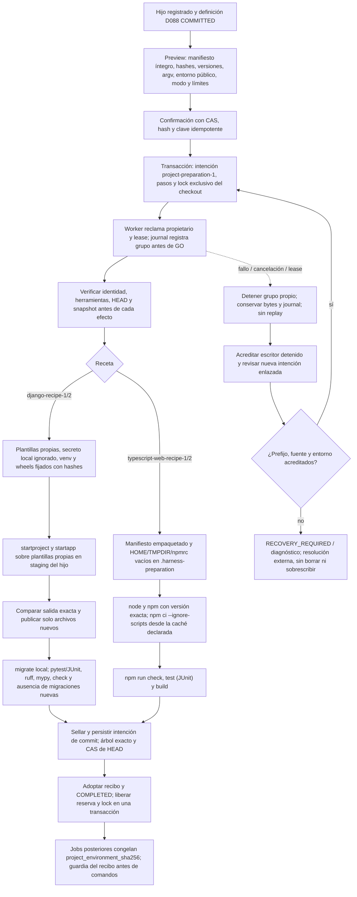
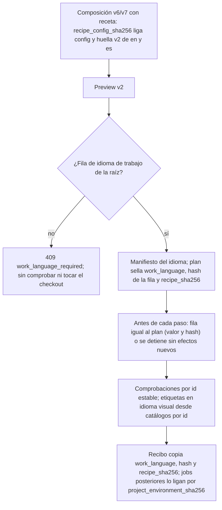

# Flujo — preparación confirmada por receta (P009-T004, P010-T002, P011-T020)

Implementado en D119 para Django y en D143 para TypeScript web;
[contrato Django](../archive/phase-009/P009-T001_CONTRATO_CREACION.md#5-receta-posterior-al-bootstrap-t004),
[entrega Django y límites](../archive/phase-009/P009-T004_RECETA_DJANGO.md),
[contrato TypeScript](../archive/phase-010/P010-T001_CONTRATO_CONSOLIDACION.md#1-arranque-de-un-proyecto-typescript-web-nuevo-t002)
y [entrega TypeScript](../archive/phase-010/P010-T002_ARRANQUE_TYPESCRIPT.md). Solo hijos nuevos registrados por el servicio,
composición v5 con `recipe = "django"` (perfil empaquetado) o `recipe = "typescript-web"` (perfil integrado sin
cambios) y commit documental raíz aceptado; desde P011-T020 (D168) las mismas claves en v6/v7 eligen las recetas v2
con el idioma de trabajo del hijo ([sección](#recetas-v2-por-idioma-de-trabajo-p011-t020-d168)). No ejecuta agentes. Ambas recetas comparten contrato
`project-preparation-1`, binding `preparation-commands-1`, tablas, locks, journal, commit técnico y recuperación;
cada una aporta su manifiesto, pasos, reglas de fuente y recibo.

El carril genérico de perfil propio entregado en P013-T008 usa `project-profile-preparation-1` y ejecutor
acotado; se documenta en [configuración guiada](configuration-setup.md#preparación-genérica-entregada-en-t008).
Este flujo de recetas conserva sus planes, pasos, recibos y ausencia de invocaciones de agentes.

## Núcleo común y receta Django (D119)

El padre ya autorizado no se vuelve a confirmar: esta confirmación cubre efectos técnicos nuevos dentro del
hijo. La preview no instala, resuelve paquetes ni invoca procesos Django/uv. Solo consulta Git local controlado
sin filtros/submódulos/lazy-fetch. Exige HEAD raíz documental y ausencia de destinos, incluso ignorados.
Las plantillas Python se materializan dentro de `.harness-preparation/`; generación no usa los templates de
Django que introducen secretos o contenido dependiente de su versión. Configuración protegida se escribe por
este servicio confirmado; el ejecutor ordinario conserva sus restricciones.

El instalador usa wheels con hashes, `--no-deps`, sin builds, configuración descubierta, descargas de Python
ni retry HTTP. Modo offline no cambia a red al fallar: usa wheelhouse explícito del operador, si existe, o
caché privada del hijo. Un hijo sin wheels/caché falla con captura. Modo network requiere techo del operador y
confirmación de ese plan. HOME, TMPDIR y caché son locales al hijo; no se modifica el entorno global.

Estados de operación: QUEUED → ACTIVE → COMPLETED; FAILED/CANCELLED para detenciones acreditadas;
RECOVERY_REQUIRED para lease/propietario inciertos. Pasos PENDING → STARTED → DONE con snapshot después del
resultado. Los procesos usan `preparation-commands-1` y FK preparation_id, nunca eventos o runs ficticios.
GET muestra journal/capturas; cancel y confirm-stopped son CAS/idempotentes. Cancelar usa el handle propio del
proceso, espera la muerte del grupo y solo entonces libera el lock. Nunca se señala un PID persistido.

Una caída no autoriza repetir instalación o red. Nueva preview/confirm con previous_id/retry_step crea otra
operación; el prefijo DONE se copia con evidencia, conservando los pasos previos. Si el entorno difiere del
último prefijo acreditado, hay archivos ajenos, escritura inicial parcial o venv incierto, se bloquea. No hay
limpieza/reinstalación automática. Si solo falta adoptar el commit ya sellado, la operación nueva conserva
sus bytes/fecha/identidad originales y concilia el mismo hash sin repetir comandos. Una caída tras el checkpoint
del último paso también puede conciliar ese commit.

La reserva incierta bloquea nuevas tareas, cambios de roles y baja incluso cuando el proceso ya no está vivo.
La admisión de jobs y la confirmación comparten la transacción SQLite; no hay un segundo lock por raíz. Tras
COMPLETED, el recibo fija intérprete/ejecutables, todas las distribuciones, hashes del entorno, lock, secreto
local por hash y archivos protegidos. Cambiar los roles conserva ese recibo si la receta no deriva. Se valida
antes de tareas/checks y de cada comando nativo; no se reescriben snapshots documentales anteriores.
La identidad del checkout y de `.venv` se compara por inodo: macOS renumera el dispositivo al remontar el volumen
tras un reinicio, y los bytes se siguen verificando enteros (D130).

[T005](../archive/phase-009/P009-T005_ENSAYO_DJANGO.md) contrasta este flujo con Python 3.13.13/uv 0.12.19 y los wheels
fijados, instalados offline en un hijo temporal. Una caída simulada tras el commit técnico y antes de adoptar
el recibo conserva la intención original: reiniciar no ejecuta herramientas, y una nueva confirmación enlazada
concilia el mismo hash sin crear procesos nuevos. Después se completan cuatro tareas con CLI falsas y cambios
de roles, check y cierre de fase. No acredita proveedores reales ni el piloto operativo.

Backup incluye journal/capturas inline, locks/procesos de ambos propietarios y las raíces nuevas; restaurar
sigue en consulta sin cargar configuración ni dar autoridad ejecutable. Retención mantiene la evidencia de
preparación y rechaza escritores/grupos vivos o inciertos de ambos tipos.

## Receta TypeScript web (P010-T002, D143)

`[recipes.typescript-web]` declara node/npm absolutos con versión exacta, la caché npm del operador (directorio
existente fuera de checkouts y estado), techo de red, timeout y salida. La composición nombra el perfil integrado
`typescript-web`, ejecutables `node`/`npm` que resuelven a los mismos archivos y un entorno propio con
`npm_config_cache` igual a esa caché: el servicio no lo reescribe, y cada tarea reinstala con la caché que acreditó
la preparación.

La preview muestra el manifiesto completo (`package.json` con el id del proyecto y `engines` exactos, lock v3 con
`typescript@5.9.3` del fixture, `tsconfig.json`, `.gitignore`, `scripts/`, `index.html`, `src/main.ts` y su test),
los destinos que deben faltar (`node_modules`, `.build`, `dist`, `.local`, `.harness-preparation`), el registro,
la caché y el aviso de que la red escribe en ella. No hay generador ni paso de publicación: el primer paso escribe
todo el manifiesto. Offline añade `--offline` y un fallo de caché no cambia a red; network exige `allow_network` y
elegirlo en la preview. Los pasos fijan `HOME`/`TMPDIR` y dos npmrc vacíos (usuario y global deben ser archivos
distintos) dentro del hijo, `engine-strict`, registro y `fetch-retries=0`.

Recibo: identidad, archivos del manifiesto que casan con `protected_paths` del perfil (misma semántica glob) y
`node`/`npm` resueltos con su hash. `node_modules` no se congela: el perfil lo reinstala antes de cada tarea. Un
`npm ci` solo se reintenta si `node_modules/` sigue igual que en el último prefijo acreditado; con caché vacía npm
falla sin crearlo (comprobado con npm 11.12.1), y bytes parciales o un `npm ci` sin checkpoint bloquean con
diagnóstico, sin borrar. El commit técnico «harness: prepare TypeScript web (typescript-web-recipe-1)» contiene
exactamente el manifiesto. El manifiesto queda fijo tras preparar; añadir dependencias requiere un flujo futuro.

## Recetas v2 por idioma de trabajo (P011-T020, D168)

`local-config-6` y `local-config-7` admiten `[recipes.django]` y `[recipes.typescript-web]` con las claves de v5 y eligen
`django-recipe-2`/`typescript-web-recipe-2`; v5 sigue eligiendo v1 con sus hashes. Mismos efectos, orden, núcleo,
locks, journal, recuperación y commit técnico que v1; cambian la prosa técnica del scaffold, el perfil (Django v2
con instrucciones inglesas y el formateador de D133; TypeScript con copia propia del perfil) y la identidad.

- El idioma sale de la fila de la raíz (D167), nunca del default, del visual ni del contenido. Una operación sucesora
  conserva los valores del plan original y se rechaza si la fila ya no coincide.
- Antes de admitir trabajo, la resolución forzada de CLI v7/v8 recompone el proyecto y vuelve a ligar el recibo
  compatible por `ProjectPreparation.bind` (P012-T013, D207). El digest derivado entra en las versiones del job;
  `admit` sigue verificando configuración, identidad, archivos y herramientas para tareas/checks/cierres. Una
  lectura `prepared=true` no sustituye ese vínculo. Sin recibo compatible no se copia una huella anterior ni se
  admite trabajo; el idioma se liga desde SQLite y los snapshots ya congelados se conservan.
- Comprobaciones por `id`: versiones (`python-version`, `installer-version`, `installed-versions`, `node-version`,
  `npm-version`), entorno incierto (`create-environment`) y fuente parcial/completa (`generate-*`; `migrate`,
  `validate-*`). Los planes v1, sin `id`, se comprueban por sus etiquetas congeladas con el mismo resultado.
- La UI muestra los pasos v2 con los catálogos en/es por `id` (validaciones con el comando del perfil) y el idioma
  de trabajo del plan; el plan conserva su etiqueta inglesa. Los planes v1 muestran su etiqueta congelada.
- El idioma funcional del hijo (`LANGUAGE_CODE = "es"`, `<html lang="es">`, textos visibles) no deriva del visual
  ni del de trabajo. Mover a v6/v7 un proyecto preparado con v1 no está soportado: cambiaría su composición congelada.

## Ampliación diseñada en P013-T001

El [contrato P013](../phase/P013-T001_CONTRATO.md) y el [flujo de configuración](configuration-setup.md)
concretan el recorrido futuro sin composición previa, guardado/activación versionados, preparación y backup.
**Diseñado, no implementado:** este documento conserva el flujo vigente hasta las entregas T004–T011.
Commit documental previo al técnico; perfil/recibo confirmado antes de tareas en el carril nuevo; formatos,
jobs, snapshots y recibos existentes intactos. La aplicación guarda TOML privado fuera de checkouts;
ningún agente obtiene escritura general de configuración global. Consulta D040 no adquiere mutaciones.
