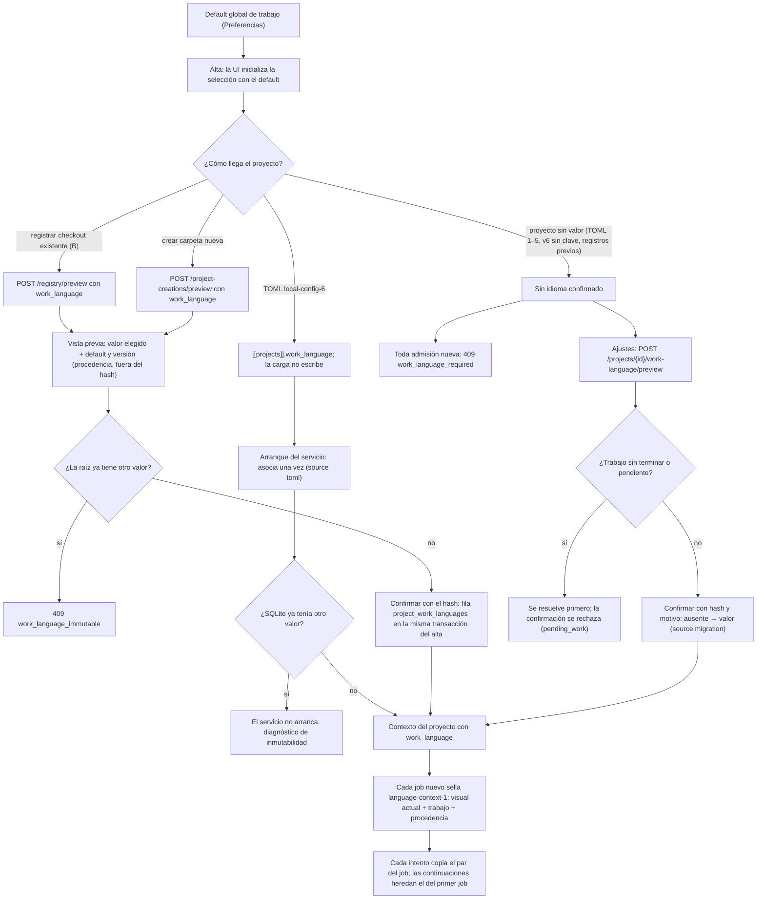

# Flujo — idioma de trabajo por proyecto

P011-T008 (D167; contrato [T001 §2/§4](../phase/P011-T001_CONTRATO_APERTURA.md#2-autoridad-persistencia-y-controles-de-idioma)).
El idioma de trabajo (`en`/`es`) rige documentación, planes y código que escriben los agentes en un proyecto. Se elige
una vez por raíz canónica y no cambia; el idioma visual es una preferencia global aparte
([preferencias](language-preferences.md)). La directiva al agente y la generación en ese idioma llegan con T009:
hoy el par congelado es procedencia.

- Inmutabilidad: actualizar o dar de baja un registro con `work_language` en el cuerpo devuelve 409
  `work_language_immutable`; la reapertura (baja y nuevo registro de la misma raíz) solo admite el valor original y
  conserva la fila original. Un TOML v6 con otro valor detiene el arranque; sin la clave, el proyecto lee el valor ya
  confirmado. Los ajustes del proyecto solo lo muestran.
- Cambiar el default de trabajo entre vista previa y confirmación no altera el valor confirmado: el hash sella el
  valor elegido y la asociación existente; el default y su versión quedan como procedencia en `confirmation`.
- La confirmación explícita no traduce, renombra ni inspecciona archivos; no se infiere el idioma del contenido.
- Admisión: el par se lee en la transacción que admite cada job nuevo (tarea, turno, check, commit, operación
  documental, preparación…). Reintentos, revalidaciones y reanudaciones copian el `language_context` del primer job
  del run, también `ui-language-1` o null de jobs anteriores; no reciben trabajo inventado.
- Un contexto de proyecto obsoleto con otro `work_language` (no debería ocurrir: la fila no cambia) se rechaza.
- Downgrade de `0025` rechazado si hay alguna asociación. Backup y restauración de consulta la conservan.
- Recetas: en `local-config-6`, `[recipes]` elige las recetas v2, que preparan con el idioma de la fila y lo sellan
  en plan y recibo; sin fila, la preparación se rechaza antes de efectos ([flujo](project-preparation.md#recetas-v2-por-idioma-de-trabajo-p011-t020-d168), D168).

## Fuente en el código

- `storage/work_language.py` (fila, captura del par), `storage/registry.py::confirm_work_language`,
  `storage/managed.py::_language`/`agent_started`.
- `services/project_registry.py` (vista previa/sello), `services/project_creation.py` (`project-creation-2`),
  `services/work_language.py` (confirmación explícita), `services/managed_runtime.py` (arranque TOML y contexto),
  `services/local_config.py` (`local-config-6`).
- `api/managed.py` (`/projects/{id}/work-language`, códigos 409), `api/schemas.py`.
- `frontend/src/WorkLanguage.tsx`, `pages/Registry.tsx`, `pages/Settings.tsx`.
