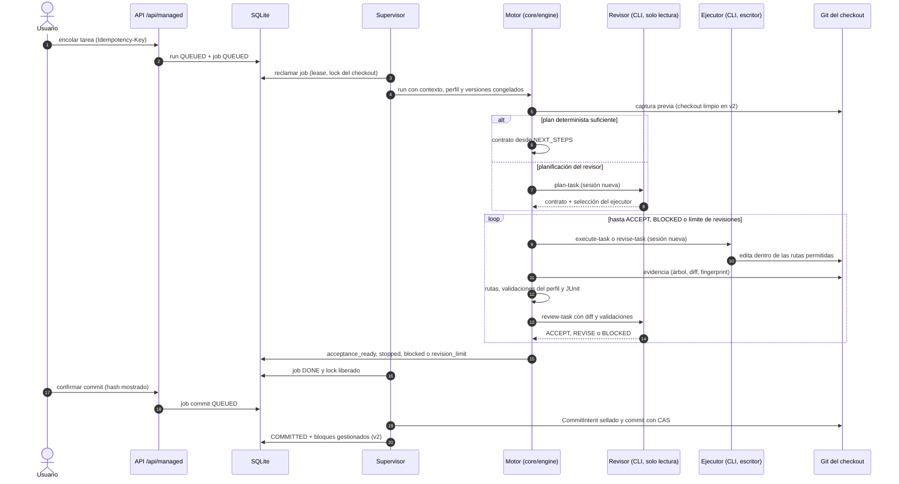
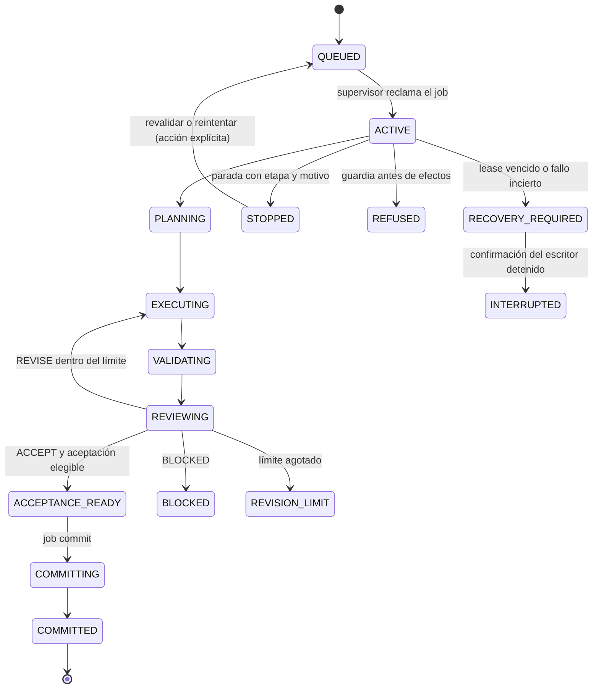

# Flujo — ejecución de una tarea

Recorrido de un run `task` desde que se encola hasta el commit del harness (D015–D026, D047, D052). El revisor
planifica y revisa en solo lectura; el ejecutor es el único escritor; el commit es una acción separada.

## Estados del run

`PREPARING` y `VALIDATING` son etapas de checkpoint; los roles `phase`, `chat`, `definition` y `planning` usan
`CHECKING` o `ANSWERING`. El job sigue `QUEUED → ACTIVE → DONE | REFUSED | RECOVERY_REQUIRED → INTERRUPTED`; un
intento sin resultado al confirmar la parada queda `INTERRUPTED` sin reintento automático.

## Fuente en el código

- `core/engine/workflow.py` (bucle plan → ejecución → validación → revisión), `core/engine/contracts.py`,
  `core/engine/planning.py`, `core/engine/acceptance.py`, `core/engine/commit.py`.
- `storage/managed.py` (cola, lease, lock, estados), `services/managed.py` (supervisor), `adapters/cli_agents.py`,
  `adapters/commands.py`, `adapters/git.py`.
- Bloques gestionados en el commit: `core/engine/documents.py` (ver [documentos](documents.md)).
