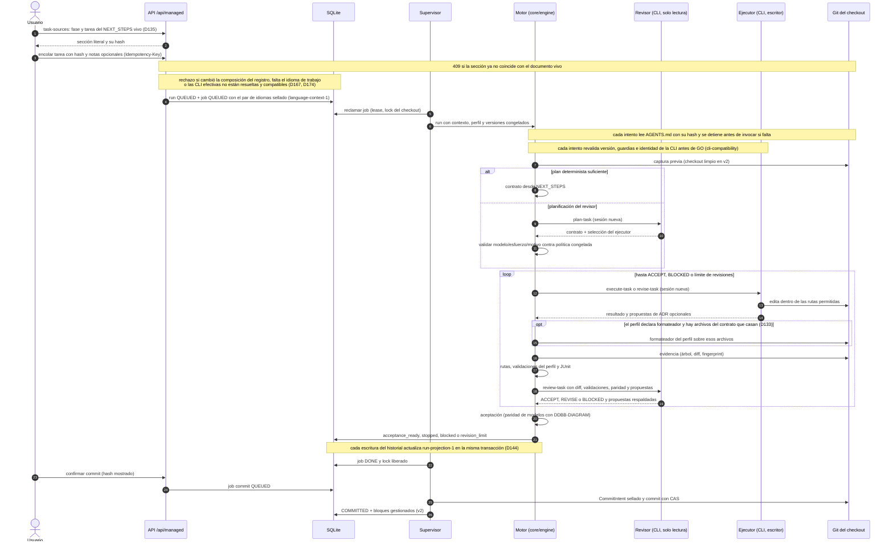

# Flujo — ejecución de una tarea

Recorrido de un run `task` desde que se encola hasta el commit del harness (D015–D026, D047, D052). El revisor
planifica y revisa en solo lectura; el ejecutor es el único escritor; el commit es una acción separada.
P009-T003: [selección de agentes por proyecto](project-agents.md) desde presets v5; los formatos anteriores
conservan su pareja heredada. Admisión, reanudación y commit comprueban el registro activo en la transacción.

## Estados del run

```mermaid
stateDiagram-v2
    [*] --> QUEUED
    QUEUED --> ACTIVE: supervisor reclama el job
    ACTIVE --> PLANNING
    PLANNING --> EXECUTING
    EXECUTING --> VALIDATING
    VALIDATING --> REVIEWING
    REVIEWING --> EXECUTING: REVISE dentro del límite
    REVIEWING --> ACCEPTANCE_READY: ACCEPT y aceptación elegible
    REVIEWING --> BLOCKED: BLOCKED
    REVIEWING --> REVISION_LIMIT: límite agotado
    ACTIVE --> STOPPED: parada con etapa y motivo
    ACTIVE --> REFUSED: guardia antes de efectos
    ACTIVE --> RECOVERY_REQUIRED: excepción, lease vencido o fallo incierto
    RECOVERY_REQUIRED --> INTERRUPTED: confirmación del escritor detenido
    RECOVERY_REQUIRED --> COMMITTED: confirmación con commit ya registrado
    STOPPED --> QUEUED: revalidar o reintentar (acción explícita)
    BLOCKED --> QUEUED: revalidar o reintentar
    REVISION_LIMIT --> QUEUED: revalidar (reintentar vuelve al límite sin invocar)
    INTERRUPTED --> QUEUED: revalidar, reintentar o conciliar la intención de commit
    ACCEPTANCE_READY --> QUEUED: job commit confirmado
    ACTIVE --> COMMITTING: job commit reclamado; intención sellada antes del efecto
    COMMITTING --> COMMITTED: resultado del commit con CAS
    COMMITTING --> STOPPED: contenido o HEAD cambiados (INVALIDATED)
    COMMITTING --> RECOVERY_REQUIRED: caída con intención pendiente
    COMMITTED --> [*]
```

Los estados intermedios son etapas del mismo job `ACTIVE`: `PREPARING`, `VALIDATING` y `REVIEWING` llegan por
checkpoint y `PLANNING`/`EXECUTING`/`REVIEWING` al iniciar cada intento; los roles `phase`, `chat`, `definition` y
`planning` usan `CHECKING` o `ANSWERING`, y `bootstrap`, `DISCOVERING`. Por eso `STOPPED`, `REFUSED` y
`RECOVERY_REQUIRED` pueden alcanzarse desde cualquiera de ellos. Revalidar exige historial `stopped`, `blocked` o
`revision_limit` con contrato congelado; reintentar al ejecutor, además, rutas permitidas. Un rechazo previo a efectos
conserva el estado terminal del historial (o `COMMITTED`) y solo marca `REFUSED` si no lo había. Un commit
`INVALIDATED` no bloquea una revalidación; un commit `COMMITTED` impide reanudar y repetir el commit.
El job sigue `QUEUED → ACTIVE → DONE | REFUSED | RECOVERY_REQUIRED → INTERRUPTED`; un intento sin resultado al
confirmar la parada queda `INTERRUPTED` sin reintento automático.

## Fuente en el código

- `core/engine/workflow.py` (bucle plan → ejecución → validación → revisión), `core/engine/contracts.py`,
  `core/engine/planning.py`, `core/engine/acceptance.py`, `core/engine/commit.py`.
- `storage/managed.py` (cola, lease, lock, estados), `storage/run_projection.py` y `storage/managed_views.py`
  (proyección y lecturas del run), `services/managed.py` (supervisor), `adapters/cli_agents.py`,
  `adapters/commands.py`, `adapters/git.py`.
- Bloques gestionados en el commit: `core/engine/documents.py` (ver [documentos](documents.md)).

## Lectura del run (D144)

- `GET /runs/{id}` devuelve el resumen, las paradas, `history.cycle_count` y `history.latest_cycle`; los ciclos se
  leen con `GET /runs/{id}/cycles?offset&limit` (por número, 10 por defecto, hasta 100). El diff de un ciclo se pide
  por páginas de bytes con su hash; los casos JUnit, por ordinal. Ninguna de estas lecturas selecciona
  `history_json` ni decodifica el historial: usan la proyección `run-projection-1` ([diagrama](../DDBB-DIAGRAM.md#proyección-de-runs-p010-t003)).
- La página del run sondea la página de ciclos visible junto con el detalle; el chat (`tests`) usa el último ciclo.

## Rutas, paridad y propuestas (D090)

- Al congelar el contrato, una entrada de `allowed_paths` o `forbidden_paths` terminada en `/` pasa a `dir/**`
  (D129). Los contratos ya congelados se leen tal como se guardaron.
- El ejecutor no escribe STATE, NEXT_STEPS, ROADMAP, DECISIONS, `docs/archive/**` ni AGENTS, CLAUDE y GEMINI
  (`harness_owned_paths` y perfil, con `executor_protected`); la reconciliación `<fase>-RECONCILE-<n>` sí edita la prosa
  de los cuatro primeros.
- Con layout v2 la entrada del revisor lleva `documentation`. Si el perfil declara `data_model_paths` y el diff los
  toca sin `DDBB-DIAGRAM.md`, la aceptación no es elegible aunque el revisor acepte; la paridad de flujos la juzga el
  revisor.
- `decision_proposals` del ejecutor llegan al revisor; las que este devuelve quedan en la revisión del ciclo y en la
  evidencia de la reconciliación. Nunca escriben DECISIONS ni cambian el veredicto.

## Encolar desde los documentos y notas adicionales (D135)

- `GET /projects/{id}/task-sources` lee el NEXT_STEPS vivo y ofrece cada tarea `PNNN-TNNN` con su sección literal
  (precedida de las restricciones compartidas, si las hay) y su SHA-256. Un id repetido no se ofrece. El formulario
  elige fase y tarea con desplegables y muestra el contrato sin editarlo; el modo manual sigue disponible.
- Con `source_sha256`, `POST /runs` vuelve a leer el documento y responde 409 `task_source_changed` si la tarea ya
  no está, cambió de fase o su texto difiere. Sin él, el texto se toma tal cual, como antes.
- `notes` (hasta 4000 caracteres; en blanco equivalen a ausentes) va en la petición del job, sin columna nueva. El
  motor las pasa al planificador como `additional_notes`, las congela en el contrato con esa clave (el revisor y el
  ejecutor las ven en `TASK_JSON`) y las añade a las instrucciones del ejecutor. Solo el usuario las aporta: una clave
  igual inventada por el planificador se retira. No amplían rutas, comandos ni permisos. Sin notas, petición, entrada
  del planificador, contrato y prompts quedan como antes. La página del run las muestra.

## Formateo del perfil (D133)

- Tras cada turno del ejecutor, y antes de capturar la evidencia, el motor ejecuta `formatter_argv` + rutas sobre los
  `changed_paths` que casan con `formatter_paths`, existen como archivo y el contrato permite. Revalidar no formatea.
  Sin archivos que casen no se lanza nada. Hoy lo declara el perfil de la receta Django (`ruff format --`, `*.py`).
- El runner nativo lo autoriza como `formatter-paths`: el argv del perfil seguido solo de archivos existentes del
  checkout. Si no llega a ejecutarse, el run se para en `formatter` antes de revisar. Un código de salida distinto
  de cero llega a la validación y al revisor.
- El ciclo guarda `formatting_json` (formato 8 del historial). El revisor lo recibe como `formatting`, y la API y la
  página del run lo muestran. `PROFILE_INSTRUCTIONS` avisa al ejecutor de que no reformatee a mano.

## Instrucciones del proyecto (D094)

- Cada intento (planificador, ejecutor, corrección y revisor; también fase, chat y planificación) lee `AGENTS.md` de
  la raíz del checkout del intento y lo incluye en su prompt. Su ruta, SHA-256 y tamaño quedan en el snapshot del
  intento; un cambio posterior solo afecta a los intentos siguientes.
- Un `AGENTS.md` ausente, enlazado, no regular, vacío, no UTF-8 o mayor de 32 KiB detiene el run en `prompts`
  antes de invocar al agente. Una versión de plantilla activa sin `{{PROJECT_INSTRUCTIONS}}` también.
- Las CLI no cargan otra copia: Claude con `--setting-sources ""` y Codex con `project_doc_max_bytes=0` (desde `cli-11`, D094).
- Idioma (D169): cada intento recibe, tras las plantillas y antes del esquema, la directiva del par congelado de su
  job, sellada en el snapshot; un par inválido o distinto del trabajo del contexto detiene el run en `prompts`. El
  commit regenera los bloques en el idioma de trabajo ([flujo](project-work-language.md#directiva-y-documentos-generados-p011-t009-d169)).
