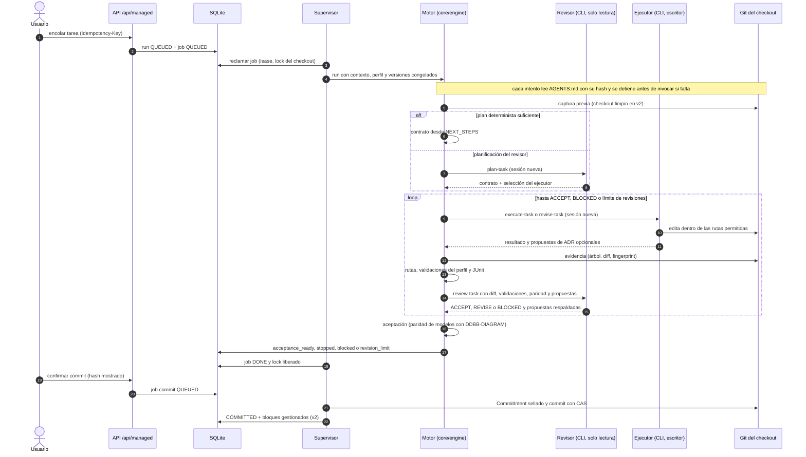
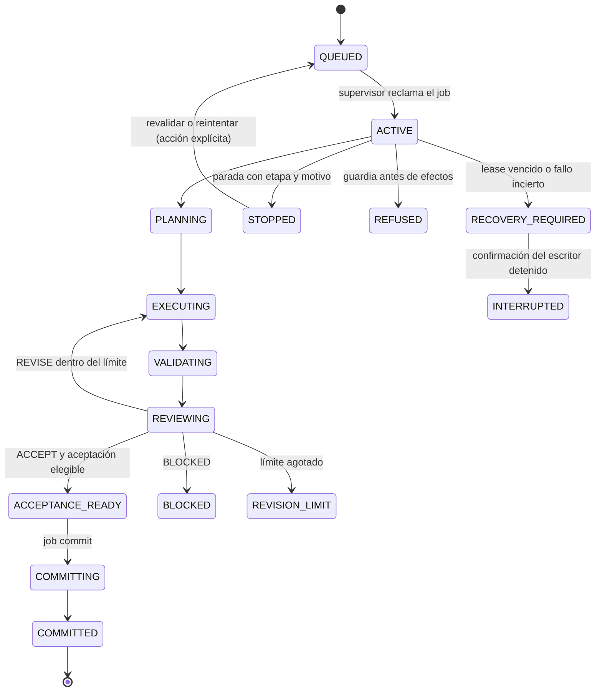

# Flujo — ejecución de una tarea

Recorrido de un run `task` desde que se encola hasta el commit del harness (D015–D026, D047, D052). El revisor
planifica y revisa en solo lectura; el ejecutor es el único escritor; el commit es una acción separada.

## Estados del run

`PREPARING` y `VALIDATING` son etapas de checkpoint; los roles `phase`, `chat`, `definition` y `planning` usan
`CHECKING` o `ANSWERING`. El job sigue `QUEUED → ACTIVE → DONE | REFUSED | RECOVERY_REQUIRED → INTERRUPTED`; un
intento sin resultado al confirmar la parada queda `INTERRUPTED` sin reintento automático.

## Fuente en el código

- `core/engine/workflow.py` (bucle plan → ejecución → validación → revisión), `core/engine/contracts.py`,
  `core/engine/planning.py`, `core/engine/acceptance.py`, `core/engine/commit.py`.
- `storage/managed.py` (cola, lease, lock, estados), `services/managed.py` (supervisor), `adapters/cli_agents.py`,
  `adapters/commands.py`, `adapters/git.py`.
- Bloques gestionados en el commit: `core/engine/documents.py` (ver [documentos](documents.md)).

## Rutas, paridad y propuestas (D090)

- El ejecutor no escribe STATE, NEXT_STEPS, ROADMAP, DECISIONS, `docs/archive/**` ni AGENTS, CLAUDE y GEMINI
  (`harness_owned_paths` y perfil, con `executor_protected`); la reconciliación `<fase>-RECONCILE-<n>` sí edita la prosa
  de los cuatro primeros.
- Con layout v2 la entrada del revisor lleva `documentation`. Si el perfil declara `data_model_paths` y el diff los
  toca sin `DDBB-DIAGRAM.md`, la aceptación no es elegible aunque el revisor acepte; la paridad de flujos la juzga el
  revisor.
- `decision_proposals` del ejecutor llegan al revisor; las que este devuelve quedan en la revisión del ciclo y en la
  evidencia de la reconciliación. Nunca escriben DECISIONS ni cambian el veredicto.

## Instrucciones del proyecto (D094)

- Cada intento (planificador, ejecutor, corrección y revisor; también fase, chat y planificación) lee `AGENTS.md` de
  la raíz del checkout del intento y lo incluye en su prompt. Su ruta, SHA-256 y tamaño quedan en el snapshot del
  intento; un cambio posterior solo afecta a los intentos siguientes.
- Un `AGENTS.md` ausente, enlazado, no regular, vacío, no UTF-8 o mayor de 32 KiB detiene el run en `prompts`
  antes de invocar al agente. Una versión de plantilla activa sin `{{PROJECT_INSTRUCTIONS}}` también.
- Las CLI no cargan otra copia: Claude con `--setting-sources ""` y Codex con `project_doc_max_bytes=0` (desde `cli-11`, D094).
